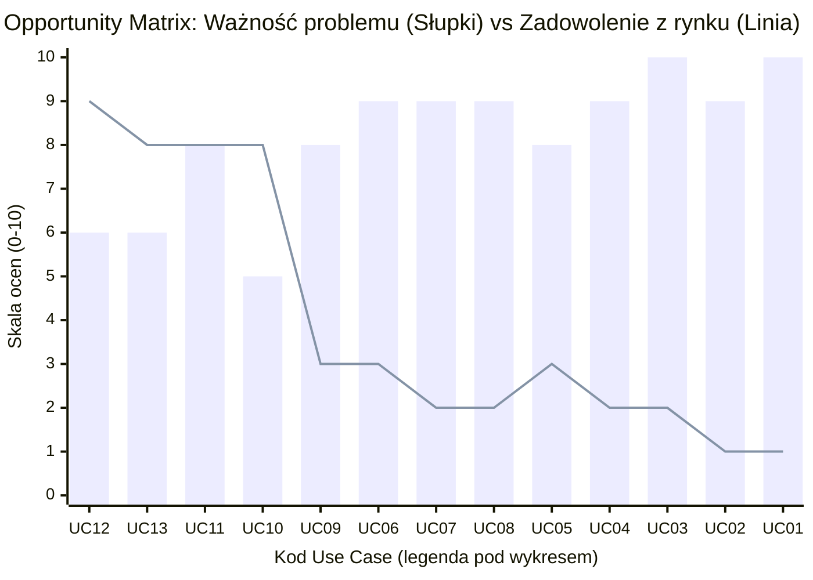
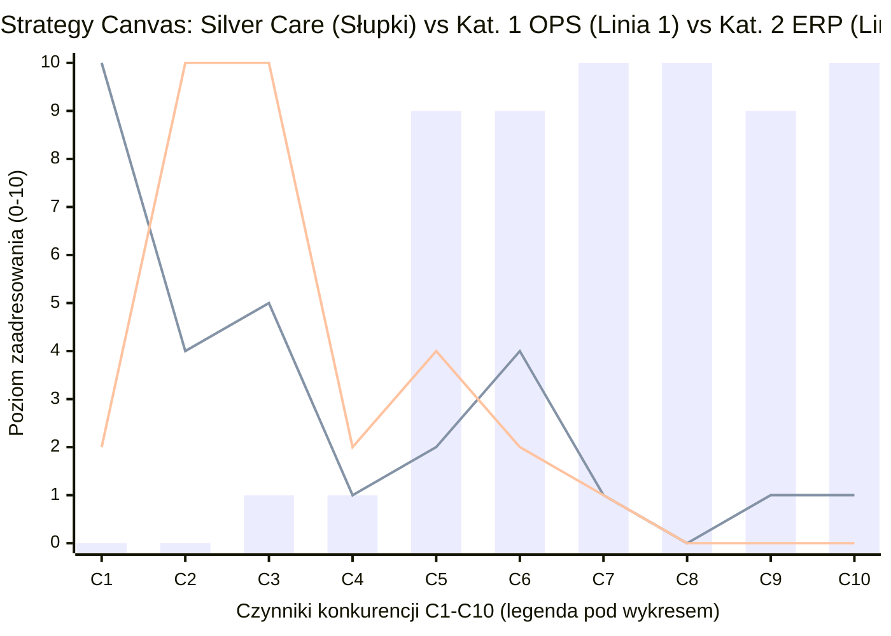
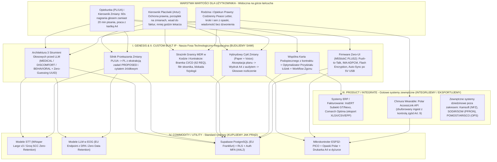
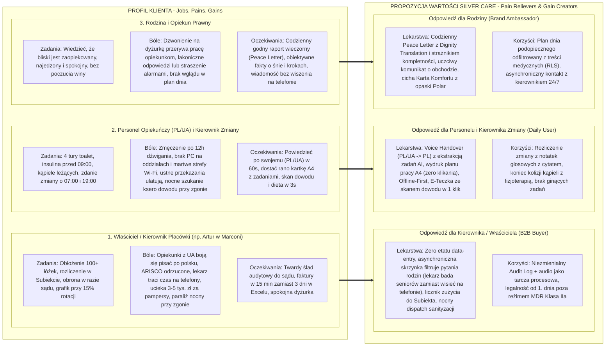

# 🧭 Silver Care — Product Discovery, Mapowanie Konkurencji i Strategia Produktowa

> **Źródła danych:**
> - [KANONICZNA_SPECYFIKACJA_USER_STORIES.md](file:///Users/michalsznurowski/Developemnt/silver_care/docs/KANONICZNA_SPECYFIKACJA_USER_STORIES.md) (v2.16, 62 wymagania kontraktowe `@REQ`)
> - Dokumentacja terenowa Product Discovery: [Dom Opieki „Marconi”](file:///Users/michalsznurowski/Developemnt/silver_care/docs/Product_discovery/Marconi/README.md) (`00`–`07`)
> - [Kompendium wdrożeniowe SilverCare Voice (Zero-UI)](file:///Users/michalsznurowski/Developemnt/silver_care/docs/Product_discovery/kompendium_wdro_eniowe_silvercare_voice_zero_ui.md)

---

## 1. Architektura Pozycjonowania: Dlaczego istniejące systemy zawodzą na oddziale?

Analiza wdrożeń na polskim rynku opieki długoterminowej (w tym udokumentowane w [07_struktura_kadrowa_i_analiza_porazki_arisco.md](file:///Users/michalsznurowski/Developemnt/silver_care/docs/Product_discovery/Marconi/07_struktura_kadrowa_i_analiza_porazki_arisco.md) **odrzucone wdrożenie systemu ARISCO w placówce Marconi**) ujawnia fundamentalny podział rynku:

1. **Kategoria 1 — Systemy administracyjno-urzędnicze (OPS / MOPS / PCPR / DPS):**
   *POMOST Std (Sygnity), Pakiet Pomoc Społeczna ARISCO, TT-Pomoc / TT-PCPR (Asseco), Izyda (Info-R), Rekord DPS (Rekord SI), Emp@tia (MRiPS).*
   - **Do czego powstały:** Do wydawania decyzji administracyjnych, wywiadów środowiskowych, sprawozdawczości ustawowej i rozliczania świadczeń w jednostkach budżetowych.
   - **Dlaczego przegrywają na oddziale opiekuńczym:** Projektowane z perspektywy urzędnika za biurkiem. Wymagają wpisywania dziesiątek pól z klawiatury w języku polskim, stałego łącza Wi-Fi i dedykowanego „operatora wprowadzania danych”. Dla opiekunki (często z Ukrainy) po 12h dźwigania podopiecznych nie dają żadnej wartości (*zero WIFM — What's In It For Me*).
2. **Kategoria 2 — Systemy rozliczeń PFRON, Kadry-Płace i ERP/FK:**
   *SOD-ARIS (ARISCO), SODiR / SOW / e-PFRON2, Comarch ERP Optima, enova365, Symfonia, Asseco WAPRO, InsERT Subiekt GT / Nexo.*
   - **Do czego powstały:** Do księgowości, deklaracji DEK/Wn-D, wyliczania dofinansowań płacowych, JPK, KSeF i wystawiania faktur VAT.
   - **Dlaczego nie mają dostępu do prawdy z oddziału:** Są ślepe na to, co wydarzyło się przy łóżku podopiecznego (np. ile pampersów ponad limit 4 szt./dobę faktycznie zużyto, kto był w szpitalu, ile sesji wykonał fizjoterapeuta).
3. **Kategoria 3 — Systemy kliniczno-szpitalne (HIS / EDM / Rozliczenia NFZ):**
   *Kamsoft (KS-SOMED/KS-PPS), Asseco AMMS, Mediporta.*
   - **Do czego powstały:** Do rozliczania kontraktów NFZ (ZOL/ZPO, skala Barthel do NFZ, JGP, EDM).

> [!IMPORTANT]
> **Strategiczna teza Silver Care:** Nie budujemy kolejnego systemu księgowego (ERP), kadrowo-płacowego (PFRON) ani urzędniczego (OPS/NFZ). **Silver Care zajmuje całkowicie niezagospodarowaną warstwę „Ostatniej Mili Opieki” (Point-of-Care Zero-UI & Family Trust)** — zbiera prawdę operacyjną przy łóżku podopiecznego (głosem PL/UA, jednym dotknięciem, z opaski i z wydruku A4) i zasila nią:
> 1. **Kolejną zmianę personelu** (Handover + Backlog zadań),
> 2. **Rodzinę podopiecznego** (Peace Letter + Fakty bez wchodzenia w reżim MDR + Asynchroniczna skrzynka chroniąca czas lekarza i dyżurki),
> 3. **Systemy ERP/Bilingowe kierownika** (gotowy wsad do Subiekta o zużytych materiałach, dniach hospitalizacji i rehabilitacji).

---

## 2. Kompletna Ewidencja Use Case'ów (Kanoniczne Stories + Marconi + Branża)

Każdy use case z naszego repozytorium, wywiadów w Marconi oraz szeroko pojętej branży został sklasyfikowany do jednego z **4 koszyków strategicznych**:
- 🟢 **CORE MOAT (Nasza Fosa):** Budujemy własne IP — tutaj wygrywamy z całym rynkiem.
- 🔵 **WORKFLOW LAYER (Warstwa Operacyjna Oddziału):** Budujemy lekki, ergonomiczny proces na oddziale (Zero-UI / One-Touch).
- 🟠 **INTEGRATE / EXPORT ONLY (Zasilamy cudze systemy):** Zbieramy dane źródłowe na oddziale, ale samą księgowość/telefonię zostawiamy wyspecjalizowanym narzędziom przez eksport/API.
- 🔴 **OUT OF SCOPE (Świadomie NIE wchodzimy):** Czerwony ocean z wysokim kosztem utrzymania legislacyjnego i zerowym wyróżnikiem.

| ID / Domena | Use Case (Przypadek Użycia) | Źródło (Kanoniczne / Marconi / Branża) | Kto dziś to robi na rynku? | Decyzja Strategiczna Silver Care | Argumentacja (Dlaczego wchodzimy / nie wchodzimy?) |
|---|---|---|---|---|---|
| **UC-01** *Voice & Handover* | **Głosowe przekazanie zmiany (PL/UA → PL) + ekstrakcja zadań i incydentów** | `SC-NUR-12`, `SC-NUR-16`, Marconi Proces 2 (`03`), Zero-UI (`M5StickC`) | Nikt (Papierowy zeszyt z niebieskim długopisem; ARISCO wymusza klawiaturę) | 🟢 **CORE MOAT** | Likwiduje barierę językową opiekunek z Ukrainy i 20-minutowe pisanie po 12h dyżuru. Tworzy niezmienialny dowód sądowy z nagraniem i cytatem (`VOICE-ZERO-GUESSING`). |
| **UC-02** *Voice & Family* | **Dyktafon AI → Raport Dobowy (Peace Letter) z separacją 3 strumieni (MDR/RODO)** | `SC-NUR-02`, `SC-NUR-03`, `SC-NUR-09`, `SC-NUR-14`, `NFR-VOICE-01/02` | Nikt (Telefony rodzin na dyżurkę lub prywatny WhatsApp łamiący RODO) | 🟢 **CORE MOAT** | Separacja `MEDICAL` / `DISCOMFORT` / `BEHAVIORAL` przed modelem pozwala dawać rodzinie codzienny spokój („Dignity Translation”) bez wejścia w certyfikację wyrobu medycznego MDR. |
| **UC-03** *Tasks & Print* | **Cykl zadań zmiany: Plan → Akceptacja Kierownika Zmiany → Wydruk A4 → Głosowe rozliczenie** | `SC-NUR-13`, `SC-NUR-15`, `SC-NUR-16`, `SC-ADM-21`, `SC-ADM-23`, Marconi Proces 1 (`02`) | Papierowe kartki na ścianie / pamięć personelu | 🟢 **CORE MOAT** | Hybryda *Paper + Voice*: opiekunki nie klikają w komputerze (pracują z wydrukiem A4 ze śladem audytowym `NUR-SHIFT-PLAN-PRINT`), a wykonanie rozliczają głosem. |
| **UC-04** *Family & Cost Opt* | **Asynchroniczna skrzynka wiadomości Rodzina ↔ Kierownik (z dyktowaniem głosem)** | `SC-FAM-04`, `SC-NUR-07`, `SC-NUR-11` | Telefony na dyżurkę / prywatne komórki / drogie dyżury telefoniczne lekarza | 🟢 **CORE MOAT** | **Optymalizacja kosztów lekarza wynajmowanego na godziny:** lekarz POZ (np. wtorkowy obchód 10:00–13:00 w Marconi) nie traci płatnych godzin na chaotyczne rozmowy z rodzinami. Pytania rodziny zbiera asynchronicznie `org_admin` (limit 3/h), konsultuje je zbiorczo na obchodzie i odpisuje głosem w 30 sekund. |
| **UC-05** *IoT & Comfort* | **Karta Komfortu z opasek (Polar) — obiektywne fakty o krokach i śnie bez alarmów MDR** | `SC-FAM-03`, `SC-FAM-02`, `NFR-INT-01` | Opaski SOS / Teleopieka (generujące fałszywe alarmy medyczne) | 🟢 **CORE MOAT** | Prezentacja wyłącznie faktów behawioralnych (`MDR-NO-PHYSIO-TO-FAMILY`, `MDR-NO-METRIC-ALARM`) buduje zaufanie rodziny bez stresu i bez klasyfikacji SaMD Klasy IIa. |
| **UC-06** *Core & Bed Opt* | **Cyfrowa Karta Podopiecznego (E-Teczka) z widocznością per rola i optymalizacją łóżek** | `SC-ADM-10..22`, Marconi Proces 4 (`01`) | Papierowa teczka w szafie + Excel Artura + częściowo ARISCO/Rekord DPS | 🔵 **WORKFLOW LAYER** | Jedno źródło prawdy na oddziale (`ADM-RESIDENT-CARD-VISIBILITY`). Natychmiastowy dostęp do skanu dowodu, diety, ryzyka zachłyśnięcia i statusu łóżek bez biegania do biura. |
| **UC-07** *Death Workflow* | **Procedura obsługi zgonu i ochrona zmiany nocnej przed paraliżem sanityzacji** | `SC-ADM-19` (wypis/zgon) + Marconi Proces 5 (`05`: `ZGN-01..18`) | Ręczna procedura (szukanie ksero dowodu w nocy, wyłączenie 2 z 4 opiekunek na 5h) | 🔵 **WORKFLOW LAYER** | W Marconi jest 15 zgonów/mies. W `SC-ADM-19` mamy już rejestrację zgonu i zwolnienie łóżka; docelowe rozwinięcie o `NIGHT_SHIFT_SANITIZATION_DISPATCH` (przesunięcie mycia/UV na salowe o 07:00) oraz blokadę kontaktu z rodziną przed Kartą Zgonu stanowi potężny argument sprzedażowy dla dużych placówek. |
| **UC-08** *Care Schedule* | **Grafikowanie opieki 24h (4 tury toalet/pampersów, blok kąpieli 10–13 vs fizjoterapia) i Grafik Zmian** | `SC-NUR-05`, `SC-NUR-12/AC1a`, `SC-ADM-23`, Marconi Proces 1 (`02`) i `06` | Ścienna kartka kąpieli + „koncert życzeń” na karteczkach | 🔵 **WORKFLOW LAYER** | Lekki grafik zmian (kto pracuje + kto jest `shift_lead`) i szablony planu opieki (`ADM-CARE-PLAN-TASKS`) rozwiązują kolizje kąpieli (2–6 opiekunek) z fizjoterapią zewnętrzną. **Uwaga:** Nie budujemy tu pełnego silnika kadrowo-płacowego RCP/Kodeksu Pracy! |
| **UC-09** *Billing Input* | **Zliczanie zużytych materiałów (pampersy >4/doba), sesji rehabilitacji i dni w szpitalu → Eksport do ERP** | Marconi Proces 3 (`04`), częściowo `SC-ADM-14` (eksport danych) | Ustne zgłoszenia opiekunek po miesiącu + karteczki fizjoterapeutów + blokowany Excel → ręczny **Subiekt GT/Nexo** | 🟠 **INTEGRATE / EXPORT ONLY** | **Kluczowa granica:** Silver Care zbiera *wsad ilościowy z oddziału* (bo tylko dyżurka wie, ile poszło pampersów i kto był w szpitalu), co odzyskuje 3–5 tys. zł/mies. utraconych przychodów. Samo wystawianie faktur VAT, KSeF i księgowość zostaje w **Subiekcie / Optimie** (eksport 1 kliknięciem). |
| **UC-10** *Intake & Barthel* | **Ofertowanie przedprzyjęciowe (np. wycena pakietu oparta o skalę Barthel / Norton) + CRM z VoIP** | Branża / Proces sprzedażowy placówek komercyjnych | Systemy CRM (Pipedrive, HubSpot, Livespace) + VoIP (Thulium, Zadarma) + arkusze kalkulacyjne | 🟠 **INTEGRATE / LIGHT FORM** | **Dlaczego nie budujemy CRM z VoIP:** Telefonia VoIP, kolejki call-center i lejki sprzedażowe to zatłoczony rynek (Thulium/HubSpot za kilkadziesiąt zł/mies.). Ponadto automatyczna kwalifikacja medyczna i wyliczanie skali klinicznej Barthel przez algorytm rodzi ryzyko Reguły 11 MDR. W Silver Care wystarczy prosty deterministyczny formularz poziomu opieki (`SC-ADM-11`) lub webhook z zewnętrznego CRM przy podpisaniu umowy. |
| **UC-11** *Public Sector* | **Rozliczenia z NFZ (ZOL/ZPO, JGP, SWIAD, EDM, e-Zdrowie P1)** | Branża (Podmioty lecznicze / ZOL) | **Kamsoft (KS-SOMED/PPS), Asseco AMMS, Mediporta** | 🔴 **OUT OF SCOPE** | **Twardy argument przeciw:** Wymaga ciągłego śledzenia zarządzeń Prezesa NFZ, integracji z szyną P1 (HL7 CDA / FHIR), słowników ICD-10/ICD-9 i certyfikacji klinicznej. Kamsoft i Asseco mają tu 30-letni monopol. |
| **UC-12** *Public Subsidies* | **Rozliczenia PFRON, dofinansowania wynagrodzeń i wnioski (SODiR, SOW, e-PFRON2, Wn-D, DEK)** | Branża (Kategoria 2: Działy kadr i płac, PCPR) | **SOD-ARIS (ARISCO), SODiR, SOW, e-PFRON2, Comarch Optima, enova365, Symfonia** | 🔴 **OUT OF SCOPE** | **Twardy argument przeciw:** To domena czysto kadrowo-płacowa i urzędowa (księgowa wylicza ulgi na niepełnosprawnych pracowników lub PCPR procesuje wnioski o turnusy). Zero synergii z pracą opiekunek przy łóżku seniora i komunikacją z rodziną. |
| **UC-13** *Social Welfare* | **Wywiady środowiskowe, decyzje administracyjne OPS/MOPS/PCPR, zasiłki** | Branża (Kategoria 1: Pomoc społeczna) | **POMOST Std (Sygnity), ARISCO, TT-Pomoc (Asseco), Izyda (Info-R), Rekord, Emp@tia** | 🔴 **OUT OF SCOPE** | **Twardy argument przeciw:** Systemy powiązane sztywno z państwowym portalem Emp@tia (MRiPS) i KPA (Kodeksem Postępowania Administracyjnego). Rynek zamówień publicznych oparty o najniższą cenę i specyfikacje ustawowe. |

---

## 3. Cztery Diagramy Strategiczne Product Discovery

### Diagram 1: Opportunity Matrix (Outcome-Driven Innovation / Jobs-to-be-Done)

Wykres zestawia **Ważność zadania dla placówki/rodziny (Słupki, 1–10)** z **Zadowoleniem z obecnych rozwiązań rynkowych (Linia, 1–10)**.
- **Prawa strona (Wysoka Ważność > 7, Niskie Zadowolenie < 4)** to **Niezagospodarowany Obszar (Underserved Opportunity / Blue Ocean)** — luka innowacyjna Silver Care (`UC-09` → `UC-01`).
- **Lewa strona (Wysokie Zadowolenie > 7)** to **Obszar Nasycony (Overserved / Red Ocean)** — tam działają systemy PFRON, ERP/FK i NFZ, z którymi **nie konkurujemy**.

| Kod osi X | Obszar / Use Case | Ważność (Słupki) | Zadowolenie rynku (Linia) | Status rynkowy dla Silver Care |
|:---:|:---|:---:|:---:|:---|
| **UC-12** | Rozliczenia PFRON / SODiR / SOW | 6 | 9 | 🔴 Rynek nasycony (enova, Optima, SOD-ARIS) — **nie wchodzimy** |
| **UC-13** | Decyzje OPS / Wywiady / Emp@tia | 6 | 8 | 🔴 Monopol państwowy (POMOST, ARISCO) — **nie wchodzimy** |
| **UC-11** | Rozliczenia NFZ / EDM / ZOL | 8 | 8 | 🔴 Monopol kliniczny (Kamsoft, Asseco) — **nie wchodzimy** |
| **UC-10** | CRM sprzedażowy z VoIP | 5 | 8 | 🔴 Zewnętrzne narzędzia (HubSpot, Thulium) — **nie budujemy** |
| **UC-09** | Wsad do faktur (pampersy, szpital, fizjo) | 8 | 3 | 🟢 **OGROMNA LUKA** — zasilamy Subiekta danymi z oddziału |
| **UC-06** | E-Teczka i optymalizacja łóżek | 9 | 3 | 🟢 **OGROMNA LUKA** — likwidacja szaf i papierowych teczek |
| **UC-07** | Procedura zgonu i ochrona nocy | 9 | 2 | 🟢 **OGROMNA LUKA** — likwidacja nocnego paraliżu 4 opiekunek |
| **UC-08** | Grafik opieki 24h (toalety, kąpiele) | 9 | 2 | 🟢 **OGROMNA LUKA** — koniec kolizji kąpieli z fizjoterapią |
| **UC-05** | Karta komfortu z opasek (bez alarmów MDR) | 8 | 3 | 🟢 **OGROMNA LUKA** — fakty bez straszenia rodziny |
| **UC-04** | Czat Rodzina ↔ Kierownik (dyktowany) | 9 | 2 | 🟢 **OGROMNA LUKA** — ochrona drogich godzin lekarza |
| **UC-03** | Cykl zadań + Wydruk A4 + Głos | 10 | 2 | 🟢 **MAKSYMALNA SZANSA** — opiekunki bez komputera |
| **UC-02** | Peace Letter (3 strumienie, Dignity Translation) | 9 | 1 | 🟢 **MAKSYMALNA SZANSA** — codzienny spokój rodziny |
| **UC-01** | Voice Handover PL/UA (Zero-UI) | 10 | 1 | 🟢 **MAKSYMALNA SZANSA** — likwidacja bariery językowej i zeszytów |

---

### Diagram 2: Blue Ocean Strategy Canvas (Kanwa Strategii + Macierz ERRC)

Porównanie **krzywych wartości (Value Curves)** dla 4 grup rozwiązań w 10 strategicznych czynnikach konkurencji (skala 0–10):
- **Słupki (`bar`):** **Silver Care** (Radykalna dywergencja na rzecz oddziału, głosu, wydruku A4 i spokoju rodziny).
- **Linia 1 (`line` niebieska):** **Kategoria 1 — Administracja OPS/DPS** (POMOST, ARISCO, TT-Pomoc, Rekord).
- **Linia 2 (`line` pomarańczowa):** **Kategoria 2 — PFRON & ERP/FK** (SOD-ARIS, SODiR, Comarch Optima, Subiekt).

| Oś | Czynnik Konkurencji | Silver Care | Kat. 1 (OPS/ARISCO) | Kat. 2 (ERP/PFRON) | Uzasadnienie dywergencji Silver Care |
|:---:|:---|:---:|:---:|:---:|:---|
| **C1** | Rozliczenia OPS / NFZ / Decyzje | **0** | 10 | 2 | Celowe 0 — monopol państwowy, biurokracja urzędowa. |
| **C2** | PFRON / SODiR / Kadry-Płace | **0** | 4 | 10 | Celowe 0 — domena księgowej w ERP Optima/enova365. |
| **C3** | Księgowość FK, VAT, KSeF | **1** | 5 | 10 | Zostawiamy w Subiekcie; generujemy jedynie wsad. |
| **C4** | CRM handlowy + CallCenter VoIP | **1** | 1 | 2 | Nie duplikujemy VoIP; prosty intake wystarcza. |
| **C5** | Wsad zużycia materiałów do ERP | **9** | 2 | 4 | Automatyczny licznik pampersów >4/doba i hospitalizacji. |
| **C6** | Tarcza Prawna i Procedury (Zgon) | **9** | 4 | 2 | Niezmienialny audyt, audio, ochrona obsady nocnej. |
| **C7** | Zero-UI: Wydruk A4 + 1-Click | **10** | 1 | 1 | Opiekunki nie klikają w PC; praca z kartką i dotykiem. |
| **C8** | Głos PL/UA → Zadania zmiany | **10** | 0 | 0 | Mowa ojczysta, Whisper + LLM, koniec bariery językowej. |
| **C9** | Ochrona czasu lekarza dyżurnego | **9** | 1 | 0 | Czat asynchroniczny odcina chaotyczne telefony do lekarza. |
| **C10** | Spokój Rodziny (Bez reżimu MDR) | **10** | 1 | 0 | Raport dobowy, obiektywne fakty, zero fałszywych alarmów. |

#### Macierz ERRC (Eliminate – Reduce – Raise – Create) dla Silver Care

```mermaid
flowchart LR
    subgraph E["ELIMINATE - Wyeliminuj całkowicie"]
        E1["Rozliczenia NFZ / JGP / SWIAD (monopol Kamsoft/Asseco)"]
        E2["Deklaracje PFRON / SODiR / SOW i kadry-płace"]
        E3["Decyzje administracyjne OPS/PCPR i integrację z Empatia"]
        E4["Wpisywanie raportów z klawiatury przez opiekunki (grzech ARISCO)"]
        E5["Diagnozy, predykcje kliniczne i alarmy z metryk (ryzyko MDR Klasa IIa)"]
    end

    subgraph R["REDUCE - Zredukuj do minimum lub integracji"]
        R1["Fakturowanie -> Licznik zużycia i eksport do Subiekta"]
        R2["CRM / VoIP -> Prosty kreator przyjęcia z alokacją łóżka"]
        R3["Grafik kadr -> Przypisanie zmian i roli Kierownika Zmiany"]
    end

    subgraph RA["RAISE - Podnieś radykalnie ponad standard"]
        RA1["Dostępność E-Teczki na dyżurce (skan dowodu w 3s przy zgonie w nocy)"]
        RA2["Rozliczalność zadań między zmianami (DONE / CANCELLED / CARRY)"]
        RA3["Bezpieczeństwo RODO Art. 9 (RLS, hash PESEL, niezmienialny Audit Log)"]
    end

    subgraph C["CREATE - Stwórz nową kategorię Blue Ocean"]
        C1["Potok głosowy PL/UA -> PL z separacją MEDICAL / DISCOMFORT / BEHAVIORAL"]
        C2["Hybryda Paper + Voice: Wydruk planu pracy A4 + głosowe rozliczenie zmiany"]
        C3["Peace Letter + Fakty z opaski Polar bez wchodzenia w reżim MDR"]
        C4["Asynchroniczna skrzynka Kierownika z odpowiedzią głosową (ochrona godzin lekarza)"]
        C5["Ochrona obsady nocnej przy zgonie (Night Shift Sanitization Dispatch)"]
    end

    E --> R --> RA --> C
```

---

### Diagram 3: Wardley Map — Ocena Przewagi Technologicznej i Fosy (Technological Moat)

Mapa Wardleya pokazuje, **gdzie leży nasza unikalna własność intelektualna (Genesis / Custom Built)**, a gdzie korzystamy z gotowych komponentów rynkowych (**Product / Commodity**), dzięki czemu nie przepalamy budżetu R&D na wymyślanie koła na nowo.

- **Oś pionowa (w górę):** Łańcuch wartości (od bezpośredniej wartości widocznej dla Klienta na górze do infrastruktury na dole).
- **Oś pozioma (w prawo):** Stopień utowarowienia technologii (`I. Genesis` → `II. Custom Built IP` → `III. Product / Rental` → `IV. Commodity / Utility`).

> [!TIP]
> **Wniosek z Mapy Wardleya dla inwestora i klienta:**
> Konkurent może w 1 dzień kupić dostęp do API OpenAI/Whisper (`Commodity`), ale **nie skopiuje w 1 dzień naszej Fosy (Strefa I i II)**:
> 1. **Fosy Regulacyjno-Architektonicznej (`M1`, `M4`):** Rozdzielenie strumieni przed modelem, twarde reguły MDR w kontrakcie wykonywalnym i brak zgadywania tożsamości przez AI chronią placówkę przed karami z Ustawy o wyrobach medycznych (do 5 mln zł) i naruszeniem Art. 9 RODO.
> 2. **Fosy Ergonomiczno-Kulturowej (`M2`, `M3`, `M6`):** Połączenie mowy po ukraińsku/polsku, pagera Push-to-Talk i wydruku A4 dla opiekunek rozwiązuje realny powód, dla którego wdrożenia systemów klasy ARISCO upadają w prywatnych domach opieki.

---

### Diagram 4: Strategyzer Value Proposition Canvas (VPC) dla 3 Kluczowych Person

Poniższy diagram przekłada wypracowaną przewagę bezpośrednio na język korzyści dla **3 grup interesariuszy**, z uwzględnieniem argumentów finansowych (czas lekarza, uszczelnienie pampersów, ochrona przed sądami).

---

## 4. Podsumowanie — Gotowy Pitch Pozycjonujący (Elevator Pitch & Defensywa Sprzedażowa)

### Jednozdaniowe Value Proposition
> **Silver Care** to pierwszy system operacyjny „Ostatniej Mili” dla domów opieki, który zamienia **60-sekundowe notatki głosowe opiekunek (po polsku i ukraińsku) oraz pracę z wydrukiem A4** w **uporządkowane przekazanie zmiany, codzienny raport spokoju dla rodziny i gotowy wsad rozliczeniowy do Subiekta** — bez zmuszania personelu do pisania na klawiaturze i bez wchodzenia w kosztowny reżim wyrobu medycznego (MDR).

### Gotowe odpowiedzi na obiekcje („Dlaczego nie macie modułu X?”)

1. **„Dlaczego nie macie rozliczeń NFZ / PFRON / wywiadów OPS (jak Kamsoft, POMOST czy ARISCO)?”**
   > *„Ponieważ systemy urzędnicze i rozliczeniowe służą księgowej i urzędnikowi za biurkiem, a przy łóżku podopiecznego ponoszą klęskę — co udowodniło odrzucenie systemu ARISCO przez personel. My rozwiązujemy problem tam, gdzie powstają koszty i ryzyko: na oddziale opiekuńczym i w relacji z rodziną, a z systemami klasy Subiekt czy Optima integrujemy się przez gotowy eksport danych.”*
2. **„Dlaczego nie macie pełnego fakturowania FK i KSeF w środku?”**
   > *„Każda placówka ma już program księgowy (np. Subiekt GT/Nexo lub Optimę), do którego przyzwyczajona jest księgowa. Problemem kierownika nie jest samo kliknięcie 'Wystaw fakturę' w Subiekcie, tylko 3 dni ręcznego zbierania z karteczek i ustnych relacji opiekunek, kto zużył ponad 4 pampersy na dobę, kto był w szpitalu i ile miał rehabilitacji. Silver Care automatycznie zbiera ten wsad z oddziału i podaje go do Subiekta na tacy, odzyskując 3–5 tys. zł miesięcznie.”*
3. **„Dlaczego nie macie rozbudowanego CRM z VoIP i kalkulatora skali Barthel przy ofertowaniu?”**
   > *„Automatyczne wyliczanie skal klinicznych i kwalifikacja medyczna przez oprogramowanie wpycha system w Regułę 11 MDR (wyrób medyczny Klasy IIa). Zamiast duplikować systemy call-center, dajemy deterministyczny kreator przyjęcia z algorytmem optymalnego przydziału łóżka (`SC-ADM-10/11`), a oszczędność na lekarzu generujemy każdego dnia po przyjęciu: dzięki asynchronicznej skrzynce wiadomości i codziennym Peace Letterom rodziny nie wydzwaniają do wynajętego na godziny lekarza i na dyżurkę.”*
