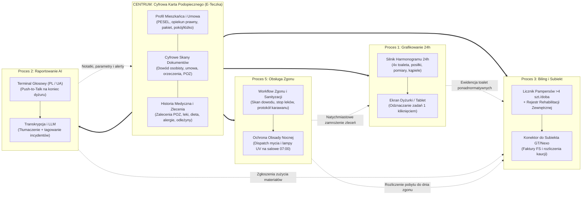

# Executive Summary: Cyfrowa Transformacja Domu Opieki Seniora „Marconi”

**Obiekt referencyjny:** Dom Opieki i Rehabilitacji Seniora „Marconi” (139 miejsc statutowych, ~100–120 mieszkańców)  
**Dokument:** Nadrzędne Zestawienie Architektury, Procesów Kluczowych i Harmonogramu Dobowego  
**Powiązany projekt:** Platforma SilverCare (Moduły: E-Teczka, Grafik 24h, Voice Handover, Biling Subiekt, Death Management)  

---

## 1. Architektura Systemu i Ekosystem Danych

Centralnym punktem zintegrowanej platformy jest **Cyfrowa Karta Podopiecznego (E-Teczka Seniora)**, która zasilana danymi wejściowymi (umowa, orzeczenia lekarskie, deklaracja POZ, skany tożsamości) stanowi pojedyncze źródło prawdy dla wszystkich modułów operacyjnych placówki:

---

## 2. Zestawienie Procesów Kluczowych (AS IS vs TO BE)

### Proces 1: Grafikowanie i Planowanie Opieki nad Podopiecznym
* **Stan obecny (AS IS):** Informacje o czynnościach opiekuńczych wokół pensjonariusza są rozproszone pomiędzy papierową teczkę w szafie biura, odręczne karty zleceń od lekarza POZ, ścienny grafik kąpieli powieszony w łazience oraz plik Excel prowadzony przez kierownika Artura. Artur drukuje listę pokoi z Excela i wiesza ją na ścianie dyżurki. Opiekunki na salach nie korzystają ze sprzętu komputerowego. Kąpiele planowe odbywają się w godzinach 10:00–13:00 i przy pacjentach bezwładnych/spastycznych wymagają zaangażowania od 2 do 6 opiekunek naraz; jeśli pacjent ma wyznaczoną kąpiel, zewnętrzny fizjoterapeuta zabiera na salę ćwiczeń inną osobę, co rodzi konflikty organizacyjne. Zapis w zeszycie pojawia się wyłącznie przy incydentach lub zgonach; brak dowodu na to, czy toalety przeciwodleżynowe odbyły się zgodnie z harmonogramem.
* **Model docelowy (TO BE):** Utworzenie cyfrowego harmonogramu opieki generowanego na miesiące w przód, przypisującego do każdego pensjonariusza czynności stałe (4 wymiany pampersów: 07:00, 14:00, 18:00, 04:00; 3 posiłki; poranne pomiary cukru i ciśnienia) oraz indywidualne zlecenia medyczne (podanie insuliny przed 09:00, leki z kasetek, zaplanowane kąpiele, toaleta cewnika, dieta). System umożliwia edycję pojedynczych dni (np. wstrzymanie zadań przy pobycie w szpitalu, przesunięcie terminu kąpieli) oraz udostępnia podgląd na monitorze dotykowym/tablecie w dyżurce z wyszukiwaniem po pokoju lub nazwisku, jak również opcję generowania czytelnych kart dobowych.  
*Szczegółowa specyfikacja procesu:* [02_proces_grafikowanie_opieki.md](./02_proces_grafikowanie_opieki.md)

---

### Proces 2: Przekazywanie Zmiany i Raportowanie Głosowe AI (Handover Voice-to-Text & Logbook)
* **Stan obecny (AS IS):** Przekazywanie dyżuru odbywa się dwa razy na dobę i trwa od 15 do 30 minut (poranny handover: 06:30–07:15, wieczorny handover: 18:30–19:15). Zmiana dzienna wpisuje raport wyłącznie niebieskim długopisem do jednego podręcznego zeszytu dyżurki (data, stan ewidencyjny, stan obecnych w obiekcie, liczba osób w szpitalu oraz notatki o zdarzeniach per pokój i nazwisko; nocka pisze czerwonym). Zeszyt stanowi dokumentację wewnętrzną placówki m.in. na potrzeby spraw sądowych z roszczeniowymi rodzinami. Równolegle personel przekazuje informacje ustnie („żeby wszystko wygadać”). Istotną część personelu stanowią pracownice z Ukrainy, dla których precyzyjne formułowanie medycznych notatek w języku polskim po 12h ciężkiej pracy fizycznej stanowi barierę stresową. Odszukanie wpisu sprzed kilku miesięcy wymaga wielogodzinnego wertowania kartek.
* **Model docelowy (TO BE):** Zastąpienie odręcznego wpisu możliwością nagrania notatki głosowej na koniec zmiany przez opiekunki i salowe w ich języku ojczystym (**po polsku lub po ukraińsku**). Model mowy Whisper transkrybuje nagranie, a silnik LLM tłumaczy wypowiedź na profesjonalną polszczyznę medyczną oraz kategoryzuje informacje per pensjonariusz (`[INCIDENT]`, `[LEK_ODMOWA]`, `[PARAMETR_POMIAR]`, `[HIGIENA_SKORA]`, `[BEHAWIORALNE]`, `[ZADANIE]`). Raport tworzy nienaruszalny cyfrowy rejestr przekazań ze znacznikiem czasu, autora i zmiany, wyświetla podsumowanie na monitorze w dyżurce i dopisuje treść do historii danego podopiecznego.  
*Szczegółowa specyfikacja procesu:* [03_proces_przekazywanie_zmiany_voice.md](./03_proces_przekazywanie_zmiany_voice.md)

---

### Proces 3: Miesięczne Fakturowanie i Rozliczanie Zużytych Materiałów i Opieki (ERP Subiekt)
* **Stan obecny (AS IS):** Kierownik Artur prowadzi plik Excel na dysku współdzielonym (kolumny: PESEL, nazwisko i imię, opiekun, kwota za pobyt, pakiet, pobyt od, pobyt do, adres zamieszkania, inny adres, Uwagi 1 na materiały i pampersy, Uwagi 2 od prezesa/księgowości, Uwagi 3 na rehabilitacje, źródło, typ pobytu, czas trwania, miesiąc przyjęcia). Plik jest blokowany, gdy edytuje go druga osoba („Karina mówi: zamknij plik, to ja go uzupełnię”). W umowie przyjęta jest norma 4 zmian pampersów na dobę – jeśli podopieczny zużył więcej, opiekunki po miesiącu zgłaszają to Arturowi ustnie. Zewnętrzni fizjoterapeuci zostawiają na stole papierowe kartki z liczbą wykonanych zabiegów (np. 12 x 60 zł), które Artur przepisuje do Excela. Artur otwiera program Subiekt, ręcznie przepisuje dane i wystawia faktury z pozycjami: opłata za pobyt, zużyte materiały oraz rehabilitacja, po czym zaznacza wiersze w Excelu kolorami (niebieski – wystawiona, zielony – opłacona, jasnozielony – w toku).
* **Model docelowy (TO BE):** Utworzenie modułu finansowo-bilingowego opartego na relacyjnej bazie danych (jednoczesna praca Artura i recepcji bez blokowania plików). System automatycznie zlicza pampersy odznaczone w dyżurce powyżej normy 4 szt./dobę, umożliwia fizjoterapeutom wprowadzanie zabiegów bezpośrednio w dedykowanym widoku zamiast na papierowych kartkach oraz automatycznie odlicza dni zarejestrowanego pobytu w szpitalu. Dane rozliczeniowe są eksportowane bezpośrednio do programu Subiekt GT / Nexo w celu wygenerowania faktur bez ręcznego przepisywania danych.  
*Szczegółowa specyfikacja procesu:* [04_proces_fakturowanie_i_rozliczenia_subiekt.md](./04_proces_fakturowanie_i_rozliczenia_subiekt.md)

---

### Proces 4: Centralna Cyfrowa Karta Podopiecznego (E-Teczka Seniora)
* **Stan obecny (AS IS):** Każdy pensjonariusz posiada papierową teczkę przechowywaną w szafie biura/dyżurki. W teczce znajdują się kserokopie: podpisana umowa z załącznikami, orzeczenia lekarskie, deklaracja wyboru lekarza POZ oraz kserokopia dowodu osobistego (wymagana przez lekarza przy stwierdzeniu zgonu pensjonariusza). Personel opiekuńczy na salach nie ma bieżącego wglądu do tych dokumentów.
* **Model docelowy (TO BE):** Utworzenie zintegrowanej cyfrowej karty podopiecznego dostępnej w systemie na komputerach i tabletach dyżurki. Karta gromadzi:
  1. **Profil mieszkańca:** PESEL, dane osobowe, pokój, łóżko, kontakty do opiekunów prawnych i rodziny.
  2. **Repozytorium skanów:** Skany dowodu osobistego, umowy, orzeczeń i deklaracji POZ.
  3. **Plan opieki:** Bieżący grafik zadań 24h, historia parametrów życiowych, wykaz leków z kasetki, dieta, alergie oraz zlecenia od lekarza POZ.
  4. **Dziennik zdarzeń:** Zestawienie notatek głosowych i incydentów z handoverów przypisanych do danego podopiecznego.  
*Szczegółowa specyfikacja procesu:* [01_architektura_i_cyfrowa_teczka.md](./01_architektura_i_cyfrowa_teczka.md)

---

### Proces 5: Procedura Obsługi Zgonu Pensjonariusza i Sanityzacji Miejsca
* **Stan obecny (AS IS):** Placówka odnotowuje średnio **15 zgonów miesięcznie** (statystycznie 1 zgon co 2 dni), a cała procedura trwa od **5 do 6 godzin**. Po zauważeniu ustania funkcji życiowych przez opiekunkę (opiekunka nie ma uprawnień orzekania zgonu), po odczekaniu ok. 2 godzin wzywany jest lekarz (przychodnia POZ w dzień powszedni lub NiŚOZ w nocy i święta). Personel musi odszukać papierową teczkę w szafie biura/dyżurki, aby wydobyć ksero dowodu osobistego, bez którego lekarz nie wystawi Karty Zgonu. Dopiero po wizycie lekarza powiadamiana jest rodzina i wzywany zakład pogrzebowy (karawan). Opiekunki wykonują czynności toaletowe: usunięcie rurek, sondy PEG, cewników, wenflonów, opatrunków, założenie czystego pampersa (zabezpieczenie fizjologiczne) i okrycie prześcieradłem. Po odbiorze ciała sala jest myta, materac dezynfekowany, pościel zmieniana, a pokój naświetlany lampą UV i wietrzony. **Krytyczne wąskie gardło nocne:** W nocy dyżurują tylko 4 opiekunki i nie ma salowych – zgon wyłącza 1–2 opiekunki na 5–6 godzin z bieżącej opieki nad pozostałymi 90+ seniorami, stwarzając bezpośrednie zagrożenie bezpieczeństwa.
* **Model docelowy (TO BE):** Zintegrowany cyfrowy workflow procedury zgonu w systemie:
  1. **Natychmiastowy dostęp do dokumentów:** Błyskawiczny wgląd w skan dowodu osobistego i PESEL w Cyfrowej Karcie Podopiecznego na tablecie dyżurki (eliminacja nocnego przeszukiwania szaf z papierami).
  2. **Uruchomienie procedury „Zgon – w toku” 1 kliknięciem:** Automatyczne wstrzymanie generowania kolejnych zleceń opiekuńczych, leków i toalet w Procesie 1 (Grafikowanie), powiadomienie koordynatora oraz przygotowanie metryki do Karty Zgonu dla lekarza.
  3. **Cyfrowa checklista toaletowa i ewidencja odbioru:** Odznaczenie usunięcia cewników, PEG-a i wenflonów, rejestracja godziny odbioru ciała przez karawan oraz cyfrowe załączenie potwierdzenia odbioru zwłok.
  4. **Zarządzanie sanityzacją i rotacją miejsc:** Automatyczne zaplanowanie zadania dezynfekcji i naświetlania lampą UV dla porannej zmiany salowych (odciążenie dyżuru nocnego), a po zakończeniu – natychmiastowe oznaczenie łóżka jako gotowego na nowe przyjęcie.
  5. **Automatyczne rozliczenie w Bilingu (Proces 3):** Zatrzymanie naliczania opłat pobytowych z dokładnością do doby zgonu oraz automatyczne wyliczenie salda kaucji i rozliczenia końcowego dla rodziny w Subiekcie.  
*Szczegółowa specyfikacja procesu:* [05_proces_obsluga_zgonu_i_sanityzacja.md](./05_proces_obsluga_zgonu_i_sanityzacja.md)

---

## 3. Plan Dnia Placówki Godzina po Godzinie (Chronologia 24h)

Poniższy harmonogram przedstawia 24-godzinny rozkład czynności w Domu Opieki „Marconi” zarejestrowany w wywiadzie z personelem:

| Przedział Czasowy | Faza Dobowa / Nazwa Procesu | Odpowiedzialne Role | Czynności Operacyjne i Wytyczne z Wywiadu |
| :--- | :--- | :--- | :--- |
| **06:00 – 06:30** | **Pobudka i Finał Czuwania Nocnego** | Opiekunki Nocne (4 osoby) | Kończenie czuwania nocnego, kontrola chorych leżących, gaszenie lampek nocnych, przygotowanie wstępnego zarysu raportu z nocy. |
| **06:30 – 07:15** | **Poranny Handover (Zakładka Raportowa)** | Opiekunki Nocka + Opiekunki Dniówka | Przekazanie dyżuru nocy (15–45 min), zdanie incydentów, stanów podgorączkowych i odmów leków. *W TO BE: podsumowanie mowy AI na monitorze dyżurki.* |
| **07:00 – 08:30** | **1. Toaleta Poranna & 1. Wymiana Pampersów** | Opiekunki Dzienne (10 osób) | Mycie poranne, toaleta intymna, pierwsza zmiana pampersów, inspekcja skóry i odleżyn, ubieranie pensjonariuszy. |
| **07:30 – 08:30** | **Pomiary Parametrów Życiowych i Insulina** | Opiekunki Dzienne (wyznaczone) | Pomiary cukru glukometrem, ciśnienie tętnicze, saturacja, temperatura. **Podanie insuliny przed godz. 09:00** (przed śniadaniem). |
| **08:00 – 09:30** | **Śniadanie i Karmienie Podopiecznych** | Salowe (2 osoby) + Opiekunki | Odbiór wózków cateringowych przez salowe, roznoszenie tac na sale, karmienie łyżką pacjentów niesamodzielnych. |
| **08:30 – 09:30** | **Poranne Rozdawanie Leków** | Opiekunki Dzienne | Wydawanie leków z przygotowanych kasetek. Opiekunka jest obecna przy pensjonariuszu podczas połykania leków. |
| **09:30 – 10:00** | **Sprzątanie Pośniadaniowe i Wietrzenie** | Salowe | Zbieranie naczyń do wózków, mycie stolików przyłóżkowych, wietrzenie sal i korytarzy. |
| **10:00 – 13:00** | **Blok Zabiegowy: Kąpiele, Rehabilitacja, Dezynfekcja** | Fizjoterapia Zewn., Salowe, Opiekunki, Lekarz POZ | 1. *Kąpiele planowe:* według grafiku, 2–6 opiekunek przy pacjentach bezwładnych. 2. *Rehabilitacja:* zewnętrzny zespół na sali lub przyłóżkowo. 3. *Sprzątanie generalne:* mycie podłóg, pranie pościeli, włączanie lamp UV. 4. *Wtorki (10:00–13:00):* wizyta planowa lekarza POZ (obchód, przegląd teczek, kwalifikacja leczenia). |
| **13:00 – 14:00** | **Obiad i Karmienie Poobiednie** | Salowe + Opiekunki | Wydawanie zup i dań drugich, karmienie osób leżących, rozdanie leków obiadowych przez opiekunki. |
| **14:00 – 15:00** | **2. Toaleta Dobowa & 2. Wymiana Pampersów** | Opiekunki Dzienne | Druga tura wymiany pampersów, toaleta intymna, repozycjonowanie pacjentów leżących w łóżkach. |
| **14:30 – 15:30** | **Rozkładanie Leków na 2 Dni Naprzód** | Wyznaczona Opiekunka w dyżurce | Praca w dyżurce przy kasetkach lekowych: rozkładanie tabletek na 2 dni do przodu dla parteru i piętra z kart zleceń. |
| **15:00 – 16:30** | **Drzemka Poobiednia / Czas Wolny / Odwiedziny** | Pensjonariusze, Salowe | Odpoczynek poobiedni, podwieczorek (kawa, ciastko, owoce), odwiedziny rodzin na salach i w ogrodzie. |
| **17:00 – 18:00** | **Kolacja i Karmienie Wieczorne** | Salowe + Opiekunki | Wydawanie kolacji z cateringu, asysta przy jedzeniu, podanie leków wieczornych przez opiekunki. |
| **18:00 – 19:00** | **3. Toaleta Wieczorna & 3. Wymiana Pampersów** | Opiekunki Dzienne | Trzecia wymiana pampersów, toaleta myjąca, kremowanie pośladków i pleców, ubieranie w piżamy, przygotowanie do snu. |
| **18:30 – 19:15** | **Wieczorny Handover (Zdanie Dniówki Nocce)** | Opiekunki Dniówka + Opiekunki Nocka | Przekazanie dyżuru nocy (4 opiekunki nocne), wpis do zeszytu niebieskim długopisem, omówienie incydentów i zleceń. |
| **19:00 – 22:00** | **Dyżur Wieczorny / Leki Nocne / Wyciszanie** | Opiekunki Nocne (4 osoby: 2 góra / 2 dół) | Podanie leków nasennych, iniekcji wieczornych (insuliny nocne, zastrzyki Clexane), gaszenie świateł głównych, wyciszanie oddziałów. |
| **22:00 – 23:00** | **Wieczorny Obchód Nocny** | Opiekunki Nocne | Kontrola bezpieczeństwa: podniesienie barierek łóżkowych, sprawdzenie suchości pampersów; zakończenie czynności do 23:00. |
| **23:00 – 04:00** | **Czuwanie Nocne („Luka Operacyjna 6h”)** | Opiekunki Nocne | Czuwanie w dyżurkach i na korytarzach, reagowanie na dzwonki przywoławcze, wołanie, lęki demencyjne i próby wspinania się przez barierki. *(W razie zgonu w nocy: obsługa procedury i wyłączenie 1–2 opiekunek).* |
| **04:00 – 05:00** | **Nocny Obchód & 4. Wymiana Pampersów** | Opiekunki Nocne | Czwarta tura wymiany pampersów u osób leżących, repozycja ułożeniowa seniorów przed porankiem. |
| **05:00 – 06:30** | **Pomiary Wczesnoporanne i Przygotowanie Raportu** | Opiekunki Nocne | Kontrola parametrów u pacjentów niestabilnych, doglądanie wstających seniorów, przygotowanie raportu nocnego. |

---

## 4. Zestawienie Zmian Operacyjnych (AS IS vs TO BE)

| Proces / Obszar | Stan Obecny (AS IS) | Model Docelowy (TO BE) | Wpływ na Efektywność i Ryzyko |
| :--- | :--- | :--- | :--- |
| **Planowanie Opieki** | Ścienna lista pokoi drukowana z Excela, ścienny grafik kąpieli, pamięć opiekunek. | Cyfrowy grafik opieki 24h na miesiące w przód z edycją dzienną na monitorze w dyżurce i opcją druku. | Eliminacja pomijania kąpieli i toalet; 100% audytowalności wykonania czynności. |
| **Przekazywanie Zmiany** | Ręczny wpis do jednego zeszytu dyżurki (niebieski długopis), ustne przekazywanie informacji. | Rejestracja notatki głosowej (PL/UA), automatyczna transkrypcja i tłumaczenie AI, rejestr przekazań z podpisem cyfrowym. | Skrócenie czasu z 20 min do 60 s; przełamanie bariery językowej; twarda podkładka prawna w sporach z rodzinami. |
| **Fakturowanie i Biling** | Plik Excel blokowany przy jednoczesnej edycji przez drugą osobę, ręczne przepisywanie danych do Subiekta. | Baza danych bez blokowania plików, automatyczne zliczanie pampersów >4 szt./doba z dyżurki, cyfrowe zabiegi fizjoterapeutów, eksport faktur do Subiekta. | Oszczędność 2 dni pracy kierownika Artura w miesiącu; zero błędów w fakturach. |
| **Dokumentacja Podopiecznego** | Papierowa teczka w szafie (umowa, orzeczenia, deklaracja POZ, ksero dowodu do procedury zgonu). | Cyfrowa Karta Podopiecznego w systemie ze skanami dokumentów, grafikiem, historią leków i notatkami z przekazań zmian. | Dostęp w 3 sekundy na sali lub w dyżurce; brak konieczności biegania do biura. |
| **Obsługa Zgonu i Sanityzacja Miejsca** | Średnio 15 zgonów/miesiąc (5–6 h trwania procedury). Nocne szukanie ksero dowodu w szafie, wyłączenie 1–2 z 4 opiekunek w nocy na mycie i lampę UV (brak salowych), ręczne wygaszanie zleceń i rozliczeń. | Cyfrowy workflow procedury zgonu, natychmiastowy dostęp do skanu dowodu w E-Teczce, automatyczne wstrzymanie zleceń lekowych i toalet, oddelegowanie sanityzacji do porannej zmiany salowych, automatyczne rozliczenie proporcjonalne w bilingu/Subiekcie. | Ochrona obsady nocnej; brak paraliżu opiekuńczego nad 90 seniorami; zgodność sanitarno-prawna. |

