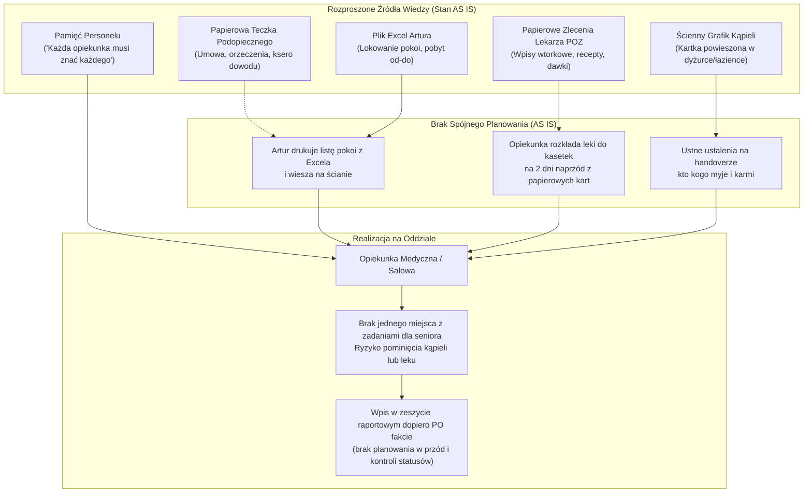
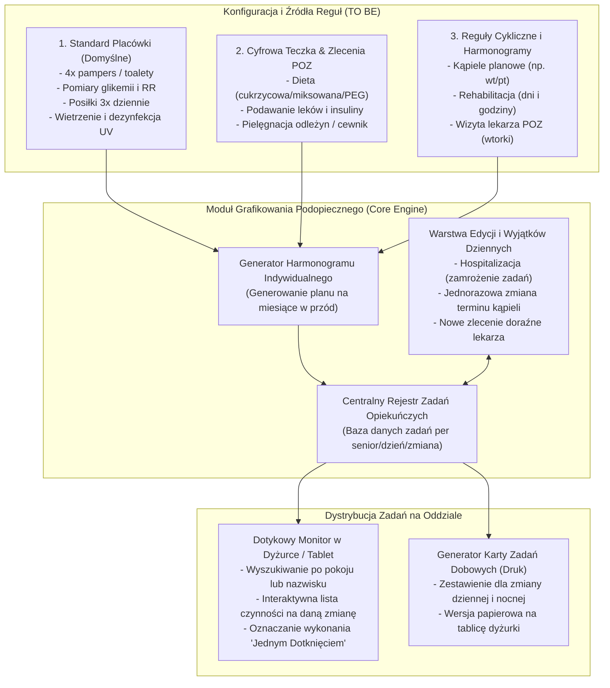

# Specyfikacja Procesu 1: Grafikowanie i Planowanie Opieki nad Podopiecznym (AS IS vs TO BE)

**Lokalizacja obiektu:** Dom Opieki Seniora „Marconi”  
**Rola analityczna:** Starszy Analityk Biznesowy & Inżynier Systemowy  
**Status dokumentu:** Zatwierdzona Specyfikacja Wymagań i Architektury Procesu  

---

## 1. Cel i Zakres Procesu

Celem przeprojektowania procesu jest zastąpienie rozproszonej, częściowo pamięciowej i papierowej organizacji opieki nad pensjonariuszem centralnym, cyfrowym **Grafikiem Podopiecznego (Care Scheduler)**. 

System musi umożliwiać:
1. **Długoterminowe planowanie (na miesiące w przód):** Agregację wszystkich czynności powtarzalnych – zarówno bazowych dla całego domu opieki (4 tury toalet, 3 posiłki, pomiary), jak i wynikających ze specyfiki schorzeń, zaleceń lekarskich oraz teczki pensjonariusza.
2. **Elastyczność operacyjną (edycja dzienna i wyjątki):** Możliwość natychmiastowej modyfikacji zadań na dany dzień (np. z powodu nagłej hospitalizacji, pogorszenia stanu zdrowia, wizyty lekarskiej, kąpieli czy odmowy wykonania czynności).
3. **Wizualizację i realizację na oddziale:** Dostęp do harmonogramu w dyżurce na monitorze dotykowym / tablecie (wyszukiwanie po pokoju lub nazwisku) oraz możliwość generowania czytelnych wydruków dobowych dla personelu opiekuńczego i salowych.

---

## 2. Model Procesu Obecnego (AS IS)

### 2.1. Przebieg i Rozproszenie Wiedzy
W stanie obecnym w Domu Opieki „Marconi” nie istnieje jeden spójny dokument ani system określający dobowy plan zadań wokół konkretnego seniora:
* **Papierowa teczka podopiecznego:** Znajduje się w szafie w administracji/dyżurce. Zawiera umowę, orzeczenia lekarskie, ksero dowodu osobistego (niezbędne do procedury stwierdzenia zgonu) oraz wstępne wytyczne opiekuńcze. Informacje z teczki nie są na bieżąco synchronizowane z pracą opiekunek.
* **Zalecenia Lekarza POZ:** Spisywane są odręcznie podczas wtorkowych wizyt planowych Pani doktor. Nowe zlecenia trafiają do papierowych kart zleceń lub są przekazywane ustnie koordynatorce.
* **Ścienny grafik kąpieli:** W dyżurce/łazience wisi kartka z rozpisanymi dniami kąpieli (kąpiele planowe odbywają się w godzinach 10:00–13:00 i wymagają zaangażowania od 2 do 6 osób personelu przy pacjentach bezwładnych).
* **Excel Artura:** Kierownik obiektu prowadzi arkusz, w którym ewidencjonuje obłożenie pokoi. Raz w miesiącu drukuje listę pokoi i wiesza ją na ścianie dyżurki.
* **Pamięć personelu („Każda musi znać każdego”):** Placówka opiera się na założeniu, że opiekunki pamiętają nawyki, diety i ograniczenia ruchowe 100 pensjonariuszy.

### 2.2. Diagram Procesu AS IS

### 2.3. Wąskie Gardła i Ryzyka Operacyjne Stanu AS IS
1. **Ryzyko błędu przy rotacji personelu (rotacja ~15%):** Nowa opiekunka po szkole medycznej nie zna podopiecznych, a papierowa lista pokoi na ścianie nie zawiera informacji o ryzyku zachłyśnięcia, odleżynach czy diecie cukrzycowej.
2. **Konflikty zasobowe w bloku 10:00–13:00:** Kolizja między kąpielą planową a przyjściem zewnętrznych fizjoterapeutów („zabrałam pacjenta na salę ćwiczeń”) – brak wspólnego kalendarza powoduje chaos w dyżurce.
3. **Brak audytowalności wykonania czynności:** Zapis w zeszycie pojawia się wyłącznie przy incydentach lub zgonach; brak dowodu na to, czy toalety przeciwodleżynowe odbyły się zgodnie z harmonogramem (kluczowy punkt sporów z rodzinami).

---

## 3. Wymagania Funkcjonalne do Modelu Docelowego (TO BE)

System łączy trzy kategorie danych wejściowych w jeden spójny profil harmonogramu podopiecznego.

### 3.1. Czynności Domyślne (Standard Placówki)
Czynności generowane automatycznie dla każdego aktywnego pensjonariusza:
* **Toalety i pampersy (4 tury dobowe):**
  * Tura 1: 07:00 – 08:30 (Toaleta poranna, zmiana pampersa, pielęgnacja skóry).
  * Tura 2: 14:00 – 15:00 (Toaleta popołudniowa, zmiana pampersa, repozycja ułożeniowa).
  * Tura 3: 18:00 – 19:00 (Toaleta wieczorna, pampers na noc, przygotowanie do snu).
  * Tura 4: 04:00 – 05:00 (Nocny obchód, wymiana pampersa u osób leżących).
* **Posiłki i nawadnianie:** Śniadanie (08:00–09:30), Obiad (13:00–14:00), Kolacja (17:00–18:00).
* **Pomiary parametrów życiowych:** Kontrola poranna (07:30–08:30) – ciśnienie tętnicze (RR), tętno, saturacja.

### 3.2. Czynności Indywidualne (Medyczne i Opiekuńcze z Teczki / POZ)
Czynności konfigurowane per podopieczny na podstawie zleceń lekarskich:
* **Glikemia i insulina:** Pomiar glukometrem o 07:30 oraz **podanie insuliny podskórnej przed posiłkiem (sztywny rygor czasowy do 09:00)**.
* **Leki z kasetek:** Wydawanie leków przygotowanych w kasetkach w oknach: Rano (08:30), Obiad (13:30), Wieczór (17:30), Noc (20:00–21:00).
* **Iniekcje i procedury specjalne:** Zastrzyki przeciwzakrzepowe (np. Clexane o 20:00 po urazach/złamaniach), toaleta rurki tracheostomijnej, płukanie cewnika Foleya, opatrunki odleżynowe (I–IV stopień).
* **Dieta dedykowana:** Standardowa / Cukrzycowa / Papkowata (miksowana) / Dojelitowa (PEG).

### 3.3. Harmonogramowanie Cykliczne (Planowanie Wielomiesięczne)
* **Kąpiele planowe:** Definiowanie dni tygodnia (np. każdy wtorek i piątek) oraz liczby personelu asystującego (1 opiekunka dla chodzących, **2–6 dla pacjentów leżących/spastycznych**).
* **Fizjoterapia i rehabilitacja:** Rezerwacja okien czasowych (poniedziałek–piątek 10:00–14:00) we współpracy ze spółką zewnętrzną.
* **Obchód lekarski:** Wtorki 10:00–13:00 – automatyczne oznaczanie pacjentów zgłoszonych do konsultacji z Panią doktor.

### 3.4. Warstwa Wyjątków i Edycji Dziennej (Dynamic Override)
* **Status „Hospitalizacja”:** Natychmiastowe zamrożenie generowania zadań opiekuńczych na czas pobytu w szpitalu, z zachowaniem rezerwacji łóżka i ciągłości umowy.
* **Ad-hoc zmiana terminu:** Przesunięcie kąpieli z powodu osłabienia lub zabiegów na inny dzień bez naruszania reguły głównej.
* **Zlecenia doraźne:** Wprowadzenie zlecenia jednorazowego (np. doraźny lek przeciwgorączkowy, dodatkowy pomiar ciśnienia co 2h).

---

## 4. Model Procesu Docelowego (TO BE)

### 4.1. Architektura Przepływu Zadań

---

## 5. Dystrybucja i Ergonomia Interfejsu na Oddziale

W wywiadzie personel wielokrotnie podkreślał, że **opiekunki nie mogą spędzać czasu przed tradycyjnym komputerem biurowym**. Z tego względu wdrożenie przewiduje dwa równoległe kanały:

1. **Dotykowy Ekran w Dyżurce (Tablet naścienny lub Monitor 24”):**
   * **Widok Szybki (Quick Tiles):** Kafelki pokojów z kolorystycznym statusem ukończenia tury toalet (Czerwony: oczekuje, Żółty: w trakcie, Zielony: ukończone).
   * **Odznaczanie „One-Touch”:** Kliknięcie pokoju $\rightarrow$ kliknięcie nazwiska $\rightarrow$ stuknięcie przycisku *„Pampers wymieniony”* lub *„Leki podane”*.
   * **Filtr Krytyczny:** Dedykowany filtr *„Insuliny do godz. 09:00”* – lista pacjentów z cukrzycą, u których nie odznaczono jeszcze podania insuliny.
2. **Karta Dobowa do Wydruku (Fizyczny Backup):**
   * Generator zwięzłego raportu A4 drukowanego codziennie o godz. 06:45 na poranną odprawę.
   * Zawiera: wykaz pacjentów do kąpieli w danym dniu, wykaz pacjentów do rehabilitacji oraz listę zaleceń specjalnych.

---

## 6. Korzyści Biznesowe Wdrożenia Procesu 1

1. **Zero pominięć w opiece:** Żaden senior nie zostanie pominięty przy porannej toalecie, wymianie pampersa czy podaniu insuliny.
2. **Eliminacja konfliktów z fizjoterapią:** Zespół zewnętrznych rehabilitantów z góry wie, o której godzinie dany senior ma kąpiel planową, eliminując sytuacje blokowania personelu.
3. **Automatyczne zasilenie bilingu (Proces 3):** Każde odznaczenie wymiany pampersa powyżej limitu 4 szt./dobę automatycznie trafia do licznika kosztów podopiecznego, znosząc konieczność ustnych zgłoszeń po miesiącu.

