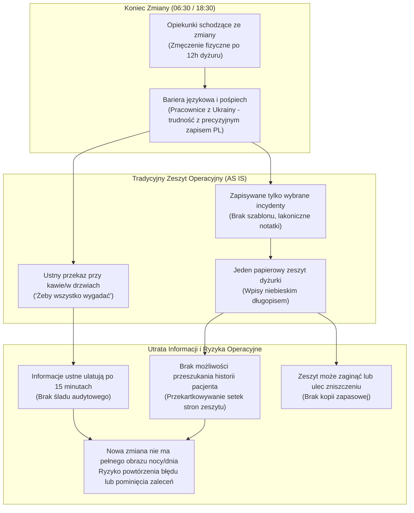
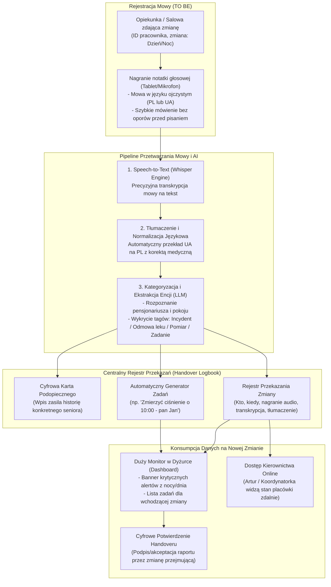

# Specyfikacja Procesu 2: Przekazywanie Zmiany i Raportowanie Głosowe AI (Handover Voice-to-Text & Logbook)

**Lokalizacja obiektu:** Dom Opieki Seniora „Marconi”  
**Rola analityczna:** Starszy Analityk Biznesowy & Inżynier Systemowy  
**Status dokumentu:** Zatwierdzona Specyfikacja Wymagań i Architektury Procesu  

---

## 1. Cel i Zakres Procesu

Proces przekazania dyżuru (handover) jest najbardziej newralgicznym punktem styku operacyjnego w 24-godzinnym cyklu życia placówki. Występuje dwa razy na dobę:
* **Poranny Handover:** 06:30 – 07:15 (Nocka zdaje Dniówce).
* **Wieczorny Handover:** 18:30 – 19:15 (Dniówka zdaje Nocce).

Celem przeprojektowania procesu jest eliminacja ograniczeń tradycyjnego, papierowego zeszytu raportów poprzez wdrożenie wielojęzycznego systemu **Voice-to-Text z automatyczną kategoryzacją AI**, centralnym **Rejestrem Przekazań (Handover Logbook)** oraz interaktywną tablicą odpraw na monitorze w dyżurce.

---

## 2. Model Procesu Obecnego (AS IS)

### 2.1. Charakterystyka Pracy z Zeszytem Raportów
* **Jeden egzemplarz fizyczny:** W dyżurce znajduje się pojedynczy, oprawny brulion („podręczny zeszyt operacyjny”).
* **Rygor niebieskiego długopisu:** Zmiana dzienna ma formalny nakaz dokonywania wpisów wyłącznie niebieskim tuszem (nocka pisze czerwonym). Wpisy zawierają: stan ewidencyjny pensjonariuszy, stan obecnych w obiekcie, liczbę osób hospitalizowanych oraz listę incydentów per pokój/nazwisko.
* **Zmęczenie fizyczne i presja czasu:** Po 12 godzinach wyczerpującej pracy fizycznej (dźwiganie podopiecznych, toalety, kąpiele, karmienie) opiekunki schodzące mają zaledwie kilkanaście minut na spisanie raportu. W efekcie notatki są zredukowane do absolutnego minimum.
* **Bariera językowa:** Istotną część personelu opiekuńczego stanowią pracownice z Ukrainy. Mimo sprawnej komunikacji werbalnej, konieczność formułowania pisemnych, precyzyjnych notatek medycznych w języku polskim powoduje dyskomfort, stres i pomijanie subtelnych, lecz kluczowych obserwacji behawioralnych.
* **„Wygadanie się” (kanał nieformalny):** Opiekunki uzupełniają braki zeszytu intensywną rozmową ustną („po to te pół godziny trzeba rano i wieczorem, żeby wszystko wygadać”). Niestety, wiedza przekazana ustnie ulatuje po kilkunastu minutach, nie trafia do personelu nieobecnego danego dnia i nie stanowi materiału dowodowego.

### 2.2. Diagram Procesu AS IS

### 2.3. Wąskie Gardła i Ryzyka Prawne Stanu AS IS
1. **Brak przeszukiwalności w sporach z rodzinami:** Jak podkreślał personel w wywiadzie: *„Zapisujemy tam różne wydarzenia, bo też mamy sprawy sądowe i musimy mieć podkładkę”*. Odszukanie w papierowym brulionie incydentu sprzed 4 miesięcy (np. oskarżenie o zaniedbanie, odleżynę czy upadek) wymaga wielogodzinnego wertowania stron.
2. **Ryzyko utraty lub uszkodzenia fizycznego:** Zeszyt leżący na blacie w dyżurce jest narażony na zalanie kawą, zniszczenie lub zagubienie, co oznacza bezpowrotną utratę historii operacyjnej.
3. **Brak możliwości zdalnego wglądu kierownictwa:** Kierownik Artur ani Koordynatorka nie mają dostępu do raportów poza dyżurką – aby poznać przebieg nocy, muszą wykonywać telefony do opiekunek.

---

## 3. Wymagania Wejściowe i Funkcjonalne do Procesu Docelowego (TO BE)

System raportowania głosowego opiera się na 5 filarach technologicznych i funkcjonalnych:

### 3.1. Prosty Interfejs Rejestracji Głosu w Dyżurce
* **Sprzęt:** Dedykowany tablet naścienny, mikrofon biurkowy zintegrowany ze stacją dokującą w dyżurce lub rejestrator mobilny Zero-UI (M5StickC PLUS2).
* **Ergonomia „One-Touch”:** Opiekunka loguje się zbliżeniowo (karta RFID / kod PIN), wybiera opcję *„Nagraj raport ze zmiany”* lub *„Dodaj notatkę do pacjenta”* i naciska duży, czytelny przycisk nagrywania.
* **Brak ograniczeń językowych:** Pracownica mówi swobodnie w języku ojczystym (**język polski** lub **język ukraiński**).

### 3.2. Silnik Przetwarzania Mowy i Tłumaczenia (Speech-to-Text & Translation)
* **Model Transkrypcyjny:** Wykorzystanie zoptymalizowanego modelu mowy (Whisper Large v3 / Whisper Turbo) o wysokiej odporności na szum tła dyżurki i akcent.
* **Automatyczne Tłumaczenie i Normalizacja:** Silnik LLM w czasie rzeczywistym tłumaczy wypowiedź z języka ukraińskiego na profesjonalny język polski, korygując fonetyczne zapisy nazwisk i standaryzując terminologię medyczną (np. „cukier”, „ciśnienie”, „pampers”, „odleżyna”, „barierki”).

### 3.3. Automatyczna Kategoryzacja i Ekstrakcja Encji
System analizuje przetłumaczony tekst i automatycznie przypisuje go do odpowiednich struktur:
1. **Identyfikacja pensjonariusza:** Rozpoznawanie imion, nazwisk i numerów pokojów (np. *„u pani Stasi z 12”*, *„pan Kowalski z parteru”*).
2. **Kategoryzacja zdarzeń (Tagowanie):**
   * `[INCIDENT]` – Upadek, uraz, rana, agresja słowna/fizyczna, awaria sprzętu.
   * `[LEK_ODMOWA]` – Odmowa przyjęcia leków, trudności w połykaniu, wymioty po leku.
   * `[PARAMETR_POMIAR]` – Anomalie parametrów życiowych (ciśnienie skurczowe >160, glikemia <70 lub >250, gorączka >38°C).
   * `[HIGIENA_SKORA]` – Zaczerwienienia, podejrzenie odleżyny, maceracja skóry, nadmierne zużycie materiałów chłonnych.
   * `[BEHAWIORALNE]` – Lęki nocne, próby wspinania się przez barierki łóżka, pobudzenie demencyjne.
   * `[ZADANIE_DLA_NASTEPNEJ_ZMIANY]` – Automatyczne wygenerowanie zadania (np. *„skontrolować ciśnienie o 11:00”*, *„przygotować do wizyty córki o 15:00”*).

### 3.4. Rejestr Przekazań (Handover Logbook)
Centralny, niezmienny (append-only) cyfrowy rejestr raportów:
* **Metadane:** Unikalny ID wpisu, data i godzina nagrania, ID i nazwisko osoby zdającej, identyfikator zmiany (Dniówka/Nocka), załączony plik audio.
* **Treść:** Oryginalny transkrypt + znormalizowane tłumaczenie w języku polskim + wyekstrahowane kategorie.
* **Cyfrowe zatwierdzenie (Acknowledge):** Osoba przejmująca zmianę (liderka wchodzącej dniówki/nocki) ma obowiązek zapoznać się z raportem i zatwierdzić go jednym kliknięciem (elektroniczny podpis odbioru dyżuru).

---

## 4. Model Procesu Docelowego (TO BE)

### 4.1. Architektura Przepływu Informacji

---

## 5. Przykładowy Scenariusz Operacyjny (End-to-End)

Poniższy przypadek demonstruje działanie pipeline'u przy zdaniu dyżuru przez opiekunkę z Ukrainy:

### 5.1. Krok 1: Wejście Głosowe (Mowa w języku ukraińskim)
> **Opiekunka Oksana (godz. 06:45, dyżur nocny):**  
> *„Зміна нічна пройшла в цілому спокійно. Але в кімнаті 8 у пана Тадеуша десь о другій ночі був сильний неспокій, хотів перелізти через перила ліжка. Ми дали йому заспокійливий чай і поправили ковдру. А в кімнаті 14 у пані Яніни о 4 ранку при зміні памперса помітили сильне почервоніння на лівому стегні, треба щоб денна зміна обов'язково показала це лікарці у вівторок і поміряла тиск о 10 ранку, бо вночі було 160 на 95.”*

### 5.2. Krok 2: Automatyczna Transkrypcja i Tłumaczenie Medyczne (PL)
> **Znormalizowany raport w języku polskim:**  
> *„Zmiana nocna przebiegła zasadniczo spokojnie. W pokoju nr 8 u pana Tadeusza około godziny 02:00 wystąpił silny niepokój psychoruchowy – podjął próbę przejścia przez barierki łóżka. Zastosowano wyciszenie i asekurację. W pokoju nr 14 u pani Janiny o godzinie 04:00 podczas wymiany pampersa zaobserwowano silne zaczerwienienie lewego biodra (podejrzenie odleżyny I stopnia). Zlecono kontrolę lekarską podczas wtorkowej wizyty POZ oraz wykonanie pomiaru ciśnienia tętniczego o godz. 10:00 (w nocy odnotowano RR 160/95 mmHg).”*

### 5.3. Krok 3: Wygenerowane Struktury Danych i Alerty

#### Zdarzenie 1: Profil Podopiecznego (Tadeusz Kowalczyk, Pokój 8)
* **Kategoria:** `[BEHAWIORALNE]`, `[BEZPIECZEŃSTWO]`
* **Treść:** Próba forsowania barierek łóżka, niepokój nocny o godz. 02:00.
* **Status:** Wyciszony, bez urazu.

#### Zdarzenie 2: Profil Podopiecznej (Janina Zielińska, Pokój 14)
* **Kategoria:** `[HIGIENA_SKÓRA]`, `[PARAMETR_POMIAR]`
* **Wykryte parametry:** RR 160/95 mmHg (godz. 04:00).
* **Alert na monitorze dyżurki:** 🔴 **CZERWONY BANNER:** *Pokój 14 – Zaczerwienienie biodra + zgłoszenie do Pani Doktor POZ na wtorek.*
* **Automatyczne zadanie dla Dniówki:** *Zmierzyć RR o 10:00 (przypisane do opiekunki parteru).*

---

## 6. Prezentacja Danych na Monitorze Dyżurki

Podczas porannej kawy i handoveru (06:45–07:15) zmiana dzienna widzi na dużym ekranie ściennym:
1. **Licznik Doby:** Obecnych: 96 | Hospitalizowanych: 4 | Zgony w nocy: 0.
2. **Tablica Ostrzeżeń Medycznych (Critical Alerts):**
   * Wykaz pacjentów z gorączką, skokami ciśnienia, incydentami hipoglikemii.
   * Lista pacjentów, którzy odmówili przyjęcia leków wieczornych/nocnych.
3. **Lista Przekazanych Zadań (Handover Tasks):**
   * Wygenerowane automatycznie zadania z nocnych notatek głosowych (kontrole parametrów, opatrunki, przygotowania do transportu).
4. **Przycisk Zatwierdzenia Dyżuru:** Podpis liderki zmiany dziennej po zapoznaniu się z raportem głosowym.

---

## 7. Korzyści Biznesowe i Operacyjne Wdrożenia

1. **Oszczędność czasu personelu:** Nagranie notatki głosowej zajmuje **60 sekund** zamiast 15–20 minut żmudnego, ręcznego pisania w zeszycie.
2. **Zniesienie bariery językowej:** Opiekunki z Ukrainy raportują bez stresu, przekazując 3-krotnie więcej detali opiekuńczych.
3. **Cyfrowa tarcza prawna dla placówki:** Każdy raport posiada nienaruszalny znacznik czasu, ID pracownika oraz oryginalne nagranie audio, co stanowi twardy dowód w przypadku roszczeń rodzin lub postępowań powypadkowych.
4. **Natychmiastowy wgląd kierownictwa:** Kierownik Artur może w dowolnym momencie z poziomu telefonu sprawdzić stan placówki bez konieczności niepokojenia dyżurki telefonami.

