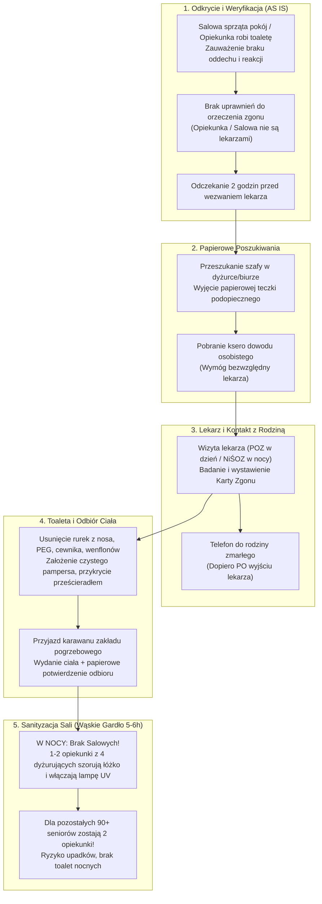
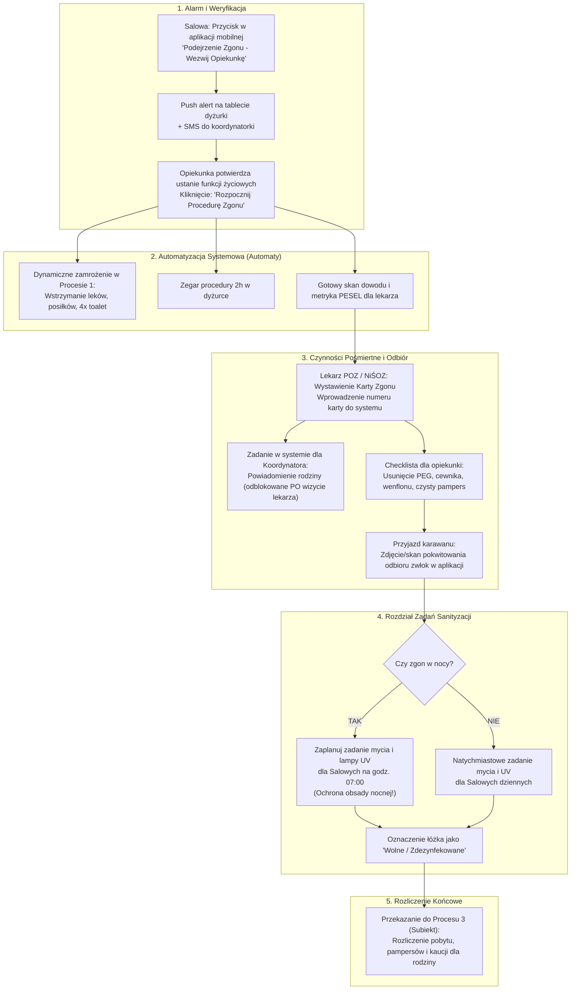

# Specyfikacja Procesu 5: Procedura Obsługi Zgonu Pensjonariusza i Sanityzacji Miejsca (AS IS vs TO BE)

**Lokalizacja obiektu:** Dom Opieki Seniora „Marconi”  
**Rola analityczna:** Starszy Analityk Biznesowy & Inżynier Systemowy  
**Status dokumentu:** Zatwierdzona Specyfikacja Wymagań, Architektury i Backlogu Zadań Operacyjnych  

---

## 1. Cel i Zakres Procesu

Zgon podopiecznego w Domu Opieki „Marconi” nie jest incydentem jednostkowym, lecz **stałym, powtarzalnym elementem rzeczywistości operacyjnej**. Placówka licząca ok. 100–140 pensjonariuszy odnotowuje średnio **15 zgonów miesięcznie** (statystycznie 1 zgon co 2 dni), przy czym rotacja wynosi 30 przyjęć w miesiącu (15 zgonów, 15 wypisów).

Procedura zgonu jest najbardziej obciążającym procesem organizacyjnym, prawnym i sanitarnym w placówce. Trwa łącznie od **5 do 6 godzin** i angażuje wszystkie piony: personel sprzątający (salowe), opiekunki medyczne, lekarzy (POZ / NiŚOZ), kierownictwo oraz administrację rozliczeniową.

Celem niniejszej specyfikacji jest:
1. **Standaryzacja i audytowalność:** Stworzenie jednoznacznego, nienaruszalnego cyfrowego śladu postępowania chroniącego dom opieki przed roszczeniami rodzin i sprawami sądowymi.
2. **Likwidacja krytycznego wąskiego gardła nocnego:** Wyeliminowanie paraliżu operacyjnego na dyżurze nocnym (gdzie dyżurują zaledwie 4 opiekunki i 0 salowych).
3. **Automatyzacja dobowego backlogu operacyjnego:** Automatyczne generowanie rutynowych zadań w systemie dla salowych, opiekunek i administracji po wystąpieniu zdarzenia (ze szczególnym uwzględnieniem scenariusza, gdy to **salowa odkrywa zgon**).
4. **Integracja z grafikowaniem i bilingiem:** Błyskawiczne wstrzymanie zleceń lekowych i toalet w Procesie 1 oraz natychmiastowe rozliczenie pobytu w Procesie 3 (Subiekt).

---

## 2. Model Procesu Obecnego (AS IS)

### 2.1. Przebieg Procedury w Praktyce Placówki (Ustalenia z Wywiadu)

W stanie obecnym procedura jest w pełni manualna i opiera się na tradycyjnym schemacie:

1. **Rozpoznanie ustania funkcji życiowych:**
   * Ustanie funkcji życiowych zauważa personel podczas rutynowych czynności (toaleta, sprzątanie pokoju przez salową, rozdawanie posiłków).
   * **Zasada formalna:** Opiekunka medyczna ani salowa **nie mają uprawnień do stwierdzenia zgonu** – orzeczenie zgonu jest wyłączną kompetencją lekarza.
2. **Rygor odczekania (2 godziny):**
   * Zgodnie z procedurą placówki od momentu zauważenia braku oznak życia odczekuje się 2 godziny przed wezwaniem lekarza orzekającego (chyba że zgon nastąpił w bezpośredniej obecności lekarza).
3. **Papierowa weryfikacja tożsamości (Ksero dowodu):**
   * Personel musi udać się do biura/dyżurki, odszukać papierową teczkę zmarłego w szafie i wydobyć z niej kserokopię dowodu osobistego. Bez okazania dowodu lekarz odmawia wystawienia dokumentów zgonu.
4. **Wizyta lekarska i Karta Zgonu:**
   * W dzień roboczy (08:00–18:00) wzywany jest lekarz z przypisanej przychodni POZ (do której senior ma deklarację).
   * W nocy, weekendy i święta wzywana jest Nocna i Świąteczna Opieka Zdrowotna (NiŚOZ).
   * Lekarz bada ciało i wypisuje Kartę Zgonu (lub kartę wizyty domowej, z którą pracownik placówki musi udać się do przychodni, by odebrać właściwą Kartę Zgonu).
5. **Kontakt z rodziną (Żelazna zasada):**
   * Telefon do rodziny wykonuje się **wyłącznie PO wizycie lekarza i formalnym wystawieniu karty zgonu** (nigdy przed, aby uniknąć fałszywych alarmów lub zarzutów).
6. **Ostatnie czynności toaletowe przy ciele:**
   * Usunięcie aparatury medycznej: rurki z nosa (zgłębniki), cewnik moczowy, rurka PEG, wenflony, odłączenie kroplówek, usunięcie opatrunków.
   * Ciało **nie jest myte** w placówce (to zadanie zakładu pogrzebowego).
   * Zmarłemu zakłada się **czysty pampers** (po zwiotczeniu mięśni zwieraczy dochodzi do pośmiertnego wypływu treści fizjologicznych) oraz okrywa czystym prześcieradłem.
7. **Odbiór ciała przez karawan:**
   * Zakład pogrzebowy (wybrany przez rodzinę) przyjeżdża na teren placówki, odbiera ciało i zostawia pisemne potwierdzenie odbioru zwłok.
8. **Sanityzacja pokoju i przygotowanie łóżka (5–6 godzin):**
   * Współlokatorzy z sali (nawet leżący) są przenoszeni do innego pomieszczenia.
   * Mycie ramy łóżka i szafki, chemiczna dezynfekcja materaca przeciwodleżynowego.
   * Uruchomienie bakteriobójczej lampy UV na określony czas, a następnie intensywne wietrzenie sali.
   * Założenie nowej pościeli.

### 2.2. Diagram Procesu AS IS

### 2.3. Krytyczne Wąskie Gardła i Ryzyka Prawne Stanu AS IS
1. **Paraliż operacyjny na dyżurze nocnym (Krytyczne ryzyko bezpieczeństwa):**
   * W nocy w całym budynku przebywa ok. **100 pensjonariuszy i zaledwie 4 opiekunki medyczne**.
   * W nocy **nie ma ani jednej salowej**.
   * Gdy następuje zgon, 1–2 opiekunki zostają całkowicie wyłączone z opieki na 5–6 godzin (przygotowanie zmarłego, procedury z lekarzem i karawanem, a następnie ciężkie mycie sali, materaca i pilnowanie lampy UV).
   * Na cały dwupiętrowy obiekt zostają wówczas zaledwie **2–3 opiekunki**. Uniemożliwia to terminowe wykonanie 4. tury pampersów (04:00–05:00) oraz zagraża bezpieczeństwu pacjentów wędrujących z demencją.
2. **Ryzyko prawne i spory z rodzinami:**
   * Brak audytowalnej checklisty w systemie. W razie roszczeń rodziny o niewłaściwą opiekę placówka musi bronić się luźnymi zapiskami w brulionie dyżurki.
3. **Bieganie po szafach w poszukiwaniu dowodu osobistego:**
   * Nocne szukanie papierowej teczki w zamkniętych szafach administracji opóźnia wezwanie lekarza.
4. **Nadmiarowe naliczanie opłat (Chaos bilingowy):**
   * Brak automatycznej synchronizacji z plikiem Excel Artura i programem Subiekt – zmarły pensjonariusz figuruje na listach posiłków cateringu jeszcze przez kolejne godziny, a faktury za dany miesiąc wymagają ręcznego korygowania.

---

## 3. Model Docelowy (TO BE) i Architektura Przepływu

Docelowy proces opiera się na **zintegrowanym cyfrowym module obsługi zgonu** w ramach platformy SilverCare:

1. **Rola Salowej (Bezpieczny Trigger Zdarzenia):**
   Salowa, która odkryje brak oznak życia, ma w swojej dedykowanej aplikacji uproszczony przycisk alarmowy: **`[Podejrzenie Zgonu - Wezwij Opiekunkę]`**. Nie podejmuje żadnych działań medycznych. System natychmiast wysyła alert na tablety dyżurki i smartfony opiekunek.
2. **Cyfrowa E-Teczka i Dane do Karty Zgonu:**
   Skan dowodu osobistego, PESEL, dane osobowe i deklaracja POZ są dostępne od ręki na tablecie dyżurki. Opiekunka jednym kliknięciem generuje metrykę dla lekarza orzekającego.
3. **Automatyczne Zamrożenie Usług (Dynamic Freeze):**
   System natychmiast usuwa seniora z grafiku toalet, wstrzymuje poranne rozkładanie leków z kasetki i powiadamia catering o wstrzymaniu dostaw posiłków.
4. **Automatyczna Dystrybucja Zadań (Smart Sanitization Dispatch):**
   Jeśli zgon nastąpi w nocy, system generuje zadania toaletowe przy ciele dla opiekunek nocnych, natomiast **ciężkie zadania sanityzacji (mycie sali, lampa UV, nowa pościel) planuje automatycznie na godzinę 07:00 dla wchodzącej zmiany salowych**. Opiekunki nocne nie tracą czasu na szorowanie pokoju i mogą czuwać nad pozostałymi 90 seniorami.
5. **Automatyczne Rozliczenie w Subiekcie:**
   System zatrzymuje licznik pobytu z dokładnością do dnia zgonu, podlicza zrealizowane rehabilitacje oraz zużyte pampersy >4 szt. i przekazuje do Subiekta gotowe rozliczenie kaucji.

---

## 4. Kompletny Backlog Zadań Operacyjnych (Operational Tasks Backlog)

Gdy salowa lub opiekunka zainicjuje procedurę zgonu, system tworzy w dobowym rejestrze pracy następujące rutynowe zadania z przypisanymi rolami, zależnościami i rygorem SLA:

### Tabela Zadań Operacyjnych przy Zgonie Pensjonariusza

| Kod Zadania | Faza | Rola Odpowiedzialna | Nazwa Zadania i Instrukcja Wykonawcza | Trigger / Warunek Wstępny | Rygor SLA | Ślad Audytowy w Systemie |
| :--- | :--- | :--- | :--- | :--- | :--- | :--- |
| **`ZGN-01`** | Faza 1 | **Salowa** | **Alarm podejrzenia ustania funkcji życiowych** Zgłoszenie w aplikacji mobilnej / naciśnięcie przycisku przywoławczego. Zakaz poruszania ciała. Dyskretne zabezpieczenie wejścia do pokoju. | Zaobserwowanie braku oddechu/reakcji przy sprzątaniu | Natychmiast (<2 min) | Znacznik czasu, ID salowej, numer pokoju |
| **`ZGN-02`** | Faza 1 | **Opiekunka Medyczna** | **Weryfikacja parametrów życiowych** Sprawdzenie tętna na tętnicy szyjnej, oddechu, reakcji źrenic, pomiar glukometrem i ciśnieniomierzem. Potwierdzenie braku oznak życia. | Zgłoszenie z `ZGN-01` | <5 min od alarmu | Wprowadzone parametry (RR: 0, Akcja: 0), podpis cyfrowy opiekunki |
| **`ZGN-03`** | Faza 1 | **Opiekunka Medyczna** | **Zabezpieczenie współlokatorów sali** Rozstawienie parawanów przyłóżkowych lub przeprowadzenie pozostałych pensjonariuszy z pokoju do świetlicy/sali dziennej. | Potwierdzenie z `ZGN-02` | <10 min | Odznaczenie checkboxa: *„Współlokatorzy zaopiekowani”* |
| **`ZGN-04`** | Faza 2 | **SYSTEM (Automat)** | **Blokada zleceń lekowych i toalet (Freeze)** Natychmiastowe zablokowanie wydawania leków z kasetki, insuliny, posiłków oraz grafiku toalet w Procesie 1. Odjęcie 1 osoby z licznika obecnych. | Odznaczenie z `ZGN-02` | Czas rzeczywisty (0 s) | Zmiana statusu w bazie: `RESIDENT_DECEASED_PENDING` |
| **`ZGN-05`** | Faza 2 | **SYSTEM (Automat)** | **Start zegara procedury 2-godzinnej** Uruchomienie wirtualnego timera w dyżurce odliczającego 120 minut przed formalnym wezwaniem lekarza orzekającego. | Odznaczenie z `ZGN-02` | Automat | Widoczny licznik czasu do wezwania lekarza |
| **`ZGN-06`** | Faza 2 | **Opiekunka Medyczna** | **Pobranie skanu dowodu z E-Teczki** Wyświetlenie w tablecie dyżurki skanu dowodu osobistego, numeru PESEL oraz deklaracji POZ podopiecznego przed przyjazdem lekarza. | Wygaśnięcie lub zbliżanie się zegara `ZGN-05` | <15 min przed lekarzem | Kliknięcie: *„Dokumenty tożsamości przygotowane”* |
| **`ZGN-07`** | Faza 2 | **Opiekunka / Koordynator** | **Wezwanie lekarza (POZ / NiŚOZ)** Telefon do przychodni POZ (w dzień powszedni 08:00–18:00) lub dyspozytora NiŚOZ (noc, weekendy, święta). Zgłoszenie zgonu pensjonariusza. | Zegar z `ZGN-05` (ok. 2h) | Zgodnie z harmonogramem | Adnotacja: godzina wezwania, nazwa placówki medycznej |
| **`ZGN-08`** | Faza 2 | **Lekarz POZ / NiŚOZ** | **Orzeczenie zgonu i Karta Zgonu** Badanie lekarskie ciała. Wystawienie Karty Zgonu (lub karty wizyty domowej). Wprowadzenie do systemu godziny orzeczenia zgonu i nazwiska lekarza. | Przybycie lekarza na oddział | Do 2 h od zgłoszenia | Numer Karty Zgonu, nazwisko lekarza, data i godzina zgonu |
| **`ZGN-09`** | Faza 3 | **Koordynator / Kierownik** | **Powiadomienie telefoniczne rodziny** Oficjalna, taktowna rozmowa z osobą uposażoną/opiekunem prawnym. Poinformowanie o zgonie i ustalenie zakładu pogrzebowego. | **Zablokowane do momentu wykonania `ZGN-08`!** | Natychmiast po `ZGN-08` (<15 min) | Imię i nazwisko powiadomionej osoby, nazwa zakładu pogrzebowego |
| **`ZGN-10`** | Faza 3 | **Opiekunka Medyczna** | **Toaleta pośmiertna i demontaż aparatury** Usunięcie sondy nosowo-żołądkowej, rurki PEG, cewnika Foleya, wenflonów i opatrunków. Założenie czystego pampersa. Okrycie czystym prześcieradłem. | Po orzeczeniu z `ZGN-08` | <30 min | Checklista toaletowa: `[x] Rurki [x] Cewnik [x] Pampers` |
| **`ZGN-11`** | Faza 3 | **Opiekunka / Salowa** | **Inwentaryzacja i depozyt rzeczy osobistych** Spisanie ubrań, zegarka, biżuterii, telefonu, aparatów słuchowych, portfela. Zapakowanie do worka depozytowego z protokołem. | W trakcie przygotowania sali | <45 min | Protokół depozytowy podpisany przez 2 osoby personelu |
| **`ZGN-12`** | Faza 3 | **Opiekunka / Koordynator** | **Wydanie ciała i rejestracja karawanu** Weryfikacja upoważnienia zakładu pogrzebowego, asysta przy wyniesieniu ciała. Pobranie i załączenie do systemu zdjęcia/skanu potwierdzenia odbioru. | Przyjazd zakładu pogrzebowego | Czas przyjazdu karawanu | Załącznik graficzny: *Potwierdzenie Odbioru Zwłok* |
| **`ZGN-13`** | Faza 4 | **Salowa (lub zmiana poranna)** | **Zdjęcie i utylizacja bielizny pościelowej** Pakowanie brudnej pościeli do worka na pranie skażone termiczne, wyrzucenie materiałów jednorazowych do odpadów medycznych. | Po opuszczeniu sali przez karawan (`ZGN-12`) | <30 min po karawanie | Odznaczenie w aplikacji salowej |
| **`ZGN-14`** | Faza 4 | **Salowa (lub zmiana poranna)** | **Mycie i dezynfekcja chemiczna łóżka** Dokładne zmycie ramy łóżka, barierek, pilota, szafki przyłóżkowej detergentem oraz pełna dezynfekcja materaca przeciwodleżynowego atestowanym środkiem. | Po wykonaniu `ZGN-13` | 1–1,5 h | Nazwa użytego środka dezynfekcyjnego, podpis salowej |
| **`ZGN-15`** | Faza 4 | **Salowa (lub zmiana poranna)** | **Naświetlanie lampą UV i wietrzenie sali** Ustawienie bakteriobójczej lampy UV, uruchomienie programu naświetlania (30–60 min), a następnie intensywne wietrzenie pokoju. | Po dezynfekcji z `ZGN-14` | 1–2 h | Czas naświetlania UV (start-stop), odznaczenie wietrzenia |
| **`ZGN-16`** | Faza 4 | **Salowa (lub zmiana poranna)** | **Zaścielenie świeżej pościeli i zwolnienie łóżka** Założenie czystego podkładu i świeżej pościeli, powrót współlokatorów. Przełączenie statusu stanowiska w systemie: *„Łóżko gotowe na przyjęcie”*. | Po wywietrzeniu sali | <30 min | Zmiana statusu zasobu: `BED_READY_FOR_ADMISSION` |
| **`ZGN-17`** | Faza 5 | **Księgowość (Artur)** | **Rozliczenie proporcjonalne i integracja z Subiektem** Rozliczenie opłaty pobytowej z dokładnością do doby zgonu. Naliczanie ponadnormatywnych pampersów (>4 szt.) i rehabilitacji. Przygotowanie rozliczenia kaucji w Subiekcie. | Wygenerowanie raportu zgonu | Do 24 h roboczych | Numer dokumentu rozliczeniowego w Subiekcie GT/Nexo |
| **`ZGN-18`** | Faza 5 | **Administracja / Recepcja** | **Archiwizacja E-Teczki podopiecznego** Przeniesienie profilu zmarłego pensjonariusza do archiwum historycznego. Zwolnienie miejsca w kolejce oczekujących i powiadomienie kierownika Artura o nowym wolnym łóżku. | Po zakończeniu rozliczenia | Do 48 h | Zmiana statusu profilu: `ARCHIVED_DECEASED` |

---

## 5. Reguły Biznesowe i Walidacje Systemowe (Hard Constraints)

Podczas projektowania oprogramowania SilverCare zaimplementowano następujące sztywne reguły walidacyjne:

1. **Blokada kontaktu z rodziną (`CONSTRAINT_NO_FAMILY_BEFORE_DOCTOR`):**
   * Przycisk powiadomienia rodziny (`ZGN-09`) jest w systemie **bezwzględnie zablokowany (disabled)** do momentu, w którym użytkownik nie wprowadzi numeru Karty Zgonu i nazwiska lekarza orzekającego w zadaniu `ZGN-08`.
2. **Ochrona obsady nocnej (`NIGHT_SHIFT_SANITIZATION_DISPATCH`):**
   * Jeżeli zdarzenie `ZGN-12` (odbiór ciała przez karawan) zakończy się w godzinach **22:00 – 06:00**, system **zabrania delegowania ciężkich zadań sanityzacyjnych (`ZGN-14`, `ZGN-15`) do personelu nocnego**.
   * Zadania te są automatycznie kolejkowane na godzinę **07:00 dla dziennej zmiany salowych**. Opiekunki nocne mają obowiązek jedynie zamknąć i wywietrzyć pokój.
3. **Automatyczny Freeze Medyczny (`INSTANT_MEDICAL_FREEZE`):**
   * W momencie zatwierdzenia `ZGN-02` system natychmiast anuluje wszystkie oczekujące w kolejce dobowej zlecenia: podanie insuliny, wydawanie leków z kasetki, pomiary glikemii i zaplanowane kąpiele. Zapobiega to przypadkowemu odznaczeniu leku przez inną opiekunkę na innym piętrze.
4. **Wymóg załącznika odbioru ciała (`MANDATORY_HEARSE_ATTACHMENT`):**
   * Zamknięcie zadania `ZGN-12` wymaga obowiązkowego załączenia pliku graficznego (zdjęcie aparatem tabletu lub skan papierowego potwierdzenia odbioru zwłok pozostawionego przez zakład pogrzebowy).
5. **Nienaruszalny audyt zdarzeń (`AUDIT_IMMUTABILITY`):**
   * Wszystkie wpisy, znaczniki czasu, pomiary parametrów i nazwiska pracowników biorących udział w procedurze zgonu trafiają do tabeli `audit_log` z prawem wyłącznie do dopisywania (append-only), co stanowi pełną ochronę prawną placówki na wypadek sporów sądowych.

---

## 6. Korzyści Biznesowe i Operacyjne Wdrożenia

1. **Ochrona bezpieczeństwa seniorów w nocy:** Zachowanie pełnej obsady 4 opiekunek na oddziałach nocnych – likwidacja zjawiska 5-godzinnego paraliżu opieki nad pozostałymi 90 pensjonariuszami.
2. **100% zgodności prawnej i gotowości procesowej:** Każdy krok posiada nienaruszalny znacznik czasu, dane personelu i dokumentację medyczną, eliminując ryzyko przegranych procesów sądowych z roszczeniowymi rodzinami.
3. **Błyskawiczna rotacja miejsc:** Czas od zgonu do przygotowania łóżka na nowego podopiecznego zostaje uregulowany w sztywnych ramach (maks. 5–6 godzin), co przy rotacji 30 osób miesięcznie optymalizuje przychody placówki.
4. **Koniec z szukaniem dokumentów:** Całkowita eliminacja biegania po szafach i szukania papierowych teczek z kserem dowodu osobistego – natychmiastowy podgląd w Cyfrowej Karcie Podopiecznego (E-Teczka).

