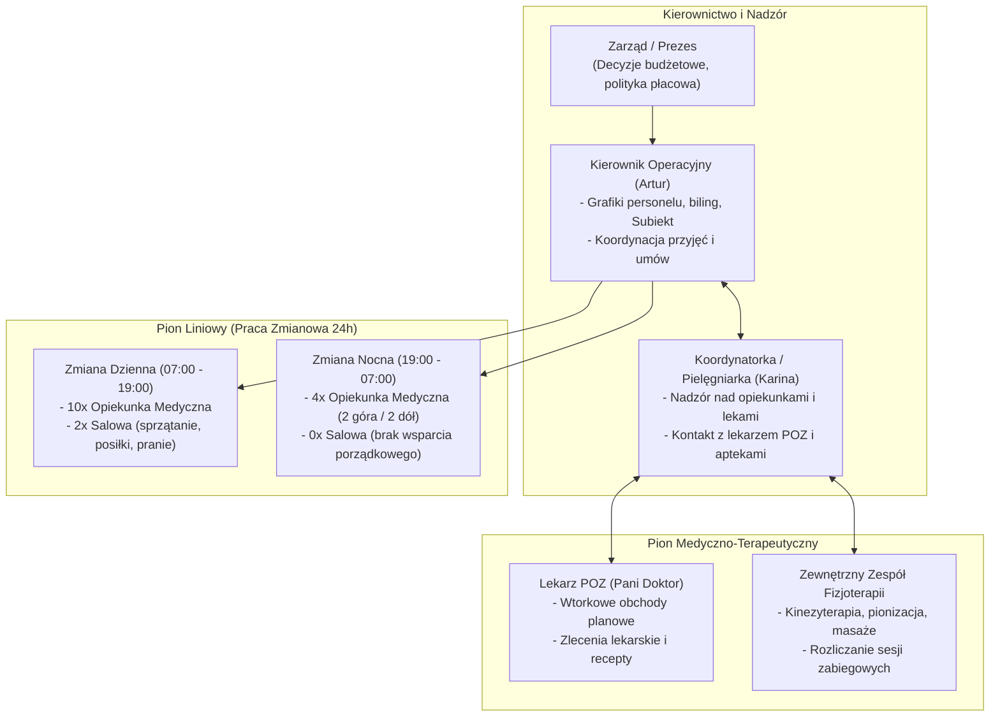
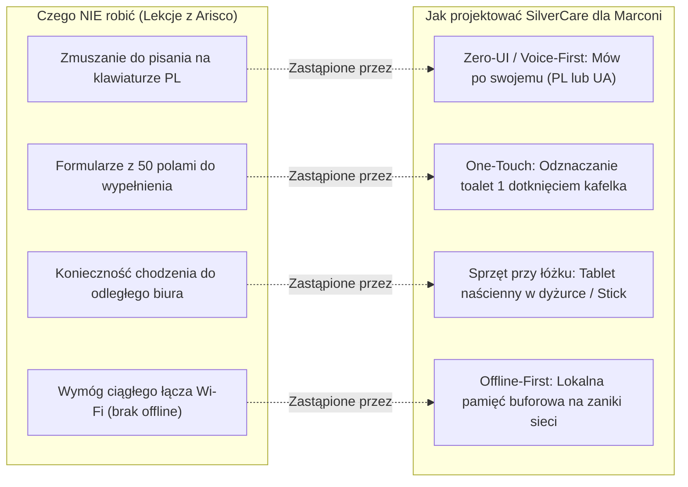

# Specyfikacja: Struktura Zespołu, Grafikowanie Kadr i Case Study Porażki Systemu „Arisco”

**Lokalizacja obiektu:** Dom Opieki Seniora „Marconi”  
**Rola analityczna:** Starszy Analityk Biznesowy & Doradca ds. Transformacji Cyfrowej  
**Status dokumentu:** Zatwierdzona Analiza Organizacyjna i Wytyczne Wdrożeniowe UX  

---

## 1. Struktura Organizacyjna i Podział Ról

W Domu Opieki „Marconi” struktura personelu została zoptymalizowana pod kątem minimalizacji kosztów operacyjnych, co przy obłożeniu rzędu 100–140 pensjonariuszy tworzy napięty bilans roboczogodzin.

---

## 2. Układanie Grafiku Pracy („Koncert Życzeń”) i Wąskie Gardła Kadrowe

### 2.1. Procedura Tworzenia Grafiku
Tworzenie grafiku miesięcznego dla personelu opiekuńczego jest procesem w pełni manualnym, prowadzonym przez kierownika Artura z miesięcznym wyprzedzeniem (np. grafik na listopad powstaje w połowie października):
* **Faza zbierania próśb („Karteczki z pobożnymi życzeniami”):** Opiekunki składają karteczki z dniami, w których nie mogą pracować (zjazdy w zaocznych szkołach medycznych, wizyty lekarskie, zaplanowane urlopy kodeksowe).
* **Faza nanoszenia ograniczeń (Krzyżyki):** Artur nanosi ograniczenia do papierowej siatki grafiku:
  > *„Zbieram to, co określam jako pobożne życzenia albo koncert życzeń – karteczka, na której wszyscy piszą: tu mam szkołę, tu lekarza, tu urlop... Układam od razu te krzyżyki, gdzie kto nie może, no a później dowalam wszystkim na maksa, bo brakuje tych rąk. I wisi taki na bólach zrodzony grafik przez cały miesiąc w dyżurce.”*
* **Wymóg elastyczności dyżurowej:** Część opiekunek dojeżdża z daleka i preferuje dyżury w schemacie doba pracy / 2 dni przerwy. Grafik podlega ciągłym odręcznym korektom z powodu nagłych absencji chorobowych.

### 2.2. Fluktuacja Kadr (~15%) i Dysproporcje Płacowe
Głównym problemem strukturalnym Marconi jest **wysoka rotacja personelu liniowego**:
1. **Nożyce płacowe sektor prywatny vs publiczny:** Szpitale publiczne oferują opiekunkom medycznym wynagrodzenia zasadnicze wyższe nawet o 50–100% względem stawek w domach opieki. Marconi pełni nieformalną rolę „szkoły zawodowej”:
   > *„Opiekunka medyczna w szpitalu zarabia o dwa razy więcej. Dlatego jest ta ciągła rotacja w Marconi – kiedy opiekunka niedoświadczona po szkole przychodzi, ona tu się uczy, zdobywa pewności siebie i idzie dalej do szpitala.”*
2. **Brak bufora chorobowo-urlopowego:** Zespół nie posiada personelu rezerwowego. Każde nagłe zwolnienie lekarskie L4 oznacza konieczność ściągania pracownic z dni wolnych lub pracę w obsadzie zredukowanej poniżej progu bezpieczeństwa.
3. **Sezonowe epidemie (Grypa / Jelitówka):** W okresie jesienno-zimowym infekcje wirusowe kładą jednocześnie pensjonariuszy i opiekunki, co paraliżuje grafik.

### 2.3. Bariera Językowa i Emocjonalna
Istotną część zespołu opiekuńczego stanowią pracownice pochodzące z Ukrainy. Charakteryzują się one wysoką kulturą opiekuńczą i empatią, jednak:
* Formułowanie pisemnych sprawozdań medycznych po polsku po 12h wyczerpującego dyżuru budzi w nich lęk przed popełnieniem błędu ortograficznego lub gramatycznego.
* W obawie przed krytyką pracownice ograniczają wpisy w zeszycie do haseł jednozdaniowych (*„spokojnie”*, *„pampers zmieniony”*), pomijając istotne obserwacje zachowań seniorów.

---

## 3. Case Study: Dlaczego Zawiódł Poprzedni System Komercyjny („Arisco”)

W wywiadzie kierownictwo szczegółowo zrelacjonowało wcześniejsze nieudane podejście do wdrożenia rynkowego oprogramowania opiekuńczego **Arisco** (zapisywanego fonetycznie w transkrypcji jako *„Arisco przez C”*). System został zakupiony, wdrożony, a po krótkim czasie całkowicie odrzucony przez personel i zarząd, zmuszając placówkę do powrotu do papierowych brulionów i Excela.

Analiza przyczyn tej porażki stanowi **kluczowe wytyczne projektowe dla platformy SilverCare**:

### 1. Brak jakiejkolwiek wartości dla personelu liniowego (Brak „WIFM” – What's In It For Me?)
* System Arisco zaprojektowano z perspektywy księgowego i urzędnika, a nie opiekunki przy łóżku podopiecznego.
* Wymuszał on żmudne, wieloklikowe wprowadzanie dziesiątek rubryk ewidencyjnych (pesel, stopień pokrewieństwa, historia orzeczeń), nie dając opiekunce w zamian żadnej pomocy w jej codziennym, fizycznym trudzie (nie przypominał o lekach, nie ułatwiał toalet, nie redukował biegania po schodach). Personel traktował go wyłącznie jako „karę i stratę czasu”.

### 2. Bariera językowa i technologiczna personelu
* Tradycyjny interfejs webowy/okienkowy wymagał sprawnego pisania na klawiaturze w języku polskim.
* Jak dosadnie podsumował to kierownik Artur:
  > *„Nie napiszą Ci. Ukrainki po polsku nie napiszą Ci sprawozdania z całego dnia do systemu na komputerze!”*
* Brak modułu rozpoznawania mowy lub choćby wielojęzyczności skazał system na natychmiastowy bojkot.

### 3. Niedostosowanie do infrastruktury obiektu (Brak komputerów i martwe strefy)
* W Domu Opieki Marconi na oddziałach opiekuńczych nie ma stanowisk komputerowych (komputery znajdują się tylko w odległym biurze kierownika i recepcji).
* Grube stropy i żelbetowe ściany budynku tworzą martwe strefy bez zasięgu sieci Wi-Fi.
* Zmuszanie opiekunki, która ma pod opieką 25 osób, do opuszczania sal i wędrowania do biura na parterze, by „poklikać w komputerze”, zakończyło się natychmiastowym fiaskiem operacyjnym.

### 4. Brak dedykowanego operatora danych (Decyzja Prezesa)
* Wdrożenie systemu typu Arisco wymagało zatrudnienia pracownika na etacie „data entry operatora”, który przepisywałby papierowe dokumenty 30 rotujących mieszkańców miesięcznie.
* Prezes placówki kategorycznie odmówił zwiększenia kosztów stałych o kolejny etat administracyjny:
  > *„Prezes powiedział, że nie zatrudni nikogo do wklepywania danych. A Karina i dziewczyny nie mają na to czasu.”*
* Bez automatyzacji wprowadzania danych system oparty na manualnym formularzu stał się pustą wydmuszką.

---

## 4. Wytyczne Projektowe i Zasady UX dla Platformy SilverCare

Aby uniknąć losu systemu Arisco, platforma **SilverCare dla Marconi** musi bezwzględnie spełniać poniższe aksjomaty architektoniczne i ergonomiczne:

1. **Aksjomat 1: Voice-First & Zero-UI (Mów, nie pisz):**
   * Żadna opiekunka nie może być zmuszana do pisania raportów na klawiaturze. Raportowanie odbywa się przez naciśnięcie przycisku i wypowiedzenie notatki w języku ojczystym (ukraińskim lub polskim).
   * Silnik Whisper + LLM bierze na siebie całą pracę transkrypcji, korekty gramatycznej, tłumaczenia i ekstrakcji encji medycznych.
2. **Aksjomat 2: Reguła 1 Dotknięcia (One-Touch Action):**
   * Interfejs tabletowy w dyżurce musi bazować na dużych kafelkach dotykowych (min. 64x64 px), czytelnych z odległości 1 metra.
   * Odznaczenie wymiany pampersa, posiłku czy pomiaru ciśnienia nie może wymagać więcej niż jednego kliknięcia.
3. **Aksjomat 3: Architektura Offline-First:**
   * Urządzenia rejestrujące (np. M5StickC PLUS2 lub tablety dyżurki) muszą buforować dane w pamięci lokalnej (LittleFS / IndexedDB) i automatycznie synchronizować się z chmurą w momencie odzyskania zasięgu Wi-Fi.
4. **Aksjomat 4: Zero Dodatkowej Administracji:**
   * System nie może generować potrzeby zatrudnienia operatora danych. Dokumenty (dowód, deklaracja POZ) są wprowadzane przez zrobienie zdjęcia telefonem/tabletem w 10 sekund (OCR i ekstrakcja danych do profilu E-Teczki).

