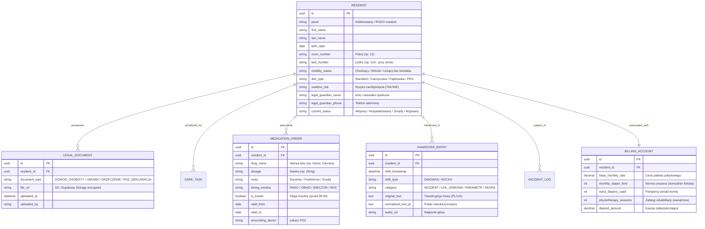

# Specyfikacja: Cyfrowa Karta Podopiecznego (E-Teczka Seniora) i Architektura Platformy

**Lokalizacja obiektu:** Placówka Referencyjna A  
**Rola analityczna:** Starszy Analityk Biznesowy & Architekt Rozwiązań Opiekuńczych  
**Status dokumentu:** Zatwierdzona Specyfikacja Modułu Centralnego (Single Source of Truth)  

---

## 1. Cel i Rola Modułu w Ekosystemie SilverCare

W tradycyjnym modelu funkcjonowania Placówki Referencyjnej A wiedza o mieszkańcu jest rozproszona pomiędzy papierowe teczki przechowywane w szafach administracji, odręczne karty zleceń lekarskich, pliki Excel Kierownika Operacyjnego oraz pamięć personelu. W efekcie opiekunka na sali nie ma dostępu do informacji o alergiach, zaleceniach dietetycznych czy ryzyku zachłyśnięcia, a przy nagłym incydencie (zasłabnięcie, zgon, wyjaśnienia z rodziną) konieczne jest fizyczne poszukiwanie dokumentów.

**Cyfrowa Karta Podopiecznego (E-Teczka Seniora)** stanowi serce platformy SilverCare. Jest to centralne, zintegrowane repozytorium gromadzące pełen profil formalno-prawny, medyczny, opiekuńczy i behawioralny seniora, zasilające wszystkie procesy pochodne:
* **Moduł Grafikowania (Proces 1):** generowanie harmonogramu toalet, leków, kąpieli i posiłków na bazie profilu podopiecznego.
* **Terminal Raportowania Głosowego AI (Proces 2):** przypisywanie nagranych notatek głosowych i alertów do karty konkretnego seniora.
* **Moduł Bilingu i Subiekta (Proces 3):** ewidencja pakietu umownego, ponadnormatywnych pampersów i zabiegów fizjoterapii.
* **Workflow Obsługi Zgonu (Proces 5):** natychmiastowe udostępnienie skanu dowodu osobistego lekarzowi oraz automatyczne wygaszenie zleceń.

---

## 2. Diagram Architektury Danych E-Teczki Seniora

---

## 3. Struktura Merytoryczna Karty Podopiecznego

### 3.1. Moduł Identyfikacyjny i Opiekuńczy (Profil Mieszkańca)
1. **Podstawowe dane osobowe:** Imię, nazwisko, data urodzenia, numer PESEL (z maskowaniem na ekranach ogólnych w dyżurce dla zgodności z RODO).
2. **Lokalizacja fizyczna w obiekcie:** Przypisany oddział (z 5 oddziałów placówki), numer pokoju oraz numer łóżka.
3. **Stopień samodzielności i mobilności:**
   * *Osoba chodząca samodzielnie* (opieka podstawowa),
   * *Osoba poruszająca się na wózku* (asysta przy wstawaniu i toalecie),
   * *Osoba trwale leżąca / spastyczna* (wymóg repozycji przeciwodleżynowej co 2h, toaleta łóżkowa, kąpiel w asyście 2–6 osób),
   * *Osoba leżąca bez kontaktu / oddział opieki wzmożonej*.
4. **Opiekunowie prawni i kontakty alarmowe:** Dane osoby upoważnionej do reprezentacji, telefony kontaktowe, stopień pokrewieństwa, upoważnienie do podejmowania decyzji formalnych.

### 3.2. Repozytorium Cyfrowych Skanów Dokumentacji (Bezpieczny Sejf Dokumentów)
Dostępne natychmiast na tablecie dyżurki bez konieczności otwierania fizycznych szaf:
* **Kserokopia / Skan Dowodu Osobistego:** Bezwzględnie wymagana przez lekarza POZ / NiŚOZ przy procedurze stwierdzenia zgonu i wystawieniu Karty Zgonu.
* **Umowa z domem opieki z załącznikami:** Wybrany pakiet opiekuńczy, ustalony limit pampersów (4 szt./doba), zgody formalne.
* **Deklaracja wyboru lekarza POZ:** Potwierdzenie przypisania seniora do przychodni współpracującej z placówką (obchody wtorkowe).
* **Orzeczenia o stopniu niepełnosprawności i wypisy szpitalne:** Historia zdiagnozowanych schorzeń, zaleceń poszpitalnych i zabiegów.

### 3.3. Plan Opieki i Gospodarka Lekowa
* **Karty zleceń lekarskich:** Aktualizowane cyfrowo po wtorkowym obchodzie lekarza POZ.
* **Rozkład leków dobowych (System Kasetkowy):**
  * Mieszkańcy przyjmują średnio po 10–15 leków na dobę.
  * System wspiera proces przygotowywania kasetek na 2 dni do przodu:
    * Okno Poranne (08:30) – po śniadaniu,
    * Okno Obiadowe (13:30) – po obiedzie,
    * Okno Wieczorne (17:30) – po kolacji,
    * Okno Nocne (20:00–21:00) – leki nasenne, wyciszające (np. Ketrel), iniekcje przeciwzakrzepowe (Clexane).
* **Ścisły rygor insuliny:** Wyodrębnienie zleceń podania insuliny podskórnej – bezwzględny wymóg realizacji do godziny **09:00** (bezpośrednio przed wydaniem śniadania).
* **Zalecenia żywieniowe:** Standardowa / Cukrzycowa / Papkowata (miksowana) / Dojelitowa (sonda żołądkowa lub gastrostomia odżywcza PEG).
* **Ryzyko zachłyśnięcia:** Wyraźny graficzny znacznik na profilu (wymóg zagęszczania płynów preparatami typu Resource ThickenUp, karmienie w pozycji wysokiej pół-Fowlera).

### 3.4. Dziennik Skóry i Profilaktyka Odleżynowa
* **Stopień ryzyka w skali Norton / Waterlow:** Ewidencja ryzyka odleżyn z karty lekarskiej.
* **Mapa odleżyn i ran:** Wizualna mapa ciała (kość ogonowa, pośladki, biodra, pięty, łopatki) z odnotowywaniem stadium odleżyny (I–IV stopień wg NPUAP/EPUAP).
* **Zlecenia specjalistycznych opatrunków:** Opatrunki hydrokoloidowe, piankowe, ze srebrem, zalecenia częstotliwości zmiany.

### 3.5. Dziennik Zdarzeń i Handover Logbook
Zestawienie chronologiczne wszystkich zdarzeń zarejestrowanych przez terminale głosowe lub ręcznie:
* Odmowy przyjęcia leków (wraz z informacją o powiadomieniu rodziny lub ponowieniu próby),
* Epizody pobudzenia demencyjnego, niepokój nocny, próby forsowania barierek łóżka,
* Historia pomiarów parametrów życiowych (ciśnienie skurczowe/rozkurczowe, glikemia, temperatura, saturacja).

---

## 4. Uprawnienia Dostępowe (RBAC) i Ochrona Danych (RODO)

Ze względu na wrażliwy charakter danych o zdrowiu (art. 9 RODO), dostęp do E-Teczki podlega ścisłej kontroli ról:

| Rola w Obiekcie | Profil i Dane Podstawowe | Skany Dokumentów (Dowód, Umowa) | Zlecenia Lekarskie i Leki | Raporty Głosowe i Incydenty | Biling i Fakturowanie |
| :--- | :--- | :--- | :--- | :--- | :--- |
| **Salowa** | Odczyt (Imię, pokój, dieta) | Brak dostępu | Brak dostępu | Zgłaszanie głosem | Brak dostępu |
| **Opiekunka Medyczna** | Pełny odczyt / edycja parametrów | Odczyt skanu dowodu (przy zgonie) | Odczyt i odznaczanie podania | Zgłaszanie i odczyt | Rejestracja pampersów >4 |
| **Koordynatorka Opieki** | Pełny odczyt i edycja | Pełny odczyt | Pełny odczyt i edycja | Pełny dostęp i zatwierdzanie | Odczyt |
| **Lekarz POZ** | Pełny odczyt medyczny | Odczyt dowodu / orzeczeń | Wystawianie i zmiana zleceń | Odczyt historii medycznej | Brak dostępu |
| **Kierownik Operacyjny** | Pełny dostęp administracyjny | Pełny dostęp | Odczyt nadzorczy | Pełny dostęp i audyt | Pełny dostęp (eksport Subiekt) |
| **Fizjoterapeuta Zewn.** | Odczyt (Imię, pokój, sprawność) | Brak dostępu | Odczyt zaleceń ruchowych | Wprowadzanie wpisów z sesji | Wprowadzanie zrealizowanych sesji |

---

## 5. Korzyści Wdrożeniowe Cyfrowej Karty Podopiecznego

1. **Błyskawiczny dostęp do informacji:** Zamiast biegania po schodach do biura, opiekunka uzyskuje pełne dane o podopiecznym w 3 sekundy na tablecie w dyżurce.
2. **Eliminacja błędów przy rotacji personelu:** Nowo zatrudniona opiekunka od razu widzi, który mieszkaniec wymaga zagęszczania płynów, który ma cukrzycę, a który próbuje wychodzić przez barierki w nocy.
3. **Pewność formalna w procedurze zgonu:** Kserokopia dowodu osobistego jest zawsze dostępna cyfrowo dla lekarza pogotowia/NiŚOZ o godzinie 03:00 w nocy bez konieczności budzenia administracji i otwierania szaf biurowych.
4. **Ciągłość opieki:** Wszystkie zalecenia lekarza POZ z wtorkowego obchodu są natychmiast widoczne dla zmian nocnych i weekendowych.
