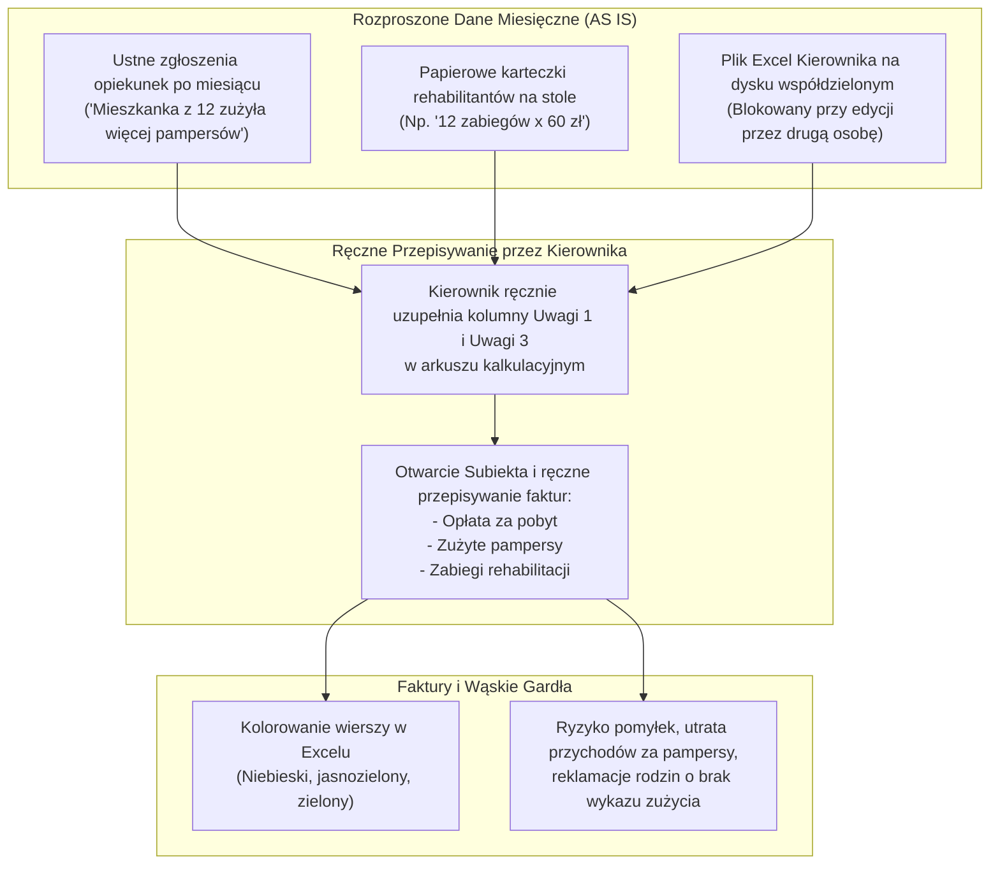
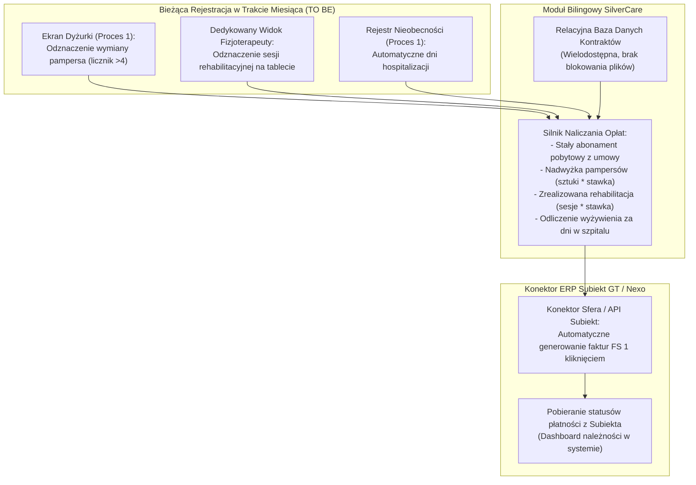

# Specyfikacja Procesu 3: Miesięczne Fakturowanie i Rozliczanie Zużytych Materiałów i Opieki (ERP Subiekt)

**Lokalizacja obiektu:** Placówka Referencyjna A  
**Rola analityczna:** Starszy Analityk Biznesowy & Inżynier Systemowy  
**Status dokumentu:** Zatwierdzona Specyfikacja Wymagań i Architektury Procesu  

---

## 1. Cel i Zakres Procesu

Celem przeprojektowania procesu jest zastąpienie podatnego na błędy, manualnego arkusza Excel oraz papierowych karteczek od podwykonawców zautomatyzowanym modułem bilingowym zintegrowanym bezpośrednio z systemem ERP **Subiekt GT / Nexo**.

Kluczowe obszary objęte automatyzacją:
1. **Wielodostępowa ewidencja kontraktów:** Likwidacja blokowania arkusza kalkulacyjnego przy jednoczesnej pracy Kierownika Operacyjnego, Koordynatorki Opieki / recepcji i księgowości.
2. **Automatyczne rozliczanie materiałów chłonnych (Pampersy >4 szt./doba):** Przejście z ustnych zgłoszeń personelu na precyzyjny, cyfrowy licznik zużycia.
3. **Cyfryzacja zleceń fizjoterapii zewnętrznej:** Zastąpienie papierowych karteczek pozostawianych na stole cyfrową ewidencją zabiegów przez rehabilitantów.
4. **Automatyczne uwzględnianie hospitalizacji:** Dynamiczne pomniejszanie opłat za wyżywienie za dni spędzone w szpitalu.
5. **Generowanie faktur 1 kliknięciem w Subiekcie:** Pełna automatyzacja fakturowania bez ręcznego przepisywania danych.

---

## 2. Model Procesu Obecnego (AS IS)

### 2.1. Charakterystyka Pracy w Excelu i Subiekcie
* **Plik Excel na dysku współdzielonym:** Kierownik Operacyjny prowadzi arkusz o strukturze kolumn:
  `PESEL` | `Nazwisko i Imię` | `Opiekun Prawny` | `Kwota za pobyt` | `Pakiet` | `Pobyt od` | `Pobyt do` | `Adres zamieszkania` | `Inny adres` | `Uwagi 1 (materiały i pampersy)` | `Uwagi 2 (od zarządu / księgowości)` | `Uwagi 3 (rehabilitacje)` | `Źródło` | `Typ pobytu` | `Czas trwania` | `Miesiąc przyjęcia`.
* **Problem blokady pliku:** Gdy Koordynatorka Opieki / recepcja edytuje dane nowo przyjętego seniora, Kierownik Operacyjny nie może wystawiać faktur z uwagi na blokadę zapisu pliku sieciowego.
* **Zasada 4 pampersów i zgłoszenia ustne:** Standardowa umowa gwarantuje 4 pampersy na dobę. Jeżeli senior zużywa 6–8 sztuk, opiekunki po upływie miesiąca przychodzą do Kierownika Operacyjnego i zgłaszają to ustnie z pamięci. Rodzi to ryzyko pominięcia opłat lub nieporozumień z rodzinami, które oczekują szczegółowego wykazu zużycia.
* **Papierowe karteczki rehabilitacji:** Zewnętrzna spółka fizjoterapeutów po zakończeniu miesiąca zostawia na biurku odręcznie zapisane kartki (np. *„Pan Kowalski: 12 zabiegów x 60 zł = 720 zł”*). Kierownik Operacyjny ręcznie przepisuje te kwoty do kolumny `Uwagi 3`.
* **Manualne fakturowanie w Subiekcie:** Kierownik otwiera Subiekta, ręcznie wyszukuje kontrahenta, przepisuje pozycje: opłata stała za pobyt, dopłata za pieluchomajtki oraz rehabilitacja, generuje fakturę FS, drukuje ją do wysyłki tradycyjnej lub wysyła PDF mailem, a wiersz w Excelu oznacza kolorem:
  * Niebieski – faktura wystawiona,
  * Jasnozielony – w trakcie uzgadniania / wysłana,
  * Zielony – opłacona (wyciąg bankowy sprawdzony ręcznie).

### 2.2. Diagram Procesu AS IS

---

## 3. Model Procesu Docelowego (TO BE)

### 3.1. Architektura Przepływu Bilingowego

---

## 4. Wymagania Funkcjonalne Modułu Finansowego

### 4.1. Wielodostępowa Baza Danych Kontraktów (Zastąpienie Excela)
* Jednoczesna edycja przez Kierownika Operacyjnego, Koordynatorkę Opieki i księgowość bez konfliktów blokad.
* Pełna historia zmian stawek, aneksów umownych i rabatów.
* Automatyczne powiadomienia o zbliżającym się końcu umów terminowych.

### 4.2. Automatyczny Licznik Materiałów Chłonnych
* Każdy podopieczny ma w umowie wpisany dobowy limit materiałów (domyślnie **4 sztuki na dobę**).
* Wymiany odznaczane przez opiekunki w module Grafikowania (Proces 1) sumują się w skali doby.
* Każda 5., 6. i kolejna sztuka w danej dobie automatycznie trafia do rejestru *„Zużycie ponadnormatywne”*.
* W przypadku pytań ze strony rodziny system generuje raport: dokładna data, godzina i identyfikator pracownika, który dokonał wymiany pampersa.

### 4.3. Moduł Fizjoterapii Zewnętrznej
* Zewnętrzni rehabilitanci otrzymują dedykowany, uproszczony dostęp tabletowy (lub logowanie kodem PIN).
* Widzą listę mieszkańców zakwalifikowanych do rehabilitacji.
* Po skończonej sesji odznaczają wykonanie zabiegu (np. kinezyterapia, pionizacja, masaż).
* Brak konieczności ręcznego wypisywania papierowych kartek i podliczania na kalkulatorze.

### 4.4. Korekta za Dni Hospitalizacji
* Zgodnie z regulaminem placówki, w przypadku pobytu podopiecznego w szpitalu rodzina zachowuje rezerwację łóżka, lecz placówka odlicza dzienną stawkę żywieniową (tzw. wsad do kotła).
* System automatycznie oblicza liczbę pełnych dni zarejestrowanego statusu `HOSPITALIZACJA` i wprowadza odpowiednią pozycję korygującą *„Odliczenie wyżywienia za pobyt w szpitalu”* na fakturze miesięcznej.

### 4.5. Dwukierunkowa Integracja z Subiekt GT / Nexo
* **Eksport dokumentów:** Generowanie kompletu faktur sprzedaży (FS) za dany miesiąc jednym kliknięciem poprzez interfejs Sfery lub pliki wymiany epp/XML.
* **Mapowanie pozycji na fakturze:**
  1. `Usługa opiekuńczo-bytowa (Pakiet standard/wzmożony)` – stawka zwolniona z VAT (ZW).
  2. `Materiały chłonne ponadnormatywne (X sztuk)` – stawka 8% VAT.
  3. `Rehabilitacja ruchowa indywidualna (Y zabiegów)` – stawka ZW / 8%.
  4. `Korekta żywieniowa (hospitalizacja Z dni)` – pozycja ujemna.
* **Rozliczenie kaucji gwarancyjnej:** Automatyczne wystawianie dokumentu rozliczenia kaucji pobranej w dniu przyjęcia w przypadku zgonu podopiecznego lub rozwiązania umowy.

---

## 5. Korzyści Biznesowe i Zwrot z Inwestycji (ROI)

1. **Oszczędność czasu kierownictwa:** Skrócenie czasu fakturowania miesięcznego z **2–3 pełnych dni roboczych** do **15 minut** (weryfikacja zestawienia i 1 kliknięcie eksportu do Subiekta).
2. **Uszczelnienie przychodów za materiały chłonne:** Odzyskanie szacunkowo **3 000 – 5 000 PLN miesięcznie** z tytułu pampersów zużytych ponad limit, które dotychczas nie były zgłaszane przez personel lub były pomijane z braku szczegółowej ewidencji.
3. **Koniec z blokowaniem plików:** Płynna współpraca recepcji i kierownictwa bez konfliktów edycyjnych.
4. **Transparentność i zaufanie rodzin:** Gotowe zestawienie wykonanych zabiegów fizjoterapii i toalet dołączane do e-faktury eliminuje telefony reklamacyjne i opóźnienia w płatnościach.
