# Specyfikacja Harmonogramu Dobowego 24h i Organizacji Pracy w Placówce Referencyjnej A

**Lokalizacja obiektu:** Placówka Referencyjna A  
**Rola analityczna:** Starszy Analityk Biznesowy & Inżynier Systemowy  
**Status dokumentu:** Zatwierdzona Chronologia Doby i Analiza Obciążeń Operacyjnych  

---

## 1. Wprowadzenie i Kontekst Operacyjny 24h

Placówka Referencyjna A funkcjonuje w systemie ciągłym 24/7/365, w dwóch równych, 12-godzinnych zmianach opiekuńczych:
* **Zmiana Dzienna (Dniówka):** 07:00 – 19:00 (Obsada: **10 opiekunek medycznych** + **2 salowe**).
* **Zmiana Nocna (Nocka):** 19:00 – 07:00 (Obsada: **4 opiekunki medyczne** + **0 salowych**).

Pomiędzy zmianami występują dwie 45-minutowe „zakładki raportowe” (06:30–07:15 oraz 18:30–19:15), podczas których dochodzi do bezpośredniego przekazania dyżuru (handoveru), wymiany informacji o incydentach i zleceniach lekarskich.

Niniejszy dokument prezentuje szczegółową chronologię doby, analizę krytycznych spiętrzeń operacyjnych oraz wytyczne dla systemu SilverCare wspierające płynność pracy personelu.

---

## 2. Diagram Pokrycia Doby i Nakładania się Zmian (Mermaid Gantt)

```mermaid
gantt
    title Pokrycie Doby przez Zmiany i Zakładki Raportowe (Format 24h)
    dateFormat HH:mm
    axisFormat %H:%M

    section Zmiana Dzienna
    Dniówka (10 opiekunek + 2 salowe)     :active, d1, 07:00, 19:00

    section Zmiana Nocna
    Nocka Poranna (4 opiekunki)            :n1, 00:00, 07:00
    Nocka Wieczorna (4 opiekunki)          :n2, 19:00, 24:00

    section Punkty Styku (Handover)
    Poranny Handover (Nocka zdaje Dniówce) :crit, h1, 06:30, 07:15
    Wieczorny Handover (Dniówka zdaje Nocce):crit, h2, 18:30, 19:15

    section Szczyty Operacyjne
    Poranne Spiętrzenie (Toalety + Leki)   :done, s1, 07:00, 09:30
    Blok Zabiegowy (Kąpiele + Fizjo + POZ) :done, s2, 10:00, 13:00
    Wieczorna Toaleta i Wyciszanie         :done, s3, 18:00, 22:00
    Czuwanie Nocne (Okno Nocne)            :done, s4, 23:00, 05:00
```

---

## 3. Chronologiczny Rozkład Doby Minuta po Minucie

### Faza I: Poranek, Toalety i Leki (06:00 – 10:00)

| Przedział Czasowy | Nazwa Czynności | Obsada | Opis Działań i Reguły Biznesowe |
| :--- | :--- | :--- | :--- |
| **06:00 – 06:30** | Pobudka i Finał Czuwania Nocnego | 4 Opiekunki Nocne | Gaszenie oświetlenia nocnego, kontrola stanu podopiecznych leżących, przygotowanie brudnopisu raportu z nocy. |
| **06:30 – 07:15** | **Poranny Handover (Odprawa)** | 4 Nocka + 10 Dniówka | Przekazanie dyżuru (15–45 min). Zdanie incydentów nocnych, skoków ciśnienia, gorączek i odmów leków. *W TO BE: podsumowanie mowy AI na monitorze dyżurki.* |
| **07:00 – 08:30** | **1. Toaleta Poranna & 1. Wymiana Pampersów** | 10 Opiekunek Dziennych | Mycie twarzy, rąk, toaleta intymna, pierwsza wymiana materiałów chłonnych, inspekcja skóry i odleżyn, ubieranie podopiecznych. |
| **07:30 – 08:30** | **Pomiary Parametrów & Insulina** | Wyznaczone Opiekunki | Pomiary cukru glukometrem, RR, saturacja, temperatura. **SZTYWNY RYGOR:** Podanie insuliny podskórnej do godz. 09:00 (przed posiłkiem). |
| **08:00 – 09:30** | **Śniadanie i Karmienie Podopiecznych** | 2 Salowe + Opiekunki | Odbiór wózków cateringowych przez salowe, roznoszenie tac na sale, asysta i łyżkowe karmienie niesamodzielnych seniorów. |
| **08:30 – 09:30** | **Poranne Rozdawanie Leków** | Opiekunki Dzienne | Wydawanie leków z przygotowanych kasetek. Opiekunka asystuje przy połykaniu tabletek (zapobieganie wypluwaniu lub gromadzeniu leków). |
| **09:30 – 10:00** | Sprzątanie Pośniadaniowe & Wietrzenie | 2 Salowe | Zbiórka brudnych naczyń do zmywarek, dezynfekcja stolików przyłóżkowych, intensywne wietrzenie sal i korytarzy. |

---

### Faza II: Blok Zabiegowy i Południe (10:00 – 14:00)

| Przedział Czasowy | Nazwa Czynności | Obsada | Opis Działań i Reguły Biznesowe |
| :--- | :--- | :--- | :--- |
| **10:00 – 13:00** | **Blok Zabiegowy: Kąpiele Planowe** | 2–6 Opiekunek | Kąpiele w łazienkach centralnych wg harmonogramu. Mieszkańcy chodzący: 1 opiekunka. Podopieczni bezwładni/spastyczni: od 2 do 6 opiekunek na osobę. |
| **10:00 – 13:00** | **Rehabilitacja i Fizjoterapia Zewnętrzna** | Zewnętrzni Fizjoterapeuci | Ćwiczenia indywidualne na sali rehabilitacyjnej lub przyłóżkowo (pionizacja, nauka chodu, rotor, masaż). |
| **10:00 – 13:00** | **Wtorkowy Obchód Lekarza POZ** | Lekarz POZ + Koordynatorka | Cotygodniowa wizyta lekarska: badanie osób ze zgłoszeń, wypisywanie recept, kwalifikacja leczenia, zmiana zleceń lekowych. |
| **10:00 – 13:00** | Sprzątanie Generalne i Pralnia | 2 Salowe | Pranie pościeli, mycie podłóg maszynowe, dezynfekcja łazienek, włączanie lamp bakteriobójczych UV w salach zwolnionych. |
| **13:00 – 14:00** | **Obiad i Karmienie Poobiednie** | 2 Salowe + Opiekunki | Wydawanie zup i dań mięsnych z cateringu, karmienie podopiecznych leżących, rozdanie leków obiadowych przez opiekunki. |

---

### Faza III: Popołudnie i Dyżur Wieczorny (14:00 – 19:00)

| Przedział Czasowy | Nazwa Czynności | Obsada | Opis Działań i Reguły Biznesowe |
| :--- | :--- | :--- | :--- |
| **14:00 – 15:00** | **2. Toaleta Dobowa & 2. Wymiana Pampersów** | 10 Opiekunek Dziennych | Druga tura wymiany pampersów, toaleta myjąca, repozycjonowanie podopiecznych leżących w łóżkach (profilaktyka odleżyn). |
| **14:30 – 15:30** | **Rozkładanie Leków na 2 Dni Naprzód** | 1 Opiekunka (dyżurka) | Precyzyjne rozkładanie tabletek do kasetek dobowych z kart zleceń lekarskich dla parteru i piętra. |
| **15:00 – 16:30** | Drzemka Poobiednia / Odwiedziny / Podwieczorek | Mieszkańcy, Salowe | Odpoczynek poobiedni, podwieczorek (kawa, herbata, ciastko, owoce), odwiedziny rodzin w pokojach i ogrodzie. |
| **17:00 – 18:00** | **Kolacja i Karmienie Wieczorne** | 2 Salowe + Opiekunki | Wydawanie kolacji, pomoc w jedzeniu, podanie leków wieczornych przez opiekunki. |
| **18:00 – 19:00** | **3. Toaleta Wieczorna & 3. Wymiana Pampersów** | 10 Opiekunek Dziennych | Trzecia wymiana pampersów, toaleta myjąca, natłuszczanie skóry, przebieranie w piżamy, przygotowanie do spoczynku nocnego. |
| **18:30 – 19:15** | **Wieczorny Handover (Zdanie Nocce)** | 10 Dniówka + 4 Nocka | Przekazanie dyżuru nocy. Wpis do zeszytu niebieskim długopisem, omówienie stanów podgorączkowych i zleceń na noc. |

---

### Faza IV: Noc i Czuwanie Nocne (19:00 – 07:00)

| Przedział Czasowy | Nazwa Czynności | Obsada | Opis Działań i Reguły Biznesowe |
| :--- | :--- | :--- | :--- |
| **19:00 – 22:00** | Dyżur Wieczorny / Leki Nocne / Wyciszanie | 4 Opiekunki Nocne (2 góra / 2 dół) | Podanie leków nasennych, uspokajających (Ketrel), iniekcji przeciwzakrzepowych (Clexane), gaszenie świateł głównych, wyciszanie. |
| **22:00 – 23:00** | **Wieczorny Obchód Nocny** | 4 Opiekunki Nocne | Kontrola bezpieczeństwa: sprawdzenie barierek łóżkowych, suchości pampersów; bezwzględne zakończenie czynności głośnych do 23:00. |
| **23:00 – 04:00** | **Czuwanie Nocne (Okno Nocne)** | 4 Opiekunki Nocne | Czuwanie w dyżurkach i na korytarzach, reakcja na dzwonki przywoławcze, lęki demencyjne i próby wspinania się przez barierki. *(W razie zgonu: obsługa procedury i zaangażowanie 1–2 opiekunek).* |
| **04:00 – 05:00** | **Nocny Obchód & 4. Wymiana Pampersów** | 4 Opiekunki Nocne | Czwarta tura pampersów u podopiecznych leżących, repozycja ułożeniowa seniorów przed porankiem. |
| **05:00 – 06:30** | Pomiary Wczesnoporanne & Raport Nocny | 4 Opiekunki Nocne | Kontrola parametrów u osób wymagających nadzoru, doglądanie wstających seniorów, przygotowanie raportu nocnego do handoveru. |

---

## 4. Analiza Krytycznych Wąskich Gardeł Doby

### 4.1. Poranne Spiętrzenie Operacyjne (07:00 – 09:30)
W ciągu zaledwie 2,5 godziny zespół 10 opiekunek musi wykonać:
* 100 pełnych toalet i wymian pampersów,
* Pomiary cukru i ciśnienia u kilkudziesięciu osób,
* Podanie insuliny przed godz. 09:00,
* Nakarmienie kilkudziesięciu seniorów niesamodzielnych,
* Wydanie porannej porcji leków z kasetek.
Jakiekolwiek opóźnienie w toaletach opóźnia wydawanie śniadania, co z kolei przesuwa wejście salowych ze sprzątaniem i opóźnia blok zabiegowy.

### 4.2. Konflikt Zasobowy w Bloku Zabiegowym (10:00 – 13:00)
Głównym problemem jest jednoczesne nakładanie się:
* Kąpieli planowych osób leżących (angażujących 2–6 opiekunek),
* Przyjścia zewnętrznych fizjoterapeutów,
* Obchodu lekarskiego POZ (wtorki).
Brak centralnego kalendarza w systemie AS IS powoduje, że rehabilitant przychodzi po podopiecznego, który właśnie ma kąpiel, lub lekarz musi czekać na zakończenie zabiegów.

### 4.3. Obciążenie Obsady Nocnej (23:00 – 04:00)
Przy obsadzie **4 opiekunek na 100 mieszkańców i braku salowych**:
* Wystąpienie pojedynczego zgonu, upadku lub pobudzenia mieszkańca z demencją angażuje 1–2 opiekunki, pozostawiając pozostałą część obiektu pod opieką 2 osób.
* Wybudzenie jednego seniora z demencją wywołuje efekt domina na oddziale, stanowiąc krytyczne obciążenie obsady nocnej i wąskie gardło operacyjne przy zdarzeniach nagłych.

---

## 5. Rekomendacje dla Systemu SilverCare

1. **Dashboard Porannego Spiętrzenia:** Widok w dyżurce z wyraźnym odliczaniem czasu do godz. 09:00 dla toalet i insulin, ze wskaźnikiem postępu wykonania kluczowych czynności.
2. **Wspólny Kalendarz Kąpieli i Rehabilitacji:** Moduł blokujący możliwość zaplanowania sesji fizjoterapii w oknie czasowym, w którym dany podopieczny ma przypisaną kąpiel planową.
3. **Zasada `NIGHT_SHIFT_SANITIZATION_DISPATCH`:** Automatyczna ochrona 4 opiekunek nocnych poprzez przerzucenie ciężkich prac dezynfekcyjnych po zgonie na poranną zmianę salowych (godz. 07:00).
