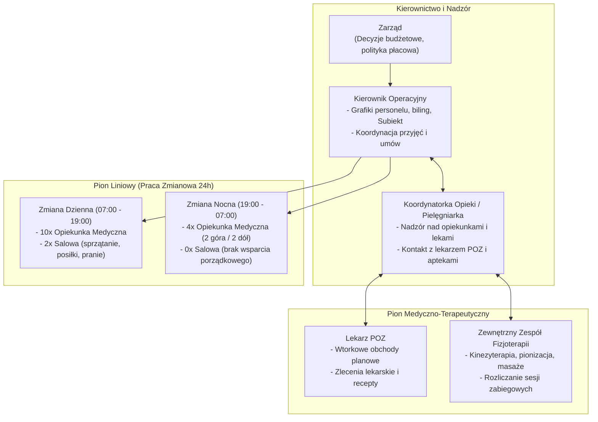
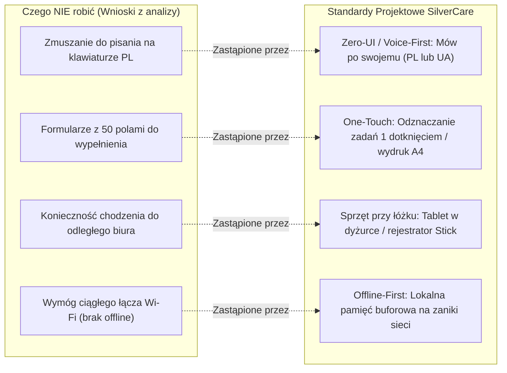

# Specyfikacja: Struktura Zespołu, Grafikowanie Kadr i Case Study Odrzucenia Dotychczasowego Systemu Dziedzinowego

**Lokalizacja obiektu:** Placówka Referencyjna A  
**Rola analityczna:** Starszy Analityk Biznesowy & Doradca ds. Transformacji Cyfrowej  
**Status dokumentu:** Zatwierdzona Analiza Organizacyjna i Wytyczne Wdrożeniowe UX  

---

## 1. Struktura Organizacyjna i Podział Ról

W Placówce Referencyjnej A struktura personelu została zoptymalizowana pod kątem kontroli kosztów operacyjnych, co przy obłożeniu rzędu 100–140 mieszkańców tworzy napięty bilans roboczogodzin.

---

## 2. Układanie Grafiku Pracy i Wąskie Gardła Kadrowe

### 2.1. Procedura Tworzenia Grafiku
Tworzenie grafiku miesięcznego dla personelu opiekuńczego jest procesem w pełni manualnym, prowadzonym przez Kierownika Operacyjnego z miesięcznym wyprzedzeniem:
* **Faza zbierania dyspozycyjności:** Opiekunki składają papierowe karteczki z dniami niedostępności (zjazdy w zaocznych szkołach medycznych, wizyty lekarskie, zaplanowane urlopy kodeksowe).
* **Faza ręcznego równoważenia obsady:** Kierownik Operacyjny nanosi wykluczenia na papierową siatkę grafiku, a następnie ręcznie bilansuje obsadę dzienną i nocną przy ograniczonych zasobach kadrowych. Wygenerowany grafik wisi przez cały miesiąc na tablicy w dyżurce.
* **Wymóg elastyczności dyżurowej:** Część opiekunek dojeżdża z dalszych miejscowości i preferuje dyżury zblokowane. Grafik podlega ciągłym odręcznym korektom z powodu nagłych absencji chorobowych.

### 2.2. Fluktuacja Kadr (~15%) i Dysproporcje Płacowe
Głównym wyzwaniem strukturalnym placówki jest **rotacja personelu liniowego (~15% w skali roku)**:
1. **Różnice płacowe sektor prywatny vs publiczny:** Szpitale publiczne oferują opiekunkom medycznym wynagrodzenia zasadnicze wyższe o 50–100% względem stawek rynkowych w prywatnych domach opieki. W efekcie nowo wykwalifikowane opiekunki po zdobyciu pierwszego doświadczenia zawodowego często przechodzą do sektora szpitalnego.
2. **Brak bufora chorobowo-urlopowego:** Zespół pracuje bez nadwyżki kadrowej. Każde nagłe zwolnienie lekarskie L4 wymaga ściągania pracownic z dni wolnych i szybkiej przebudowy harmonogramu.
3. **Sezonowe infekcje:** W okresie jesienno-zimowym infekcje wirusowe dotykają jednocześnie mieszkańców i personel, utrudniając utrzymanie pełnej obsady.

### 2.3. Bariera Językowa Wielojęzycznego Personelu Opiekuńczego
Istotną część zespołu opiekuńczego stanowią pracownice wielojęzyczne (posługujące się językiem ojczystym UA oraz komunikatywnym językiem polskim). Charakteryzują się one wysokim zaangażowaniem i empatią w bezpośredniej opiece, jednak:
* Formułowanie pisemnych sprawozdań w języku polskim po 12h wyczerpującego dyżuru wiąże się z obawą przed popełnieniem błędów ortograficznych lub gramatycznych.
* Aby uniknąć błędów językowych, pracownice ograniczają wpisy w papierowym zeszycie do krótkich, rutynowych haseł, pomijając szczegółowe obserwacje zachowań seniorów.

---

## 3. Case Study: Dlaczego Zawiódł Dotychczasowy System Dziedzinowy (System ERP/Opiekuńczy)

Podczas badania terenowego kierownictwo szczegółowo omówiło wcześniejsze, nieudane podejście do wdrożenia komercyjnego **Dotychczasowego Systemu Dziedzinowego (Systemu ERP/Opiekuńczego)**. Oprogramowanie zostało zakupione i uruchomione, lecz po krótkim czasie zostało odrzucone przez personel liniowy i kadrę zarządzającą, co zmusiło placówkę do powrotu do papierowych brulionów i arkuszy Excel.

Analiza przyczyn tego niepowodzenia stanowi **kluczowe wytyczne projektowe dla platformy SilverCare**:

### 1. Brak wartości dla personelu liniowego (Brak „WIFM” – What's In It For Me?)
* Dotychczasowy System Dziedzinowy zaprojektowano z perspektywy księgowego i pracownika administracji biurowej, a nie opiekunki przy łóżku podopiecznego.
* Wymuszał on żmudne, wieloklikowe wprowadzanie dziesiątek rubryk ewidencyjnych (PESEL, stopień pokrewieństwa, historia orzeczeń), nie dając opiekunce żadnego wsparcia w jej codziennych obowiązkach (nie ułatwiał organizacji toalet ani przekazywania zmiany). Personel postrzegał system wyłącznie jako dodatkowy obowiązek biurokratyczny.

### 2. Bariera językowa i klawiaturowa
* Tradycyjny interfejs formularzowy wymagał sprawnego pisania na klawiaturze komputera w języku polskim.
* W warunkach wielojęzycznego zespołu opiekuńczego (PL/UA) wymóg samodzielnego redagowania pełnych raportów tekstowych na komputerze okazał się barierą nie do pokonania bez wsparcia głosowego i automatycznego tłumaczenia.

### 3. Niedostosowanie do infrastruktury obiektu (Brak komputerów na salach i martwe strefy Wi-Fi)
* Na oddziałach opiekuńczych nie ma stacjonarnych stanowisk komputerowych (komputery znajdują się wyłącznie w biurze kierownika i recepcji).
* Grube stropy i żelbetowe ściany budynku tworzą strefy bez stabilnego zasięgu sieci Wi-Fi.
* Konieczność opuszczania oddziału (gdzie opiekunka odpowiada za ok. 25 osób) i chodzenia do biura na parterze w celu uzupełnienia formularzy komputerowych okazała się nieakceptowalna operacyjnie.

### 4. Brak dedykowanego etatu administracyjnego do wprowadzania danych
* Utrzymanie tradycyjnego systemu formularzowego przy rotacji 30 mieszkańców miesięcznie wymagałoby wydzielenia dedykowanego etatu administracyjnego („data entry”) do przepisywania dokumentacji papierowej.
* Zarząd placówki wykluczył zwiększenie kosztów stałych o dodatkowy etat biurowy, a Koordynatorka Opieki i personel liniowy nie dysponowali rezerwą czasową na ręczne przepisywanie teczek.

---

## 4. Wytyczne Projektowe i Zasady UX dla Platformy SilverCare

Aby wyeliminować bariery, które doprowadziły do odrzucenia Dotychczasowego Systemu Dziedzinowego, platforma **SilverCare** opiera się na czterech aksjomatach architektonicznych i ergonomicznych:

1. **Aksjomat 1: Voice-First & Zero-UI (Mów, nie pisz):**
   * Żadna opiekunka nie jest zmuszana do pisania raportów na klawiaturze. Raportowanie odbywa się przez naciśnięcie przycisku i wypowiedzenie notatki w języku ojczystym (PL lub UA).
   * Silnik Whisper + LLM realizuje transkrypcję, korektę językową, tłumaczenie i strukturyzację faktów.
2. **Aksjomat 2: Reguła 1 Dotknięcia i Hybryda z Wydrukiem A4:**
   * Interfejs w dyżurce bazuje na czytelnych elementach dotykowych oraz wydruku planu pracy A4 dla zmiany.
   * Rozliczenie zadań na zmianie odbywa się jednym kliknięciem lub na podstawie notatek głosowych.
3. **Aksjomat 3: Architektura Offline-First:**
   * Urządzenia rejestrujące (M5StickC PLUS2 lub aplikacja w dyżurce) buforują dane w pamięci lokalnej (LittleFS / IndexedDB) i automatycznie synchronizują się z chmurą po odzyskaniu zasięgu Wi-Fi.
4. **Aksjomat 4: Zero Dodatkowej Administracji:**
   * System nie generuje potrzeby zatrudnienia operatora danych. Dokumenty są dołączane w formie cyfrowych skanów/zdjęć bezpośrednio do E-Teczki podopiecznego.
