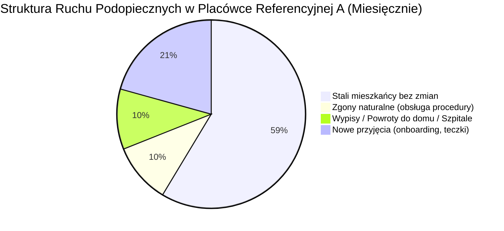

# Placówka Referencyjna A – Dokumentacja Product Discovery

**Projekt:** SilverCare – Cyfrowa Transformacja Placówek Opiekuńczych  
**Obiekt referencyjny:** Placówka Referencyjna A (duży prywatny dom opieki długoterminowej i rehabilitacji)  
**Lokalizacja:** Polska (region dolnośląski)  
**Limit miejsc:** 139 miejsc statutowych (obłożenie średnie ~100–120 stałych mieszkańców, 5 oddziałów)  
**Status dokumentacji:** Kompletne opracowanie analizy przedwdrożeniowej, procesów AS IS, modeli TO BE oraz backlogu wdrożeniowego  

---

## 1. Wprowadzenie i Cel Opracowania

Niniejszy katalog stanowi kompletny zbiór dokumentacji z etapu **Product Discovery** przeprowadzonego w Placówce Referencyjnej A. Opracowanie powstało na bazie wielogodzinnych wywiadów pogłębionych z kadrą zarządzającą (Kierownik Operacyjny), Koordynatorką Opieki, personelem opiekuńczym (opiekunki medyczne, w tym zespół wielojęzyczny PL/UA), personelem pomocniczym (salowe) oraz współpracującymi fizjoterapeutami.

Celem dokumentacji jest:
1. **Zmapowanie procesów stanu obecnego (AS IS):** Rzetelna identyfikacja wąskich gardeł, manualnych arkuszy kalkulacyjnych, papierowych zeszytów, luk organizacyjnych i barier kompetencyjno-językowych.
2. **Projekt architektury i modeli docelowych (TO BE):** Zdefiniowanie rozwiązań cyfrowych platformy **SilverCare** odpowiadających na realia pracy przy łóżku podopiecznego (interfejsy dotykowe w dyżurkach, terminale głosowe *Voice-to-Text / Zero-UI*, automatyzacja bilingowa z ERP Subiekt).
3. **Standaryzacja procedur krytycznych:** Szczegółowe uregulowanie procedury zgonu, przygotowania sal, zarządzania lekami z kasetek i obsługi zaleceń lekarskich POZ.
4. **Przygotowanie backlogu wdrożeniowego:** Przełożenie wniosków biznesowych na ustrukturyzowane zadania operacyjne dla zespołu programistycznego i personelu placówki.

---

## 2. Mapa Zagadnień i Struktura Katalogu

Dokumentacja została podzielona na dedykowane pliki tematyczne, z których każdy wyczerpująco opisuje wyodrębniony obszar operacyjny placówki:

| Plik | Tytuł Dokumentu | Główne Zagadnienia i Zakres Merytoryczny |
| :--- | :--- | :--- |
| [00_executive_summary.md](./00_executive_summary.md) | **Executive Summary & Architektura Platformy** | Holistyczne podsumowanie transformacji cyfrowej, nadrzędny diagram architektury SilverCare, skrótowe zestawienie 5 kluczowych procesów, chronologia 24h oraz macierz korzyści AS IS vs TO BE. |
| [01_architektura_i_cyfrowa_teczka.md](./01_architektura_i_cyfrowa_teczka.md) | **Cyfrowa Karta Podopiecznego (E-Teczka Seniora)** | Centralny punkt prawdy o podopiecznym: profil mieszkańca, repozytorium skanów (umowa, orzeczenia, POZ, dowód osobisty), plan opieki 24h, historia leków, dziennik incydentów z handoverów. |
| [02_proces_grafikowanie_opieki.md](./02_proces_grafikowanie_opieki.md) | **Proces 1: Grafikowanie i Planowanie Opieki 24h** | Długoterminowe planowanie czynności powtarzalnych, 4 tury toalet/pampersów (07:00, 14:00, 18:00, 04:00), blok zabiegowy i kąpiele planowe (10:00–13:00, 2–6 osób), zlecenia lekarskie POZ, warstwa wyjątków dziennych (hospitalizacja). |
| [03_proces_przekazywanie_zmiany_voice.md](./03_proces_przekazywanie_zmiany_voice.md) | **Proces 2: Raportowanie Głosowe AI (Handover Voice-to-Text)** | Eliminacja papierowego zeszytu dyżurki z rygorem niebieskiego długopisu, silnik mowy Whisper + LLM (tłumaczenie UA $\rightarrow$ PL, normalizacja terminologii), automatyczne tagowanie zdarzeń (`[INCIDENT]`, `[LEK_ODMOWA]`, `[PARAMETR]`), pulpit odpraw. |
| [04_proces_fakturowanie_i_rozliczenia_subiekt.md](./04_proces_fakturowanie_i_rozliczenia_subiekt.md) | **Proces 3: Miesięczne Fakturowanie i Biling (ERP Subiekt)** | Zastąpienie blokowanego pliku Excel Kierownika Operacyjnego bazą danych, automatyczne zliczanie pampersów powyżej normy (>4 szt./dobę), cyfrowy moduł rehabilitacji zewnętrznej, odliczanie hospitalizacji, konektor do Subiekt GT / Nexo. |
| [05_proces_obsluga_zgonu_i_sanityzacja.md](./05_proces_obsluga_zgonu_i_sanityzacja.md) | **Proces 5: Procedura Zgonu i Sanityzacji Stanowiska** | Obsługa 15 zgonów miesięcznie, reguła 2 godzin, natychmiastowy dostęp do skanu dowodu dla lekarza POZ/NiŚOZ, toaleta pośmiertna, ochrona zmiany nocnej (`NIGHT_SHIFT_SANITIZATION_DISPATCH`), 18 rutynowych tasków backlogowych. |
| [06_harmonogram_dobowy_24h_i_organizacja_pracy.md](./06_harmonogram_dobowy_24h_i_organizacja_pracy.md) | **Chronologia Dobowa 24h i Analiza Obciążeń** | Szczegółowy rozkład doby minuta po minucie, analiza spiętrzenia porannego (07:00–09:30), blok zabiegowy, okno czuwania nocnego (23:00–04:00), koordynacja z posiłkami cateringu. |
| [07_struktura_kadrowa_i_analiza_porazki_wdrozenia.md](./07_struktura_kadrowa_i_analiza_porazki_wdrozenia.md) | **Struktura Zespołu i Case Study Odrzucenia Systemu Dziedzinowego** | Macierz obsady (10 opiekunek w dzień, 4 w nocy, 2 salowe), układanie grafiku zmianowego, rotacja ~15%, dysproporcje płacowe ze szpitalami, analiza odrzucenia dotychczasowego oprogramowania ERP/Opiekuńczego i wytyczne UX. |

---

## 3. Kluczowe Metryki i Dane Wejściowe Placówki (Baseline)

* **Limit miejsc statutowych:** 139 łóżek.
* **Liczba oddziałów:** 5 wyodrębnionych stref (w tym oddział osób leżących bez kontaktu, oddział demencyjny, oddziały osób chodzących).
* **Średnia rotacja miesięczna:** ok. **30 przyjęć**, **15 zgonów** oraz **15 wypisów** (co oznacza, że statystycznie co 2 dni personel przeprowadza pełną procedurę zgonu i dezynfekcji).
* **Obsada opiekuńcza:**
  * Dniówka (07:00 – 19:00): **10 opiekunek medycznych** + **2 salowe**.
  * Nocka (19:00 – 07:00): **4 opiekunki medyczne** + **0 salowych** (kluczowe wąskie gardło zasobowe).
* **Leki i zalecenia:** Każdy podopieczny przyjmuje średnio **10–15 leków na dobę**, rozkładanych ręcznie do kasetek na 2 dni do przodu.
* **Materiały chłonne:** Limit umowny wynosi **4 pampersy na dobę**; każde dodatkowe zużycie podlega comiesięcznemu refakturowaniu na rodzinę w programie Subiekt.

---

## 4. Główne Zasady Projektowe SilverCare dla Placówki Referencyjnej A (Zero Friction)

1. **Zero-UI / Voice-First:** Personel opiekuńczy nie może być zmuszany do żmudnego wprowadzania danych z klawiatury komputera. Rejestracja zdarzeń odbywa się głosowo w języku ojczystym pracownika (PL / UA) lub jednym dotknięciem na ekranie dotykowym w dyżurce.
2. **Prawda w Jednym Miejscu (Single Source of Truth):** Eliminacja dublowania informacji w plikach Excel, ściennych listach i papierowych zeszytach.
3. **Tarcza Dowodowa dla Kierownictwa:** Nienaruszalny cyfrowy ślad audytowy każdego zdarzenia, pomiaru, odmowy leku czy procedury zgonu zapewniający pełną rozliczalność i ochronę przed roszczeniami.
4. **Ochrona Obsady Nocnej:** System blokuje przeciążanie 4 opiekunek nocnych zadaniami porządkowo-administracyjnymi, automatycznie transferując ciężkie prace sanityzacyjne na dzienną zmianę salowych.
