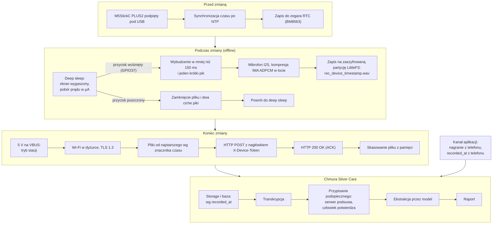

# SilverCare Voice (Zero-UI) – Kompendium Architektoniczne, Sprzętowe i Regulacyjne

Dokument stanowi kompletną bazę wiedzy i plan wdrożenia bezekranowych rejestratorów głosowych dla personelu opiekuńczego w ramach platformy **SilverCare**. Założeniem projektu jest całkowite wyeliminowanie oporu technologicznego (brak smartfonów, tabletów, logowania i ekranów dotykowych) na rzecz modelu **Zero-UI / Push-to-Talk** z automatycznym zrzutem danych po odłożeniu urządzenia do stacji bazowej na koniec zmiany.

**Dwa kanały wejścia.** Urządzenia są opcją, nie warunkiem. Placówka, która nie chce inwestować w sprzęt, nagrywa w aplikacji Silver Care na telefonie lub tablecie (sekcja 1a). Placówka wybiera tryb: **tylko aplikacja**, **tylko urządzenia** albo **mieszany**. Od momentu przyjęcia nagrania oba kanały korzystają z tego samego potoku przetwarzania (architektura: `docs/architecture/VOICE_SHIFT_REPORTING_PIPELINE.md`).

## 1. Analiza Rynku i Wybór Sprzętu

W branży opiekuńczej wprowadzenie kolejnej aplikacji mobilnej często kończy się niepowodzeniem z powodu lęku personelu przed technologią. Rozwiązaniem jest urządzenie wielkości pagera lub klipsa, działające na zasadzie krótkofalówki: **wciśnij -> powiedz -> puść -> odłóż na bazę po zmianie**.

### Porównanie dostępnych ścieżek sprzętowych

| Rozwiązanie | Typ i forma | Koszt jedn. | Zgrywanie na koniec zmiany | Dostęp do API / Własny backend | 
| ----- | ----- | ----- | ----- | ----- | 
| **M5StickC PLUS2** *(Rekomendowane na MVP)* | Moduł IoT (ESP32) w obudowie pagera | \~95–110 PLN | Automatyczne po Wi-Fi (po podłączeniu zasilania) lub USB | **Pełna kontrola** (własny firmware C++ / MicroPython) | 
| **Omi (Based Hardware)** | Open-source AI Wearable (klips / naszyjnik) | \~350–400 PLN | Automatyczne po BLE / Wi-Fi | Otwarte repozytorium (MIT), własny webhook / SDK | 
| **Klasyczny dyktafon USB + Hub** | Mini-dyktafon z klipsem (np. Sony / Philips / OEM) | \~120–250 PLN | Przez wieloportowy hub USB (jako pamięć masowa) | Pełna kontrola przez lokalny skrypt na stacji bazowej (Raspberry Pi) | 
| **Plaud NotePin** | Komercyjny klips AI Voice Recorder | \~750 PLN | Automatyczne po Wi-Fi w stacji dokującej | **Brak publicznego API** (zamknięty ekosystem chmurowy) | 
| **Theatro / Vocera** | Komunikatory Enterprise dla szpitali (USA) | Model subskrypcyjny Enterprise | Stacje dokujące na koniec zmiany | Zamknięty ekosystem (Motorola Solutions), bardzo wysoki koszt wejścia | 
| **Aplikacja Silver Care** *(wariant bez sprzętu)* | Telefon lub tablet, który placówka już ma | 0 PLN sprzętu | Na bieżąco, a bez sieci z kolejki offline | **Pełna kontrola** (nasza aplikacja i backend) | 

### Dlaczego M5StickC PLUS2 wygrywa na etapie MVP?

1. **Forma i waga:** Wymiary $48 \times 25 \times 13\text{ mm}$ i waga zaledwie $17\text{ g}$ (wielkość małego pagera lub klipsa).

2. **Kompletny zestaw komponentów w obudowie:**

   * Procesor **ESP32-PICO-V3-02** (Wi-Fi + Bluetooth LE, 2 rdzenie).

   * Wbudowany cyfrowy mikrofon **MEMS (SPM1423)** na magistrali $\text{I}^2\text{S}$.

   * Duży fizyczny przycisk frontowy (`GPIO37`) idealny do funkcji *Push-to-Talk*.

   * Wbudowany brzęczyk (buzzer) do sygnalizacji dźwiękowej, zegar czasu rzeczywistego **RTC (BM8563)**, akumulator $200\text{ mAh}$ oraz pamięć **8 MB Flash**.

3. **100% otwartości:** Możliwość całkowitego wyczyszczenia oprogramowania fabrycznego i wgrania własnego firmware'u komunikującego się bezpośrednio z chmurą SilverCare (np. Supabase).

### 💡 FAQ – Wybór sprzętu i kwestia pamięci

**P: Czy \~7 MB wolnej pamięci Flash na M5StickC PLUS2 to nie za mało? Czy musimy podpinać zewnętrzny moduł karty microSD?**

**O:** **Nie trzeba podpinać żadnego zewnętrznego modułu ani karty microSD.** M5StickC PLUS2 nie ma wbudowanego slotu SD, a dołożenie zewnętrznej nakładki (*SD Card Unit/Hat*) wydłużyłoby urządzenie o prawie $2\text{ cm}$ i stworzyło element podatny na wyłamanie. Problem pamięci rozwiązuje się programowo poprzez kompresję audio w locie:

* **Surowy WAV (**$16\text{ kHz}$**, 16-bit, Mono):** zajmuje $32\text{ KB/s}$ ($\sim 1{,}92\text{ MB/min}$). Na wolnych $6{,}5\text{ MB}$ partycji *LittleFS* zmieści się tylko ok. $3{,}4\text{ minuty}$.

* **WAV z kompresją IMA ADPCM (4-bit,** $16\text{ kHz}$**, Mono) – *Rekomendowane*:** kompresja $4:1$ liczona w ułamku milisekundy bez obciążania baterii. Zajmuje tylko $8\text{ KB/s}$ **(**$\sim 480\text{ KB/min}$**)**, co daje **ponad** $13{,}5\text{ minuty}$ **czystego mówienia** (ok. 55 osobnych, 15-sekundowych notatek z jednej zmiany). Modele Whisper oraz Gemini Audio rozpoznają ten format bezbłędnie.

* **Kodek Opus / Speex (**$16\text{ kbps}$**):** pozwala zmieścić aż $50\text{ minut}$ nagrań na wbudowanym Flashu.

**P: Te Sticki są chińskiej produkcji – czy możemy ich legalnie i bezpiecznie użyć na etapie MVP w polskich placówkach?**

**O:** **Tak, w 100% legalnie i bezpiecznie.** Producent (M5Stack, wspierany kapitałowo przez Espressif Systems) dostarcza sprzęt przemysłowy posiadający oficjalną europejską **Deklarację Zgodności CE (dyrektywa radiowa RED 2014/53/EU oraz RoHS)**, którą można dołączyć do dokumentacji wdrożeniowej w domu opieki. Co najważniejsze: przed wdrożeniem wykonujesz pełne wymazanie pamięci (`esptool.py erase_flash`) i wgrywasz własny kod C++. Urządzenie nie łączy się z żadną chińską chmurą – w kodzie ma zaszyty wyłącznie adres Twojego serwera w Unii Europejskiej (np. Supabase we Frankfurcie).

**P: Jakie są fizyczne słabości M5StickC PLUS2 w warunkach domu opieki i jak je obejść na etapie MVP?**

**O:** Urządzenie w fabrycznej obudowie nie jest wodoszczelne (brak normy IP65/IP67), ma odsłonięte górne złącze GPIO, mały boczny przycisk zasilania/resetu (ryzyko przypadkowego wciśnięcia) oraz jaskrawy, „techniczny” kolor. Rozwiązaniem na MVP jest wydrukowanie na drukarce 3D cienkiego **etui ochronnego z elastycznego filamentu TPU** (w kolorach SilverCare, np. białym lub granatowym), które:

1. Zasłania górne piny GPIO oraz chowa boczne przyciski na płasko.

2. Zostawia odsłonięty wyłącznie główny przycisk frontowy *Push-to-Talk*, otwór mikrofonu i port USB-C.

3. Nadaje urządzeniu profesjonalny, medyczno-opiekuńczy wygląd z logo SilverCare.

## 1a. Kanał alternatywny: aplikacja zamiast urządzeń

Nie każda placówka zechce kupować i utrzymywać urządzenia. Dla niej wejściem jest aplikacja Silver Care. Tryb wybiera placówka w ustawieniach, a kod i potok są te same.

### Dwa tryby nagrywania w aplikacji

1. **Z wyborem podopiecznego** (działa dziś): opiekunka wybiera osobę z listy, nagrywa i wysyła. Podopieczny jest potwierdzony przy nagraniu, więc notatka od razu idzie do przetwarzania.
2. **Tryb dyktafonu:** jeden duży przycisk, bez wyboru i bez czytania ekranu, czyli to samo „wciśnij, powiedz, puść” co na urządzeniu. Nagranie trafia do kolejki „Do przypisania”, w której kierownik zmiany potwierdza, o kim jest notatka. Ten tryb pozwala sprawdzić cały przepływ Zero-UI w pilotażu, zanim placówka kupi jakiekolwiek urządzenie.

### Porównanie z urządzeniem

| | Urządzenie Zero-UI | Aplikacja |
| ----- | ----- | ----- |
| Koszt sprzętu (10 osób) | ~1 650 PLN | 0 PLN, jeśli placówka ma telefony lub tablety |
| Kto mówi | Z przydziału urządzenia do osoby na zmianę | Z zalogowanego konta |
| O kim | Zawsze przez kolejkę „Do przypisania” | Wybór przed nagraniem albo kolejka (tryb dyktafonu) |
| Kiedy dociera nagranie | Po odłożeniu do stacji, zwykle na koniec zmiany | Od razu albo po powrocie sieci |
| Pytanie uzupełniające od asystenta | Niedostępne (brak ekranu), trafia do kierownika zmiany | Od razu, z możliwością dogrania |
| Próg wejścia dla personelu | Najniższy | Wymaga obsługi telefonu, łagodzony trybem dyktafonu |

### Na co uważać w kanale aplikacji

* **Prywatne telefony pracowników:** nagranie czekające w kolejce offline jest zapisane w pamięci telefonu, a to dane szczególnej kategorii (art. 9 RODO) poza kontrolą placówki. Rekomendacja: urządzenia należące do placówki, a na prywatnym sprzęcie tryb bez kolejki offline i kasowanie nagrania po potwierdzeniu wysyłki oraz przy wylogowaniu.
* **Konta i logowanie:** każda osoba nagrywa na własnym koncie, więc autor notatki jest znany bez przydziału urządzeń. Wspólne konto „dyżurka” odbiera tę informację i jest niedopuszczalne.

## 2. Kosztorys Wdrożenia (Zespół 10-osobowy) i Źródła Zakupu

> **Wariant bez sprzętu (tylko aplikacja):** 0 PLN na urządzenia, jeśli placówka ma telefony lub tablety dla personelu. Poniższy kosztorys dotyczy wariantu z urządzeniami.

Dla 10-osobowego zespołu rekomendowane jest zamówienie **11–12 sztuk** (1–2 sztuki jako „zimny zapas” w szufladzie dyżurki na wypadek uszkodzenia mechanicznego lub zalania).

### Zestawienie kosztów sprzętu (Ceny brutto – 2026)

| Element zestawu | Ilość | Cena jedn. | Koszt łączny | Rola w systemie SilverCare | 
| ----- | ----- | ----- | ----- | ----- | 
| **M5StickC PLUS2 (SKU: K016-P2)** | 11 szt. | \~105 PLN | \~1 155 PLN | Pagery głosowe dla 10 opiekunek + 1 sztuka zapasowa | 
| **Stacja ładująca USB (10–12 portów, min. 60W)** | 1 szt. | \~160 PLN | \~160 PLN | Fizyczna „baza” w dyżurce, do której odkłada się sticki po zmianie | 
| **Krótkie kable USB-C (20–30 cm, magnetyczne)** | 12 szt. | \~15 PLN | \~180 PLN | Wygodne wpinanie jedną ręką (końcówka magnetyczna chroni port) | 
| **Klipsy do ubrania / smycze z karabińczykiem** | 12 szt. | \~12 PLN | \~144 PLN | Montaż do kieszeni uniformu lub na smyczy | 
| **RAZEM (Wariant z Wi-Fi w dyżurce)** | **Zestaw** | — | **\~1 639 PLN** | **Kompletny sprzęt gotowy do wdrożenia pilotażowego** | 
| *Opcjonalnie: Raspberry Pi 5 (4 GB + zasilacz + SD)* | *1 szt.* | *\~380 PLN* | *\~380 PLN* | *Lokalny hotspot Wi-Fi i bufor, jeśli w dyżurce brak stabilnej sieci* | 

### Sprawdzone linki do zakupu (ważne: szukaj wersji PLUS2, SKU: `K016-P2`)

* **Allegro (najszybsza dostawa w Polsce 24–48h):** [Wyszukiwanie M5StickC PLUS2 na Allegro](https://allegro.pl/listing?string=m5stickc%20plus2%20esp32%20mini%20iot%20development%20kit%20zestaw%20rozwojowy%20iot)

* **Oficjalny sklep producenta M5Stack:** [M5StickC PLUS2 w M5Stack Store](https://shop.m5stack.com/products/m5stickc-plus2-esp32-mini-iot-development-kit) ($19{,}95\text{ USD}$ netto/szt.)

* **AliExpress (zakup hurtowy 10–12 szt.):** [Oferty M5StickC PLUS2 na AliExpress](https://inbusiness.aliexpress.com/wholesale/m5-stick-c-plus-2.html)

* **Porównywarka Ceneo:** [Sprawdź dostępność w polskich sklepach na Ceneo](https://www.ceneo.pl/193402983)

> **Uwaga przy zakupie:** Zawsze weryfikuj, czy w koszyku jest wersja **PLUS2** (czarny obrys wokół ekranu, żółto-pomarańczowa obudowa, **8 MB Flash**, bateria $200\text{ mAh}$), a nie starsza wersja *Plus* (4 MB Flash, $120\text{ mAh}$) ani okrojona *Plus SE*.

## 3. Architektura Oprogramowania i Przepływ Danych (End-to-End)

System składa się z dwóch części: lekkiego oprogramowania układowego (**Firmware C++** w środowisku PlatformIO / ESP-IDF) na urządzeniu oraz chmurowego backendu (**Supabase Storage + PostgreSQL + Edge Functions + LLM API**).

### Schemat cyklu życia notatki głosowej

**Kanał aplikacji** zaczyna się od kroku 4: nagranie powstaje w aplikacji (z `recorded_at` z telefonu i autorem z zalogowanego konta) i jest wysyłane od razu albo z kolejki offline. Kroki 1–3 dotyczą tylko urządzeń.

### Kluczowe mechanizmy techniczne

1. **Idealna chronologia nagrań z różnych urządzeń:**
   Każde nagranie otrzymuje w nazwie i metadanych dokładny znacznik czasu z wbudowanego zegara **RTC (`recorded_at`) z momentu faktycznego wciśnięcia przycisku**, a nie z momentu wgrania pliku do chmury. Nawet jeśli Opiekunka A podepnie sticka o 19:00, a Opiekunka B o 19:20, baza danych układa wszystkie zdarzenia z całego dnia na jednej, spójnej osi czasu (`ORDER BY recorded_at ASC`).

2. **Skąd system wie, KTO mówi i O KTÓRYM podopiecznym?**

   * **Identyfikacja opiekuna:** Każdy fizyczny stick ma unikalny `device_id`, a system pamięta, komu urządzenie było przydzielone w danym czasie (np. Stick #04 na zmianie dziennej = Pani Krystyna). Przydział zmienia się przy wymianie urządzenia albo innej obsadzie zmiany. W aplikacji autorem jest zalogowane konto.

   * **Identyfikacja seniora:** Opiekunki stosują prostą regułę: *„Zawsze zaczynaj notatkę od imienia lub pokoju podopiecznego, np.: Pani Janina z trójki zjadła cały obiad, ale skarży się na ból kolana”* oraz *„jedno naciśnięcie, jedna osoba”*. **Model AI nie ustala tożsamości** (zasada stała Silver Care). Serwer porównuje imię, nazwisko, pokój i łóżko z transkrypcji z listą podopiecznych tej placówki i podsuwa kandydatów, a kierownik zmiany potwierdza wybór w kolejce „Do przypisania”. Dopiero potwierdzona notatka, z zamaskowanymi danymi osobowymi, trafia do modelu.

3. **Sygnalizacja dźwiękowa (zamiast ekranu):**

   * `1 krótki pik` przy wciśnięciu – start nagrywania.

   * `2 krótkie piki` po puszczeniu – notatka bezpiecznie zapisana.

   * `Długi niski sygnał (brzęczenie)` – bateria poniżej $15\%$ lub pamięć pełna (wymagane podpięcie do ładowarki).

## 4. Wymagania Prawno-Regulacyjne (MDR, RODO, AI Act, Cyberbezpieczeństwo)

Wdrożenie urządzeń rejestrujących głos w placówce opiekuńczej dotyka czterech reżimów prawnych: **MDR** (Rozporządzenie o wyrobach medycznych 2017/745), **RODO** (szczególna kategoria danych o zdrowiu – art. 9), **AI Act** oraz **CRA** (Cyber Resilience Act).

### Granica MDR: Kiedy SilverCare JEST, a kiedy NIE JEST wyrobem medycznym?

Zgodnie z wytycznymi **MDCG 2019-11** oraz **Regułą 11 Załącznika VIII MDR**, o tym, czy oprogramowanie wymaga certyfikacji medycznej (SaMD – *Software as a Medical Device*), decyduje **deklarowane przez producenta przeznaczenie (*Intended Purpose*)** oraz realne funkcje przetwarzania:

| Obszar | Strefa Bezpieczna (Non-Medical / Poza MDR) | Strefa Wyrobu Medycznego (MDR Klasa IIa lub wyższa) | 
| ----- | ----- | ----- | 
| **Cel systemu w dokumentacji** | Organizacja pracy personelu, ewidencja czynności bytowo-opiekuńczych, automatyzacja notatek i raportów dla rodziny/dyrekcji. | Diagnozowanie, predykcja stanów chorobowych, monitorowanie parametrów fizjologicznych w celach klinicznych, dobór terapii. | 
| **Działanie promptów AI** | • Transkrypcja mowy na tekst |  | 

• Porządkowanie faktów: *„Zjadła 100% posiłku, wypiła 400 ml płynów, zgłasza ból kolana”*

• Kategoryzacja organizacyjna (Higiena / Dieta / Samopoczucie) | • Wnioskowanie medyczne: *„Objawy wskazują na początek infekcji dróg moczowych / sepsy”*

• Rekomendacje terapeutyczne: *„Zwiększ dawkę leku przeciwzakrzepowego”*

• Triaż medyczny i alerty zagrożenia życia |
| **Klienci docelowi** | Domy Pomocy Społecznej (DPS), prywatne domy seniora, agencje opieki domowej, rodziny. | Szpitale, oddziały kliniczne, Zakłady Opiekuńczo-Lecznicze (w zakresie aparatury medycznej), przetargi NFZ na telemedycynę. |

### Lista wymagań architektonicznych i formalnych do wdrożenia

Aby legalnie i bezpiecznie uruchomić pilotaż i sprzedaż (nawet poza reżimem MDR), system musi spełniać poniższe wymogi:

#### A. Wymagania sprzętowe i sieciowe (M5StickC PLUS2)

1. **Sprzętowe szyfrowanie pamięci (`ESP32 Flash Encryption` & `Secure Boot`):**

   Jeśli opiekunka zgubi sticka na terenie placówki, osoba postronna po podłączeniu go kablem USB do komputera i użyciu narzędzia `esptool.py` nie może odczytać plików `.wav`. Wypalenie klucza szyfrującego w pamięci jednokrotnego zapisu (`eFuse`) procesora ESP32 sprawia, że cała partycja *LittleFS* jest zaszyfrowana sprzętowo (AES-256).

2. **Szyfrowana transmisja i autoryzacja urządzenia:**

   Komunikacja z chmurą wyłącznie po **TLS 1.3**. Każdy stick posiada indywidualny klucz/token (`X-Device-Token`) zaszyty w bezpiecznej partycji NVS, co uniemożliwia podszycie się pod urządzenie.

3. **Gwarancja dostarczenia (Idempotentność + ACK):**

   Plik audio jest usuwany z pamięci sticka dopiero po otrzymaniu kodu `HTTP 200 OK` z bazy danych. Jeśli Wi-Fi zerwie połączenie w połowie zrzutu, nagranie zostaje na urządzeniu do kolejnej próby.

#### B. Wymagania chmurowe i AI (Backend SilverCare)

1. **Lokalizacja serwerów w EOG (UE):**

   Baza danych i zasobnik plików (np. Supabase) muszą być hostowane w regionie europejskim (np. Frankfurt `eu-central-1`).

2. **Umowy Zero Data Retention z dostawcami AI:**

   Korzystanie z komercyjnych endpointów API (np. OpenAI API Platform / Google Cloud Vertex AI / Azure) z wyłączonym trenowaniem modeli na przesyłanych danych klientów oraz podpisanym dodatkiem **DPA (Data Processing Addendum)**.

3. **Polityka minimalizacji i retencji audio (RODO art. 5 i 9):**

   Głos to dana biometryczna. Po wygenerowaniu i zatwierdzeniu transkrypcji tekstowej oryginalne pliki `.wav` powinny być automatycznie usuwane z chmury po krótkim okresie buforowym (np. po 7–14 dniach na wypadek weryfikacji sporu).

4. **Zasada nadzoru człowieka (*Human-in-the-loop* – wymóg AI Act):**

   Wygenerowana przez AI notatka z głosu opiekunki ma w interfejsie webowym status szkicu/podsumowania, który koordynator zmiany lub opiekunka może skorygować lub zatwierdzić jednym kliknięciem.

5. **Logi audytowe (*Audit Trail*):**

   Rejestrowanie w bazie każdego odczytu i edycji karty seniora (kto, kiedy, z jakiego konta).

#### C. Wymagania formalno-prawne (Dokumentacja)

1. **Umowa Powierzenia Przetwarzania Danych (DPA):** Podpisywana z każdym domem opieki (placówka jest Administratorem Danych Osobowych, a SilverCare jest Podmiotem Przetwarzającym – Procesorem).

2. **Ocena Skutków dla Ochrony Danych (DPIA – art. 35 RODO):** Dokument opisujący analizę ryzyka dla przetwarzania notatek głosowych o podopiecznych wraz z wdrożonymi zabezpieczeniami (szyfrowanie Flash, TLS, retencja).

3. **Opinia Kwalifikacyjna (MDR Qualification Report):** Dokument potwierdzający, że system pełni funkcje organizacyjno-opiekuńcze i nie podlega pod ustawę o wyrobach medycznych.

### 💡 FAQ – Certyfikacja, audyty i konsekwencje biznesowe

**P: Czy za spełnienie tych wymagań dostaje się oficjalny certyfikat? Jakie audyty się przechodzi?**

**O:** To zależy od wybranej ścieżki:

1. **Ścieżka pozamedyczna (Rekomendowana na start / MVP):** Nie przechodzisz państwowej certyfikacji wyrobu medycznego. Zlecasz wyspecjalizowanej firmie doradczej lub kancelarii medtech tzw. **Audyt Kwalifikacyjny (MDR Pre-assessment)** oraz audyt RODO/DPIA. Otrzymujesz oficjalną **Opinię Prawno-Regulacyjną / Raport z Audytu**, który stanowi Twoją „tarczę” przed kontrolami i dowód dla dyrektorów placówek, że system działa w 100% legalnie bez znaku CE medycznego. Dodatkowo możesz uzyskać certyfikat **ISO 27001** (bezpieczeństwo informacji).

2. **Ścieżka pełnej certyfikacji medycznej (MDR Klasa IIa + ISO 13485):** Przechodzisz pełny audyt w akredytowanej **Jednostce Notyfikowanej** (np. TÜV SÜD, DNV, PCBC). Po zatwierdzeniu dokumentacji technicznej (wg normy IEC 62304 dla oprogramowania) i oceny klinicznej otrzymujesz oficjalny **Certyfikat Zgodności UE (MDR)** uprawniający do postawienia medycznego znaku CE.

**P: Co zyskujemy biznesowo, jeśli w przyszłości zdecydujemy się na pełny certyfikat MDR?**

**O:**

* **Legalne funkcje diagnostyczne i predykcyjne AI:** Możliwość wdrożenia algorytmów wykrywających wczesne objawy chorób, infekcji, odwodnienia czy pogorszenia stanu psychicznego bezpośrednio z notatek personelu.

* **Dostęp do rynku szpitalnego, ZOL i przetargów publicznych (NFZ):** Otwarcie rynku podmiotów leczniczych, które wymagają statusu wyrobu medycznego w specyfikacjach przetargowych.

* **Wysoka bariera wejścia dla konkurencji (Moat):** Certyfikacja MDR trwa 1,5–2 lata i kosztuje $150\text{ 000} - 300\text{ 000+}\text{ PLN}$, co chroni Waszą pozycję rynkową przed łatwym skopiowaniem przez zwykłe software house'y.

**P: Z czym nas ogranicza brak pełnego certyfikatu MDR na etapie MVP?**

**O:** Możecie bez przeszkód sprzedawać system do prywatnych domów opieki, DPS-ów i agencji opiekuńczych jako **system wsparcia pracy personelu i komunikacji**, ale:

* **Nie wolno Wam w marketingu ani w promptach AI używać funkcji diagnostycznych/terapeutycznych** (AI może porządkować fakty podane przez opiekunkę, ale nie może samo stawiać diagnoz ani sugerować zmiany leków).

* Wprowadzenie do obrotu systemu o cechach wyrobu medycznego bez certyfikatu grozi administracyjnymi karami finansowymi z Ustawy o wyrobach medycznych (nawet do $5\text{ mln PLN}$). Dlatego tak ważne jest pilnowanie czystości językowej w interfejsie i promptach.

## 5. Firmy Audytorskie i Kancelarie Medtech w Polsce

Poniżej znajduje się lista podmiotów na polskim rynku, do których można zwrócić się o **kwalifikację regulacyjną oprogramowania (MDR Qualification)**, audyt DPIA/RODO oraz testy bezpieczeństwa:

### 1. Doradztwo regulacyjne MDR / SaMD (Medical Device Consulting)

* **MEDDEV (meddev.pl):** Specjalizują się w kwalifikacji oprogramowania (Reguła 11 MDR, wytyczne MDCG), wdrażaniu normy IEC 62304 oraz przeprowadzaniu analizy luk (*Gap Analysis*).

* **Pure Clinical (pureclinical.eu):** Kompleksowe wsparcie dla startupów medtech i oprogramowania AI w medycynie, od kwalifikacji po certyfikację klasy IIa/IIb.

* **Multicert (multicert.pl):** Przygotowanie dokumentacji technicznej wyrobów medycznych i systemów zarządzania jakością ISO 13485.

### 2. Kancelarie prawne specjalizujące się w Healthtech, RODO i AI Act

* **Creativa Legal (creativa.legal):** Kancelaria wyspecjalizowana w obsłudze projektów telemedycznych, healthtech, AI Act oraz ochronie danych medycznych.

* **DZP – Domański Zakrzewski Palinka (Praktyka Life Sciences):** Jedna z największych praktyk prawa medycznego i farmaceutycznego w Polsce, wydająca wiążące opinie kwalifikacyjne.

* **Wardyński i Wspólnicy (Zespół Healthcare & Life Sciences):** Doradztwo regulacyjne na styku nowych technologii, urządzeń IoT i ochrony zdrowia.

### 3. Audyty techniczne i testy penetracyjne (IoT / Cloud Security)

* **SecuRing (securing.pl)** oraz **Niebezpiecznik:** Techniczne audyty bezpieczeństwa architektury chmurowej, API oraz testy bezpieczeństwa sprzętowego urządzeń IoT.

> **Szacowany koszt wstępnego audytu kwalifikacyjnego (MDR Boundary Opinion + DPIA):**
>
> Zazwyczaj mieści się w przedziale $4\text{ 000} - 10\text{ 000 PLN netto}$ i zajmuje od 2 do 4 tygodni.

## 6. Rekomendowana Mapa Drogowa (Roadmap) dla SilverCare

### Faza 1: Prototyp Techniczny i Walidacja UX (Tygodnie 1–4)

* Tryb dyktafonu w aplikacji i kolejka „Do przypisania” dla kierownika zmiany. Pozwala zacząć pilotaż w placówce bez sprzętu i sprawdzić przepływ Zero-UI na telefonach.

* Zakup zestawu 11–12 sztuk **M5StickC PLUS2**, wieloportowej ładowarki USB i magnetycznych kabli USB-C (budżet $\sim 1\text{ 650 PLN}$).

* Napisanie firmware'u obsługującego *Push-to-Talk* z kompresją **IMA ADPCM**, zegarem RTC i automatycznym wysyłaniem plików po wykryciu $5\text{ V}$ na porcie USB.

* Wydruk 3D ochronnych nakładek TPU (zasłonięcie bocznych przycisków i górnego portu GPIO).

* Podpięcie pipeline'u (Storage -> STT -> przypisanie podopiecznego przez serwer i człowieka -> LLM).

### Faza 2: Zabezpieczenie Architektury i Formalności (Tygodnie 5–8)

* Włączenie sprzętowego szyfrowania **Flash Encryption & Secure Boot** na procesorach ESP32.

* Zlecenie zewnętrznej opinii kwalifikacyjnej potwierdzającej status **Non-Medical (poza MDR)** oraz przygotowanie wzoru **DPIA** i umowy powierzenia (**DPA**) dla domów opieki.

* Weryfikacja promptów AI pod kątem wyeliminowania sugestii diagnostycznych (czysta agregacja faktów).

### Faza 3: Pilotaż w Domu Opieki i Skalowanie (Miesiąc 3+)

* Wdrożenie systemu na 10-osobowym zespole w pierwszej placówce (urządzenia, aplikacja albo tryb mieszany).

* Zebranie metryk (czas oszczędzony przez personel, odsetek nagrań przypisanych bez korekty kandydata, żywotność baterii, udział nagrań z aplikacji i z urządzeń).

* Przy skali powyżej 15–20 placówek: decyzja o ewentualnym wydzieleniu modułu klinicznego i rozpoczęciu certyfikacji MDR Klasy IIa pod rynek szpitalny i ZOL.