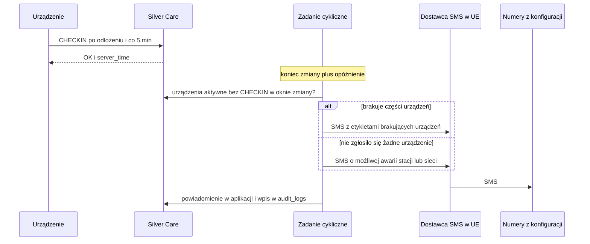
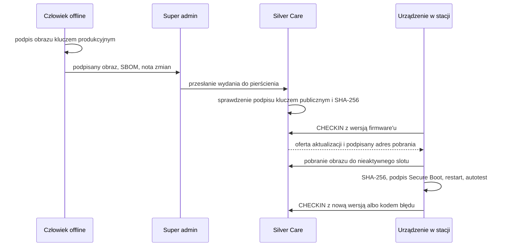

# Urządzenia nagrywające i stacja dokująca: wymagania, decyzje i plan wdrożenia

**Wersja:** 1.0 · **Data:** 2026-11-26 · **Status:** 📝 PROPOZYCJA do review (Michał ↔ Darek)
**Dotyczy:** ADR-022, `SC-NUR-17`, `SC-ADM-24` (rejestr urządzeń), `SC-ADM-27` (nowe: urządzenie nie wróciło do stacji), silver_care#307 (zamknięte, zastąpione przez #345), #326, #330, #343, #345, silver-care-devices#11, #14
**Procedura zgubienia urządzenia:** [docs/procedury/ZGUBIENIE_URZADZENIA.md](../procedury/ZGUBIENIE_URZADZENIA.md)

> **Kontrakt (`contracts/*.contract.mjs`) pozostaje jedynym źródłem prawdy.** Ten dokument zbiera wymagania i proponuje zmiany kontraktu (sekcja 8). Wymaganie oznaczone jako „nowe” obowiązuje dopiero po wpisaniu do kontraktu w oknie kontraktowym, które otwiera człowiek.
>
> Sekcja 7 (zgodność z przepisami) to analiza inżynierska, nie opinia prawna. Wnioski oznaczone „do potwierdzenia” wymagają IOD albo prawnika.

## 1. Zakres i granice

Dokument obejmuje:
- urządzenie M5Stack StickS3 z firmware'em z repozytorium `silver-care-devices`;
- stację dokującą: ładowarkę i sieć dla urządzeń;
- część serwerową kanału urządzeń: przyjęcie nagrań, zgłoszenia obecności w stacji, rejestr urządzeń, powiadomienie SMS;
- procesy: protokół partii i postępowanie przy zgubieniu urządzenia.

Granice obowiązujące każde wymaganie poniżej:
- **Urządzenie nagrywa i przekazuje.** Nie jest wyrobem medycznym, nie ocenia stanu zdrowia i nie ustala, kogo dotyczy nagranie (ADR-006, ADR-022).
- Urządzenie nie odtwarza i nie wyświetla treści nagrań ani nazwisk (`SC-NUR-17/AC2`).
- Autora sesji ustala serwer z przedstawienia w pierwszej notatce, bez modelu AI i bez rozpoznawania głosu. Rozpoznawanie mówcy po głosie byłoby przetwarzaniem danych biometrycznych (art. 9 RODO) i jest poza zakresem.
- **Nie analizujemy emocji ani tonu głosu.** Strumień `DISCOMFORT` wynika z treści transkryptu, nie z cech głosu. AI Act (art. 5 ust. 1 lit. f) zakazuje rozpoznawania emocji w miejscu pracy.
- **Dane urządzeń nie służą ocenie pracowników.** Zgłoszenia, zwroty do stacji i autorstwo sesji nie trafiają do rankingów, statystyk na osobę ani wskaźników „zdyscyplinowania” (AI Act zał. III pkt 4, art. 22³ Kodeksu pracy).
- Powiadomienia dotyczą sprzętu, nigdy podopiecznego (ADR-005, `FORBIDDEN_TRIGGERS`). Precedensem jest powiadomienie `A1 device_sync_stale` z katalogu powiadomień.

## 2. Stan na 2026-11-26 (sprawdzony w kodzie)

| Obszar | Stan | Gdzie |
|---|---|---|
| Nagrywanie, kolejka odporna na restart, ekrany, oszczędzanie energii | ✅ zrobione, PR w review | silver-care-devices#13 |
| Kasowanie nagrania wyłącznie po `deviceMayDelete` | ✅ logika i testy na komputerze | `lib/ingest/ingest_decision` |
| Klient protokołu 1.2.0 (INIT → UPLOAD → COMMIT) | ✅ logika z atrapą transportu | `lib/sync`, silver-care-devices#12 |
| Wi-Fi, HTTPS i wysyłka z urządzenia | ❌ brak (F6) | silver-care-devices#11 |
| Konfiguracja przez USB: Wi-Fi, adres serwera, token | ❌ brak (F7) | silver-care-devices#11 |
| Szyfrowanie flash, Secure Boot, szyfrowanie NVS | ❌ wyłączone w `sdkconfig` (F10) | `sdkconfig.defaults` |
| Partycje `recordings` i `nvs_keys` z flagą `encrypted` | ✅ przygotowane | `partitions.csv` |
| Aktualizacje firmware'u przez Wi-Fi | ❌ brak (D1: już w pilotażu) | sekcja 3.7, #345 C3 i D4 |
| Polecenia serwisowe USB tylko w buildzie `-dev` | ✅ | `src/devtools.cpp` (`SC_DEV_TOOLS`) |
| Przyjęcie nagrań INIT → PUT → COMMIT, odmowa dla unieważnionego tokenu | ✅ w kodzie na `staging`, ⚠️ **migracja niezastosowana w bazie stagingowej** (sekcja 6.2) | PR #331 i #313, migracja `20261125120000_voice_device_uploads.sql` |
| Panel rejestru i unieważniania | ❌ brak | silver_care#326 (Darek) |
| Zgłoszenia obecności w stacji, liczenie urządzeń, SMS | ❌ brak, nowe wymaganie | sekcja 3.4 |
| Procedura zgubienia urządzenia | ⚠️ szkic w `SECURITY.md`, zastępuje go dokument procedury | `docs/procedury/` |

## 3. Wymagania

Konwencja: **ID · wymaganie · weryfikacja**. „Nowe” oznacza, że wymaganie potrzebuje wpisu w kontrakcie (sekcja 8).

### 3.1 Urządzenie: ochrona danych (DEV-SEC)

| ID | Wymaganie | Weryfikacja |
|---|---|---|
| DEV-SEC-01 | Każde urządzenie, które nagrywa prawdziwe dane, ma szyfrowanie flash XTS-AES-256 w trybie Release. Klucz generuje chip przy pierwszym uruchomieniu i nikt go nie zna, także Silver Care. | `espefuse.py summary`, odrzucona próba `read_flash`, wpis w protokole partii |
| DEV-SEC-02 | Secure Boot V2 (RSA-3072). Klucz produkcyjny powstaje offline, ma dwie niezależne kopie poza repozytorium i nie trafia do CI. Egzemplarze testowe dostają **osobny klucz testowy**, nigdy produkcyjny (D11). | protokół partii; obraz podpisany innym kluczem nie startuje |
| DEV-SEC-03 | Token urządzenia i hasło Wi-Fi leżą wyłącznie w zaszyfrowanym NVS. | na egzemplarzu: odczyt partycji `nvs` daje szyfrogram |
| DEV-SEC-04 | Tryb pobierania z ROM ustawiony na stałe na *Secure Download*, JTAG wyłączony. | `espefuse.py summary` |
| DEV-SEC-05 | Firmware dla urządzeń z prawdziwymi danymi nie ma poleceń serwisowych (`SC_DEV_TOOLS`) ani żadnej drogi odczytu nagrań poza protokołem. | `tools/check-secure-config.mjs` w CI |
| DEV-SEC-06 | Konfiguracja przez USB: • `PROVISION` działa tylko na nieskonfigurowanym urządzeniu; • adres serwera tylko `https://` i tylko z listy dozwolonych hostów; • `ROTATE_TOKEN` wymienia token i zachowuje nagrania; • `FACTORY_RESET` wymaga potwierdzenia przyciskiem i kasuje nagrania oraz NVS; • żadne polecenie nie zwraca tokenu, hasła Wi-Fi ani treści nagrań. | `test_provision` |
| DEV-SEC-07 | Firmware aktualizuje się wyłącznie obrazem podpisanym kluczem Secure Boot (D1). Gdy nowa wersja nie potwierdzi startu, urządzenie wraca do poprzedniej. Wymaga tego także CRA (aktualizacje bezpieczeństwa). | `test_fw_update`; na egzemplarzu: obraz niepodpisany jest odrzucany |
| DEV-SEC-08 | Nagranie kasuje się wyłącznie po `deviceMayDelete: true` (już jest). | `test_ingest_decision` |
| DEV-SEC-09 | Logi urządzenia nie zawierają treści audio, nazw osób, tokenu ani hasła Wi-Fi (już w zasadach repozytorium). | review |

### 3.2 Urządzenie: sieć (DEV-NET)

| ID | Wymaganie | Weryfikacja |
|---|---|---|
| DEV-NET-01 | Wi-Fi włącza się tylko w stacji (wykryte napięcie USB) i nigdy w trakcie nagrywania. | test na egzemplarzu |
| DEV-NET-02 | Połączenia wyłącznie po TLS z weryfikacją certyfikatu (pakiet certyfikatów ESP-IDF). `http://` jest dozwolone tylko w buildzie `-dev`, do makiety w sieci lokalnej. | `test_net_policy`, `check-secure-config` |
| DEV-NET-03 | Lista dozwolonych hostów: Silver Care (staging i produkcja) oraz projekt Supabase w UE. Dotyczy także `upload_url` z odpowiedzi INIT, żeby fałszywa odpowiedź nie przekierowała nagrania. | `test_net_policy`, w tym podszycie (`silvercare.example.evil.com`, `@` w adresie) |
| DEV-NET-04 | Zegar urządzenia ustawiany z `server_time` każdej odpowiedzi (protokół 1.2.0, już w kontrakcie). | test z makietą |
| DEV-NET-05 (nowe) | **Zgłoszenie obecności w stacji (CHECKIN).** Po odłożeniu do stacji i co 5 minut w stacji urządzenie wysyła zgłoszenie z polami technicznymi: `battery_pct`, `pending_count`, `firmware_version`, `clock_state`. Bez danych osobowych (`fields.forbidden` jak dla INIT). Odpowiedź: `OK`, `DEVICE_REVOKED` albo `RETRY_LATER`, zawsze z `server_time`. | test klienta z makietą; test endpointu |
| DEV-NET-06 (nowe, opcjonalne) | **Wyjęcie ze stacji (CHECKOUT).** Przy zaniku napięcia USB urządzenie próbuje przez najwyżej 5 s wysłać zgłoszenie wyjęcia. Brak odpowiedzi niczego nie blokuje. | test na egzemplarzu |

### 3.3 Stacja dokująca (STA)

Model na pilotaż to **ładowarka wieloportowa i własny router z osobną siecią dla urządzeń** (rekomendacja dla silver-care-devices#14 D1). Stacja nie ma własnej logiki ani pamięci.

| ID | Wymaganie | Weryfikacja |
|---|---|---|
| STA-01 | Ładowarka ma co najmniej tyle portów, ile jest urządzeń, plus jeden. | lista zakupowa (BOM) |
| STA-02 | Osobna sieć Wi-Fi dla urządzeń (WPA2 albo WPA3). Ruch wychodzący tylko HTTPS do hostów z DEV-NET-03, bez portów przychodzących. | instrukcja dla działu technicznego placówki (#14 D3) |
| STA-03 | Stacja nie przechowuje nagrań. Nagrania czekają na urządzeniu do potwierdzenia przyjęcia. | projekt stacji |
| STA-04 | Hasło sieci urządzeń da się zmienić bez zmian po stronie serwera. Po zgubieniu urządzenia placówka zmienia hasło, a pozostałe urządzenia dostają nowe przez USB. | procedura zgubienia |
| STA-05 (nowe) | **Liczenie urządzeń.** Serwer wylicza stan stacji ze zgłoszeń CHECKIN. Urządzenie jest „w stacji”, gdy jego ostatnie zgłoszenie ma mniej niż 15 minut. Panel Kierownika placówki pokazuje „W stacji: X z Y aktywnych”, a przy każdym urządzeniu ostatnie zgłoszenie, baterię i liczbę niewysłanych nagrań. | E2E panelu |
| STA-06 | **Sygnalizacja na miejscu.** W pilotażu stan pokazuje ekran urządzenia („W stacji”, „Wysłane”, „Nie wysłano”). Wyświetlacz albo diody na samej stacji to wariant v2 (D5). | test na egzemplarzu |
| STA-07 | Pilotaż ma jedną stację na placówkę. Model danych nie może blokować kilku stacji w przyszłości, np. po jednej na piętrze. | review migracji |

### 3.4 Powiadomienie: urządzenie nie wróciło do stacji (ALERT, nowe, `SC-ADM-27`)

| ID | Wymaganie |
|---|---|
| ALERT-01 | Urządzenie **aktywne**, czyli nie unieważnione i nie oznaczone jako „w rezerwie”, **nie wróciło do stacji**, jeśli nie zgłosiło się (CHECKIN) w oknie od 60 minut przed końcem zmiany do końca zmiany plus opóźnienie. |
| ALERT-02 | Sprawdzenie odbywa się po każdej zmianie z `shift_definitions` placówki, w strefie `Europe/Warsaw`. Obsługuje zmianę czasu i zmianę nocną przechodzącą przez północ. Opóźnienie wynosi domyślnie **60 minut** i jest konfigurowalne w zakresie 30–180 minut. |
| ALERT-03 | Jeden SMS na zmianę i na numer, z listą wszystkich brakujących urządzeń. Klucz idempotencji: placówka, definicja zmiany, data zmiany, odbiorca. |
| ALERT-04 | Gdy nie zgłosiło się **żadne** aktywne urządzenie, SMS informuje o możliwej awarii stacji albo sieci, a nie o zgubieniu. |
| ALERT-05 | Treść nie zawiera danych osobowych ani linku. Zawiera tylko etykiety urządzeń, nazwę zmiany i godzinę. Brak linku utrwala nawyk „nie klikam linków z SMS-ów” i chroni przed smishingiem. Szablony są w katalogu powiadomień, a test sprawdza szablony (`NTF-NO-PII`). |
| ALERT-06 | **Konfiguracja przez Kierownika placówki:** • włączenie i wyłączenie powiadomień; • do 5 numerów, każdy z etykietą (np. „Telefon dyżurny”, „Kierownik placówki”); • potwierdzenie numeru kodem SMS przed pierwszą wysyłką; • opóźnienie; • SMS testowy.  Numery czyta i zmienia wyłącznie `org_admin:own`. Po zapisie numer jest pokazywany zamaskowany. Usunięcie numeru kasuje go z bazy. |
| ALERT-07 | `audit_logs` rejestruje dodanie, potwierdzenie i usunięcie numeru, zmianę ustawień oraz każdą wysyłkę. W logach i audycie zapisywany jest identyfikator odbiorcy, nigdy numer. |
| ALERT-08 | Równolegle z SMS-em Kierownik placówki dostaje powiadomienie w aplikacji. Przy błędzie dostawcy SMS następuje ponowienie, a po porażce e-mail do Kierownika placówki. |
| ALERT-09 | Dostawca SMS działa w EOG, ma umowę powierzenia i jest na wykazie integratorów UKE (D6, `INFRA-EU-REGION`). |
| ALERT-10 | Gdy unieważnione urządzenie zgłosi się w stacji (CHECKIN albo INIT), Kierownik placówki dostaje powiadomienie w aplikacji i e-mail. To sygnał odnalezienia urządzenia albo próby nadużycia. |
| ALERT-11 | **Alert dotyczy sprzętu, nie osoby.** SMS i panel nie wskazują, kto miał urządzenie. Dane alertów nie trafiają do żadnych zestawień o pracownikach. |
| ALERT-12 | Kierownik placówki może oznaczyć urządzenie jako „w rezerwie”. Takie urządzenie nie jest liczone i nie wyzwala alertu. |

Przykładowe treści do katalogu szablonów:

- Brak urządzeń: `Silver Care: po zmianie dziennej (koniec 19:00) do stacji nie wróciły urządzenia: Stick 02. Sprawdź stan w panelu Silver Care.`
- Żadne nie zgłosiło się: `Silver Care: po zmianie dziennej żadne urządzenie nie zgłosiło się w stacji. Możliwa awaria stacji lub sieci. Sprawdź stację.`
- Potwierdzenie numeru: `Silver Care: kod potwierdzający numer dla powiadomień o urządzeniach: 482913. Jeśli to nie Ty, zignoruj tę wiadomość.`

**Znane ograniczenia, świadomie przyjęte:**
- Urządzenie odłożone i zaraz wyjęte przez tę samą zmianę liczy się jako zwrócone. Zgłoszenie wyjęcia (DEV-NET-06) pozwoli to później zawęzić.
- Osoba na podwójnej zmianie, która nie odkłada urządzenia, wywoła alert. Dlatego treść mówi „nie wróciło do stacji”, a nie „zgubione”.
- SMS po zmianie dziennej przychodzi wieczorem. Pierwszym odbiorcą powinien więc być telefon dyżurny zmiany na miejscu, a nie prywatny telefon kierownika (D8, sekcja 7, Kodeks pracy).

### 3.5 Rejestr urządzeń: uzupełnienia do silver_care#326

| ID | Wymaganie |
|---|---|
| REG-01 | Przy urządzeniu widać: status (aktywne, w rezerwie, unieważnione), ostatnie zgłoszenie w stacji, ostatni zrzut, baterię i liczbę niewysłanych nagrań. |
| REG-02 | Unieważnienie wymaga potwierdzenia i trafia do `audit_logs` (już w `VOICE-DEVICE-REGISTRY`). |
| REG-03 | „Urządzenie odnalezione”: nowy token dla tego samego urządzenia, wgrywany przez `ROTATE_TOKEN`. Model danych (nowy wiersz albo wznowienie wiersza) do decyzji przy #326. |
| REG-04 | Przy urządzeniu widać numer z obudowy, wersję firmware'u i tryb zabezpieczeń z protokołu partii. To dane do karty faktów z procedury zgubienia. |
| REG-05 | Zmiana `SC-ADM-24/AC5` („bez alarmów”): jedyny alarm dotyczy sprzętu, który nie wrócił do stacji (`SC-ADM-27`). |

### 3.6 Procesy i dokumenty (OPS)

| ID | Wymaganie |
|---|---|
| OPS-01 | **Protokół partii** dla każdego urządzenia: numer z obudowy, data, osoba, wersja firmware'u, tryb zabezpieczeń, wynik kontroli. Bez kluczy i tokenów. Bez protokołu placówka nie wykaże, że zgubione urządzenie było zaszyfrowane (art. 34 ust. 3 lit. a RODO). |
| OPS-02 | Procedura zgubienia urządzenia dla placówki i Silver Care: [docs/procedury/ZGUBIENIE_URZADZENIA.md](../procedury/ZGUBIENIE_URZADZENIA.md). |
| OPS-03 | Instrukcja dla opiekunek na jedną stronę (#14 D6). Mówi, że urządzenie nagrywa tylko przy wciśniętym przycisku i że nie wolno go wynosić z placówki. |
| OPS-04 | Szkolenie personelu placówki z korzystania z funkcji AI (AI Act art. 4). Informacja o nagraniach dla personelu, podopiecznych i odwiedzających (art. 13 i 14 RODO). |
| OPS-05 | **Obsługa podatności (CRA):** • adres do zgłaszania podatności (`security.txt`); • rejestr podatności; • lista składników firmware'u (SBOM) przy każdym wydaniu; • ścieżka zgłoszenia do ENISA. |

### 3.7 Aktualizacje firmware'u (OTA, nowe, decyzja D1)

Już w pilotażu działa ścieżka produkcyjna: aktualizacja przez Wi-Fi z Silver Care. USB zostaje ścieżką serwisową.

| ID | Wymaganie | Weryfikacja |
|---|---|---|
| OTA-01 | Aktualizacja odbywa się wyłącznie w stacji: na zasilaniu USB, poza nagrywaniem i po wysłaniu zaległych nagrań. | test na egzemplarzu |
| OTA-02 | Serwer oferuje aktualizację w odpowiedzi `CHECKIN`: wersja, rozmiar, SHA-256 i podpisany adres pobrania z krótkim terminem ważności, na hoście z listy DEV-NET-03. | test endpointu |
| OTA-03 | Urządzenie zapisuje obraz w nieaktywnym slocie (szyfrowanie flash działa przezroczyście) i sprawdza rozmiar oraz SHA-256. Podpis Secure Boot V2 weryfikuje `esp_ota_end`, a obraz bez ważnego podpisu jest odrzucany. | `test_fw_update`; na egzemplarzu: obraz niepodpisany odrzucony |
| OTA-04 | Urządzenie odrzuca wersję niższą albo równą obecnej (ochrona przed cofnięciem w aplikacji). Ochrona w eFuse (`secure_version`) przychodzi po pilotażu (#345 G3). | `test_fw_update` |
| OTA-05 | Po restarcie nowa wersja przechodzi autotest: pamięć, mikrofon, NVS i udany `CHECKIN`. Dopiero potem wywołuje `esp_ota_mark_app_valid_cancel_rollback()`. Bez potwierdzenia bootloader wraca do poprzedniej wersji, a nagrania na urządzeniu zostają. | test na egzemplarzu |
| OTA-06 | Następny `CHECKIN` raportuje wersję. Nieudana próba zgłasza kod techniczny, np. `UPDATE_HASH_MISMATCH` albo `UPDATE_ROLLED_BACK`. | test klienta z makietą |
| OTA-07 | **Klucz podpisujący nigdy nie trafia na serwer ani do CI.** Obraz podpisuje człowiek offline (`espsecure.py sign_data --version 2`). Przy przesłaniu serwer sprawdza podpis kluczem publicznym pierścienia i odrzuca obraz niepodpisany albo podpisany innym kluczem. Przejęcie serwera nie pozwala więc wgrać na urządzenia obcego firmware'u. | test endpointu wydań |
| OTA-08 | Wydania mają pierścienie: `test` (egzemplarze z kluczem testowym), `pilot` i `all`. Super admin publikuje wydanie i może je wstrzymać. Przesłanie, publikacja i wstrzymanie trafiają do `audit_logs`. | E2E super admina |
| OTA-09 | Aktualizacje bezpieczeństwa instalują się domyślnie automatycznie, zgodnie z CRA (zał. I). Czy placówka może je wstrzymać, wymaga decyzji. | review |
| OTA-10 | USB zostaje ścieżką serwisową: podpisany obraz przez USB do odzyskania urządzenia, gdy aktualizacja przez Wi-Fi nie działa. Działanie po trybie Release do potwierdzenia na egzemplarzu (#345 C7). | test na egzemplarzu |
| OTA-11 | Każde wydanie ma SBOM i notę zmian. | review wydania |

## 4. Decyzje i rekomendacje

| # | Decyzja | Rekomendacja | Uzasadnienie | Status |
|---|---|---|---|---|
| D1 | Aktualizacje firmware'u po zabezpieczeniu urządzeń | **Już w pilotażu ścieżka produkcyjna:** aktualizacja przez Wi-Fi z Silver Care, obraz podpisany offline, wydania w pierścieniach (sekcja 3.7). USB zostaje ścieżką serwisową. | Pilotaż sprawdza podejście docelowe, nie tymczasowe. W trybie Release nie da się już wgrać firmware'u przez `esptool`, a CRA wymaga aktualizacji bezpieczeństwa. Wymaga okna kontraktowego (protokół 1.3.0) i zadania serwerowego (#345 D4). | **decyzja Michała z 2026-11-26** |
| D2 | Kto robi stronę serwerową (#326, CHECKIN, SMS, wydania firmware'u) | Propozycja w #345: Darek robi serwer, panel, SMS i wydania firmware'u. Michał robi firmware, stację, klucze, okno kontraktowe i formalności. | Unikamy pracy nad tym samym z dwóch stron. | do przeglądu z Darkiem (#345) |
| D3 | Długość klucza szyfrowania flash | XTS-AES-256 (dwa bloki klucza w eFuse, łącznie 512 bitów) | Na S3 kosztuje tyle samo co AES-128, a daje wyższy margines. | **zdecydowane 2026-11-27 (Michał)**, wdrożone w silver-care-devices#16 |
| D4 | Szyfrowanie każdego nagrania kluczem publicznym serwera | Po pilotażu, w oknie kontraktowym | Urządzenie nie umiałoby odczytać własnych nagrań, więc nawet złamanie chipa nie dałoby treści. Zmienia protokół i serwer. | propozycja |
| D5 | Gdzie liczyć urządzenia | **Pilotaż: serwer ze zgłoszeń CHECKIN.** Wariant v2: stacja z wyświetlaczem albo diodami. | Stacja na pilotaż jest pasywna (ładowarka i router). Liczenie na serwerze nie wymaga nowego sprzętu. | do potwierdzenia |
| D6 | Dostawca SMS | **SMSAPI.** Usługa jest już używana przez `api/cron/process-outbox` do SMS-ów powiadomienia `F1`. Token `SMSAPI_TOKEN` trzymamy w Vercelu (Production i Preview, osobne tokeny z samym uprawnieniem SMS), a nie w Supabase. | Wymóg `INFRA-EU-REGION`. Brakuje umowy powierzenia, potwierdzenia lokalizacji danych oraz wpisu w rejestrze podmiotów przetwarzających i w `PROVIDERS` (#345 F3). | **decyzja Michała z 2026-11-26** |
| D7 | Opóźnienie alertu | Domyślnie 60 minut, zakres 30–180 | Wymaganie Michała: godzina po końcu zmiany. Zakres pozwala placówce dopasować alert do przekazania zmiany. | do potwierdzenia |
| D8 | Numery odbiorców | Do 5, z potwierdzeniem kodem. W pierwszej kolejności telefony służbowe: dyżurny zmiany i Kierownik placówki. | Telefon prywatny tylko za zgodą pracownika (art. 22¹a KP). Oczekiwanie reakcji na SMS wieczorem na prywatnym telefonie może być traktowane jak dyżur (art. 151⁵ KP). | do potwierdzenia |
| D9 | Link w SMS | Bez linku | Ochrona przed smishingiem i nawyk „nie klikam linków z SMS-ów”. | do potwierdzenia |
| D10 | Kto wprowadza urządzenie na rynek | Pilotaż: egzemplarze testowe Silver Care, po opinii prawnika. Start komercyjny: Silver Care jako producent. Opcje i uzasadnienie w sekcji 4.1. | Od tej decyzji zależą obowiązki z sekcji 7. | otwarte, pytania do prawnika w #348 (P1) |
| D11 | Klucz testowy | Osobny klucz Secure Boot dla egzemplarzy testowych | Secure Boot V2 jest nieodwracalny. Egzemplarz testowy z kluczem produkcyjnym to dodatkowa kopia ryzyka. | **zdecydowane 2026-11-27 (Michał)**; środowisko `-secure-dev` w silver-care-devices#16 |
| D12 | Podwójne ID `SC-ADM-24` | Przenumerować „Rejestr urządzeń nagrywających” na `SC-ADM-26` w oknie kontraktowym (`VOICE-DEVICE-REGISTRY.source`). Nowe story alertu ma `SC-ADM-27`. | W specyfikacji `SC-ADM-24` oznacza i „Źródło finansowania”, i „Rejestr urządzeń”. | do potwierdzenia |
| D13 | Sieć stacji | Własny router z osobną siecią (rekomendacja). Alternatywa: osobny SSID w sieci placówki. | Izolacja urządzeń, kontrola ruchu wychodzącego, łatwa zmiana hasła po zgubieniu urządzenia. | silver-care-devices#14 D1 |
| D14 | Etap 2 z #307 (transkrypcja na stacji) | Po pilotażu, z poprawionymi założeniami (sekcja 6) | Zlikwidowałby wyjątek ADR-009 (surowe audio w USA), ale nie zmienia klasyfikacji MDR. | propozycja |

### 4.1 D10: kto wprowadza urządzenia na rynek

Analiza robocza do rozmowy z prawnikiem, nie opinia prawna. **Decyzja zapada w #348** (P1), w issue zbierającym wszystkie pytania do prawnika.

| Opcja | Na czym polega | Obowiązki Silver Care | Plusy | Minusy |
|---|---|---|---|---|
| **A. Silver Care producentem** | Sprzedaż, dzierżawa albo użyczenie w abonamencie urządzenia StickS3 z firmware'em Silver Care, pod marką Silver Care | • RED: CE, deklaracja zgodności UE, dokumentacja techniczna, ocena art. 3 ust. 3 lit. d–f według EN 18031, możliwa jednostka notyfikowana. • CRA: zgłaszanie podatności już dziś, pełne wymagania od 11.12.2027. • WEEE i baterie: BDO, oznakowanie, opłaty. • Odpowiedzialność za produkt (dyrektywa 2024/2853 obejmuje oprogramowanie). • Instrukcja po polsku. | Pełna kontrola nad aktualizacjami, wsparciem i bezpieczeństwem; jeden dostawca dla placówki | Koszt i czas zgodności, obowiązki producenta |
| **B. Placówka kupuje sprzęt** | Placówka kupuje StickS3 u dystrybutora, Silver Care wgrywa firmware i zabezpiecza urządzenie | • CRA za firmware i tak. • Prawdopodobnie odpowiedzialność za zmianę właściwości z art. 3 ust. 3 lit. d–f RED, bo to Silver Care wgrywa firmware i wypala eFuse swoim kluczem. | Sprzęt fabryczny z CE od M5Stack; WEEE i baterie po stronie dystrybutora | Niejasny podział odpowiedzialności, trudniejsza logistyka i wsparcie, mała realna ulga |
| **C. Partner sprzętowy (ODM)** | Producent kontraktowy wprowadza rejestrator Silver Care pod swoją albo wspólną marką, a Silver Care dostarcza firmware na umowę | Umowne: aktualizacje, obsługa podatności, wsparcie przy ocenie zgodności | CE, WEEE i baterie po stronie podmiotu z doświadczeniem; dobra przy skali | Koszt, minimalne wolumeny, czas liczony w miesiącach, mniej elastyczności |
| **D. Pilotaż: egzemplarze testowe** | Urządzenia zostają własnością Silver Care i są użyczone na czas pilotażu, umową z klauzulą o egzemplarzach testowych i zwrocie | Do oceny prawnej: przekazanie w ramach działalności gospodarczej, nawet bezpłatne, zwykle jest „udostępnieniem na rynku”, a wyjątki dla prototypów są wąskie | Najniższy koszt na start | Nie rozwiązuje sprawy na stałe; ryzyko, że i tak jest to udostępnienie na rynku |

**Rekomendacja:**
- **Pilotaż: D.** Warunki: opinia prawnika przed styczniem, tylko 2 urządzenia i projekt zgodny z EN 18031. Wymagania DEV-SEC, DEV-NET i OTA w dużej mierze się z nią pokrywają.
- **Start komercyjny: A.** Obowiązki z CRA za firmware spadają na Silver Care w każdej opcji. Zabezpieczenie eFuse naszym kluczem i tak czyni nas podmiotem, który zmienia urządzenie. Podczas pilotażu warto zbierać dokumentację techniczną pod CE i zarezerwować budżet na laboratorium.
- **Skala (setki sztuk i więcej):** wrócić do opcji C albo własnego projektu sprzętu z partnerem.
- **W każdej opcji:** pobrać od M5Stack albo dystrybutora deklarację zgodności UE dla StickS3 (K150), łącznie z rozporządzeniem 2022/30.

## 5. Plan wdrożenia

### 5.1 Wyniki walidacji planu z 2026-11-26

Plan z rozmowy z 2026-11-26 przeszedł drugi przegląd. Poprawki:

1. **Secure Boot V2 nie ma trybu deweloperskiego.** Raz włączony zostaje na zawsze; tryb Development dotyczy tylko szyfrowania flash. Egzemplarz testowy dostaje więc osobny klucz testowy (D11) i do końca życia przyjmuje tylko obrazy nim podpisane.
2. **Działanie portu USB po trybie Release jest niepotwierdzone.** Dokumentacja ESP-IDF 4.4 dla S3 wymienia eFuse wypalane w trybie Release (m.in. `HARD_DIS_JTAG`, `DIS_DOWNLOAD_MANUAL_ENCRYPT`) i nie wymienia `DIS_USB_JTAG`, więc port USB aplikacji powinien działać. Konfiguracja i aktualizacja przez USB (D1) zależą od tego. Sprawdzamy to na egzemplarzu testowym **przed** wypaleniem urządzeń pilotażowych. Plan B: aktualizacja przez Wi-Fi.
3. **Szyfrowanie NVS przy Arduino jako komponencie.** Arduino inicjuje NVS przez `nvs_flash_init()`. Czy w ESP-IDF 4.4.7 ta funkcja sama używa kluczy z `nvs_keys`, sprawdzamy na egzemplarzu: odczyt partycji `nvs` musi dać szyfrogram.
4. **Rozmiar bootloadera.** Z Secure Boot i szyfrowaniem bootloader może się nie zmieścić przed tablicą partycji pod 0x8000. Układ partycji ustalamy przed pierwszym wypaleniem, bo potem nie da się go zmienić. **Pomiar 2026-11-28:** bootloader ma 39 632 B, a z podpisem zajmuje 0xB000, więc tablica partycji przechodzi pod 0x10000 we wszystkich buildach (silver-care-devices#16).
5. **Zgłoszenia obecności zmieniają protokół** z 1.2.0 na 1.3.0. Firmware może je zaimplementować dopiero po zmianie kontraktu i odświeżeniu kopii `contract/device-protocol.json`. Bez otwartego okna kontraktowego krok K6 czeka.
6. **„Jedna sesja” obejmuje firmware, konfigurację, dokumenty i test na egzemplarzu testowym.** Strona serwerowa (#326, CHECKIN, SMS) to osobne zadania Darka, z limitem 3 plików na zadanie i testami E2E. Wypalenie urządzeń pilotażowych następuje dopiero po review.
7. **Pilotaż to 2 urządzenia i 1 stacja** (silver-care-devices#14), a nie partia. Protokół partii jest i tak wymagany (OPS-01).
8. **CRA wzmacnia D1.** Od 11.09.2026 producent zgłasza aktywnie wykorzystywane podatności, a od 11.12.2027 obowiązują wymagania zasadnicze, w tym aktualizacje bezpieczeństwa. Ścieżka aktualizacji nie jest opcjonalna.
9. **Znaczniki `@REQ` w testach firmware'u.** Do czasu wpisania nowego wymagania (sekcja 8) testy bezpieczeństwa noszą `@REQ: VOICE-DEVICE-INGEST`.
10. **Decyzja D1 z 2026-11-26 zmienia krok K3 i etap 3.** K3 to teraz klient aktualizacji przez Wi-Fi ze ścieżką serwisową USB, a etap 3 dostaje zadanie wydań firmware'u (S4a). Protokół 1.3.0 musi objąć ofertę aktualizacji, więc okno kontraktowe staje się warunkiem pilotażu, a nie tylko alertu SMS.

### 5.2 Etapy

**Etap 0. Przed sesją (człowiek)**
- Decyzje D5 i D2 z Darkiem (#345). D1 i D6 zapadły 2026-11-26, D3 i D11 2026-11-27.
- PR silver-care-devices#13 scalony albo sesja na gałęzi od `feat/firmware-pilot`.
- Klucz testowy Secure Boot wygenerowany offline: `espsecure.py generate_signing_key --version 2 --scheme rsa3072`.
- Egzemplarz testowy z kablem USB, który można trwale zabezpieczyć.
- Opcjonalnie okno kontraktowe dla zmian z sekcji 8. Wtedy w sesji mieści się też krok K6.

**Etap 1. Sesja firmware'u (Michał z agentem, repozytorium `silver-care-devices`)**

Każdy krok: RED (test czerwony) → GREEN → `pio test -e native` → `node tools/check-protocol.mjs` → build wszystkich środowisk.

| Krok | Zakres | Pliki | Test RED | Gotowe, gdy |
|---|---|---|---|---|
| K1 | Konfiguracja przez USB (F7, DEV-SEC-06) | `lib/provision/`, `src/provision.cpp`, `tools/provision.mjs` | `test_provision`: • za długi wiersz; • `http://` i host spoza listy; • ponowne `PROVISION`; • token nie pojawia się w żadnej odpowiedzi; • `FACTORY_RESET` bez potwierdzenia. | testy zielone; token czytany ze standardowego wejścia, nie z argumentu |
| K2 | Wi-Fi, HTTPS, wysyłka i zegar (F6, F5b, DEV-NET-01–04) | `lib/net_policy/`, `src/net.cpp`, zmiany w `src/main.cpp` | `test_net_policy`: schemat, lista hostów, podszycie pod host, poprawny host Supabase | testy zielone; pełny przebieg z makietą w buildzie `-dev` |
| K3 | Aktualizacja przez Wi-Fi (OTA-01–06) i ścieżka serwisowa USB (OTA-10). Weryfikacja i zapis obrazu powstają przed oknem kontraktowym, obsługa oferty z `CHECKIN` po nim. | `lib/fw_update/`, `src/fw_update.cpp`, `src/ota.cpp`, `tools/update.mjs` | `test_fw_update`: • za duży obraz; • zła suma kontrolna; • oferta z wersją niższą albo równą obecnej; • host pobrania spoza listy; • blok poza kolejnością; • przerwany transfer nie zmienia slotu startowego. | testy zielone; autotest po starcie i `esp_ota_mark_app_valid_cancel_rollback()` |
| K4 | Profil zabezpieczeń (DEV-SEC-01–05) | `sdkconfig.secure.defaults`, `platformio.ini` (środowiska `-secure-dev` i `-secure`), ewentualnie `partitions.csv`, `tools/check-secure-config.mjs` | test skryptu kontroli na złej i dobrej konfiguracji | oba środowiska się budują; bootloader mieści się przed tablicą partycji; CI odrzuca `SC_DEV_TOOLS` w `-secure`. Krok zaczyna 30-minutowe sprawdzenie, czy PlatformIO buduje bootloader z Secure Boot V2. Jeśli nie, bootloader powstaje w ESP-IDF 4.4.7 z tym samym `sdkconfig`. |
| K5 | Dokumenty | `docs/SECURITY.md`: instrukcja krok po kroku i wzór protokołu partii | nie dotyczy | review Darka |
| K6 | CHECKIN i CHECKOUT (DEV-NET-05, 06), tylko po zmianie kontraktu | `lib/sync/`, `src/net.cpp`, `contract/` | rozszerzenie `test_sync_client` | testy zielone; makieta obsługuje CHECKIN |

**Etap 2. Egzemplarz testowy (Michał przy urządzeniu, agent prowadzi)**
1. Wgranie `-secure-dev`: Secure Boot z kluczem testowym, szyfrowanie flash w trybie Development.
2. Start, nagranie, wysyłka do makiety, potem na staging, kasowanie po `ACCEPTED`.
3. `read_flash` partycji `recordings` i `nvs`: brak sygnatury `OggS` i czytelnych napisów.
4. Aktualizacja przez Wi-Fi ze stagingu instaluje obraz podpisany kluczem testowym (pierścień `test`). Obraz niepodpisany i wersja niższa są odrzucane, a cofnięcie po nieudanym autoteście działa. To samo sprawdzamy przez USB, czyli ścieżką serwisową.
5. **Port USB aplikacji działa** (konfiguracja i aktualizacja). Wynik decyduje o D1 przed etapem 4.

**Etap 3. Strona serwerowa (Darek, repozytorium `silver_care`, zadania do 3 plików, RED z E2E w Page Object)**

| Krok | Zakres |
|---|---|
| S1 | Okno kontraktowe (otwiera człowiek): zmiany z sekcji 8 |
| S2 | Migracja: pola zgłoszeń obecności przy `voice_devices`, status „w rezerwie”, `device_alert_recipients`, `device_alert_settings`, dziennik wysyłek. RLS na numerach tylko dla `org_admin:own`. |
| S3 | Endpoint CHECKIN (`DEVICE_INGEST_PROTOCOL` 1.3.0). Odmowa i powiadomienie dla unieważnionego urządzenia (ALERT-10). |
| S4 | Panel rejestru #326 z uzupełnieniami REG-01–05 i licznikiem „W stacji: X z Y” |
| S4a | Wydania firmware'u (OTA-07–09): • super admin przesyła podpisany obraz; • serwer sprawdza podpis kluczem publicznym pierścienia; • pierścienie i wstrzymanie wydania; • oferta w odpowiedzi `CHECKIN`; • podpisany adres pobrania z prywatnego bucketu `device-firmware`. |
| S5 | Konfiguracja SMS: numery, potwierdzenie kodem, opóźnienie, SMS testowy |
| S6 | Zadanie cykliczne alertu (ALERT-01–04, 08), integracja z dostawcą SMS (D6), szablony |
| S7 | E2E ról: Kierownik placówki konfiguruje i widzi numery, personel i bliscy nie widzą ich wcale |

**Etap 4. Urządzenia pilotażowe (człowiek, po review Darka)**
- Wygenerowanie produkcyjnego klucza Secure Boot offline i zapis w dwóch niezależnych miejscach.
- Jeden egzemplarz w trybie Release: kontrole z etapu 2 plus odrzucony `read_flash`. Dopiero potem drugi.
- Protokół partii (OPS-01), rejestracja w panelu, konfiguracja przez USB.
- Pierwsze wydanie pilotażowe podpisane kluczem produkcyjnym trafia do pierścienia `pilot` i instaluje się przez Wi-Fi.

**Etap 5. Formalności przed pierwszym prawdziwym nagraniem**
- DPIA dla kanału urządzeń i potoku głosowego (art. 35 RODO).
- Umowa powierzenia z placówką z listą podprzetwarzających: Groq, Supabase, Vercel, dostawca SMS.
- Klauzule informacyjne dla podopiecznych, personelu i odwiedzających. Informacja dla personelu, jeśli placówka uzna zwroty do stacji za formę monitoringu (art. 22³ KP).
- Szkolenie personelu (OPS-04), instrukcja dla opiekunek (OPS-03), przekazanie procedury zgubienia (OPS-02).
- Groq:
  - potwierdzona zerowa retencja (zrzut ekranu z datą);
  - numer umowy w rejestrze podmiotów przetwarzających;
  - ocena transferu (TIA);
  - ścieżka `GROQ_DEMO_LLM` wyłączona w środowisku pilotażu.

**Gotowość do pilotażu.** Wszystkie warunki muszą być spełnione:
- DEV-SEC-01–07 i OTA-01–08 na obu urządzeniach i w protokole partii;
- działający panel unieważniania;
- działający alert SMS albo świadoma decyzja placówki, że liczy urządzenia ręcznie przy przekazaniu zmiany;
- procedura zgubienia przekazana placówce;
- podpisane DPIA i umowa powierzenia.

## 6. Ocena issue #307 i #330 (stan na 2026-11-26)

### 6.1 silver_care#307: firmware i stacja dokująca z etapem Edge

#307 jest parasolem ścieżki Michała. Komentarz z 2026-11-25 aktualizuje część opisu, ale treść główna i kryteria akceptacji są w dużej części nieaktualne.

| Element #307 | Ocena | Gdzie jest dziś |
|---|---|---|
| Urządzenie bez ekranu, diody i wibracje | **Nieaktualne.** Ekran pokazuje tylko stan (#300). StickS3 nie ma diod ani wibracji. | `SC-NUR-17/AC2` |
| Push-to-talk, kodek, 16 kHz mono | **Zrobione.** Opus 16 kb/s w Ogg. Limit nagrania w firmware wynosi 120 s, a nie 180 s z #307. | silver-care-devices#13 |
| Kolejka na flashu z SHA-256 | **Zrobione.** | silver-care-devices#13 |
| Metadane `device_uid`, `sequence_no`, czas z RTC | **Nieaktualne.** Protokół 1.2.0 używa `client_capture_id`, `session_id`, `session_seq`, `clock_state` i `server_time`, bo StickS3 nie ma RTC. | `DEVICE_INGEST_PROTOCOL` |
| Kasowanie po ACK ze stacji | **Zmienione.** ACK przychodzi z serwera (`deviceMayDelete`), stacja niczego nie przechowuje. | `SC-NUR-17/AC3` |
| Wysyłka po odłożeniu do stacji | **W toku** (F6). | silver-care-devices#11, krok K2 |
| Stacja wielostanowiskowa z diodami READY / PROCESSING / ERROR | **Otwarte, do przeprojektowania.** Stacja na pilotaż jest pasywna. Stan pokazują ekran urządzenia i panel, a brak zwrotu sygnalizuje SMS. Diody na stacji to wariant v2 (D5). | STA-05, STA-06, ALERT |
| Stacja jako komputer: LUKS, SQLite, kolejka store-and-forward, OTA | **Nieaktualne na pilotaż.** Rekomendacja to brak lokalnego bufora (architektura potoku, §9 pkt 5). Zasady „bez portów przychodzących” i „tylko HTTPS wychodzące” nadal obowiązują. | STA-02, STA-03 |
| Klucz idempotencji `sha256(device_id + sequence_no + audio_sha256)` | **Nieaktualne.** Klucz to para (`device_id`, `client_capture_id`). | `DEVICE_INGEST_PROTOCOL.idempotencyKey` |
| Token na stacji, konfiguracja per placówka | **Zmienione.** Token jest per urządzenie i leży w zaszyfrowanym NVS. | `DEVICE_AUTH`, DEV-SEC-03 |
| Etap 1: transfer do Supabase i potok serwerowy | **W toku** (Darek). | #322, #323, #324, #325, #326, #327 |
| Etap 2: transkrypcja i redakcja na stacji | **Odłożone za pilotaż. Założenia wymagają poprawki** (niżej). | D14 |
| AC1: BOM z wyceną, schemat zasilania i diod, architektura firmware'u i demona stacji | **Częściowo.** Architektura firmware'u jest w README i kodzie. BOM z wyceną nie istnieje w repozytorium (zakup w #14 D4). Demon stacji jest zbędny przy stacji pasywnej. | #14 |
| AC2: plan przejścia na etap 2 z benchmarkiem sprzętu | **Nie zaadresowane**, odłożone. | D14 |
| AC3: synchronizacja `MEDICAL_CATEGORIES` ze stacją, szyfrowanie i kasowanie audio na brzegu | **Nie zaadresowane dla etapu 2.** Dla etapu 1 szyfrowanie i kasowanie na urządzeniu opisują DEV-SEC-01 i DEV-SEC-08. | sekcja 3.1 |
| AC4: wkład Darka z linku do rozmowy ChatGPT | **Nie do sprawdzenia w repozytorium.** W dokumentach nie ma śladu tej treści. Potwierdza Darek. | — |

**Dwa założenia etapu 2 są błędne i trzeba je poprawić, zanim ktoś do niego wróci:**
1. *„Do chmury trafia wyłącznie oczyszczony tekst, bez danych medycznych.”* Kontrakt wymaga, żeby strumień `MEDICAL` i `medication_event` trafiały do brudnopisu personelu (`daily_logs`) i do `MedicationAlertBanner`. Redakcja na brzegu może usunąć dane medyczne ze ścieżki do modelu, ale nie z danych dla personelu. Te muszą dotrzeć do Silver Care osobną drogą, z pominięciem modelu.
2. *„Cenzurowanie na brzegu jako tymczasowa tarcza regulacyjna do czasu certyfikacji (#262).”* Klasyfikacja MDR zależy od przewidzianego zastosowania, a nie od miejsca przetwarzania. Etap 2 daje korzyść wobec RODO (koniec transferu surowego audio do USA z ADR-009, minimalizacja), ale nie zmienia statusu wobec MDR.

**Wykonane 2026-11-26:** #307 zamknięte jako zastąpione. Zadania przeszły do #345, w tym:
- silver-care-devices: „Bezpieczeństwo urządzenia przed pilotażem” (K1–K5, F6, F7, F10);
- silver_care: `SC-ADM-27` (CHECKIN, liczenie urządzeń, SMS), Darek;
- uzupełnienie silver-care-devices#14 o BOM z wyceną;
- osobne issue „Etap 2: transkrypcja na brzegu, analiza po pilotażu” z dwiema poprawkami powyżej.

### 6.2 silver_care#330: bezpieczny odbiór nagrań StickS3

Issue wciąż ma status **OPEN**, choć kod jest gotowy. PR #331 (Darek) ma `Closes #330`, ale był kierowany do `codex/nowe-zmiany`, a nie do domyślnej gałęzi. Zmiana trafiła na `staging` przez #313 (review i scalenie: Michał), a słowo `Closes` z #331 nie zadziałało.

| Wymaganie #330 | Ocena | Dowód |
|---|---|---|
| Token urządzenia wyznacza placówkę i jest sprawdzany ponownie przy potwierdzeniu | ✅ Zrobione | `prepare_voice_device_upload`, `commit_voice_device_upload` i `register_stored_device_capture` wybierają urządzenie po `token_hash` z `revoked_at IS NULL` |
| Podpisany zapis w prywatnym Storage bez nadpisywania | ✅ Zrobione | `createSignedUploadUrl(..., { upsert: false })` w `voice-device-upload.ts` |
| Rozmiar i SHA-256 sprawdzane przed ACK | ✅ Zrobione | strumieniowe `matchesUpload` z limitem `maxAudioBytes` |
| Ponowienie po utracie ACK zwraca `DUPLICATE` przy jednym zapisie | ✅ Zrobione | rezerwacje `private.voice_device_uploads`; próba z dwoma równoległymi COMMIT opisana w #331 |
| Sprzątanie wygasłych rezerwacji i porzuconych plików | ✅ w kodzie, ⚠️ harmonogram do potwierdzenia | `expire_voice_device_uploads` wołane z `expire_voice_captures` przez `/api/cron/process-voice-captures`. Endpoint wywołuje zewnętrzny planista HTTPS, którego konfiguracji nie ma w repozytorium. |
| Test podpisanego PUT i izolacji na lokalnym Supabase | ✅ Zrobione | opis weryfikacji w #331 |
| Próba na staging po promocji | ❌ **Zablokowana** | Na pushu `f1dba92c` (scalenie #313) CI pominął zadania „Vercel Deploy”, „Apply staging migrations” i „Promote staging alias”. Przyczyna: od `217d7275` zadanie `verify` zależy od zadania `database`, które działa tylko dla pull requestów. Na pushu `database` jest pominięte, a `deploy` ma warunek bez `!cancelled()`, więc GitHub Actions pomija je razem z resztą łańcucha. **Od 2026-11-25 baza stagingowa i podgląd na Vercelu nie dostają nowych zmian**, łącznie z migracjami #303 i #330. |
| Próba z fizycznym StickS3 | ❌ Zablokowana | Firmware nie ma jeszcze wysyłki (F6, krok K2 w sekcji 5.2) |

**Rekomendacja:**
- Zostawić #330 otwarte do czasu próby na staging.
- Naprawić CI: #343, PR #346. Warunki `deploy`, `migrate_staging` i `promote_staging` dostają `!cancelled()` i jawny wynik zależności. Scalenie do `staging` samo uruchomi poprawiony łańcuch.
- Potwierdzić, że planista wywołuje `/api/cron/process-voice-captures` na staging.
- Próba z urządzeniem po kroku K2 jako F8 z silver-care-devices#11.
- Wymaganie DEV-NET-03 (lista hostów) musi obejmować host Supabase Storage, bo podpisany PUT idzie prosto tam.

## 7. Zgodność z przepisami

Analiza inżynierska, do potwierdzenia przez IOD albo prawnika. Kolumna „Dotyczy” to ocena robocza. Otwarte pytania prawne zbieramy w #348.

| Akt | Dotyczy | Co wynika dla urządzeń i stacji | Działanie | Termin |
|---|---|---|---|---|
| **RODO** (2016/679) | Tak | • Art. 9: nagrania zawierają dane o zdrowiu. • Art. 25 i 32: szyfrowanie, Secure Boot, TLS, unieważnianie i minimalizacja (nagranie żyje na urządzeniu tylko do zrzutu, bez odtwarzania). • Art. 28: umowa powierzenia z placówką i lista podprzetwarzających, w tym dostawca SMS. • Art. 30: rejestry czynności po obu stronach. • Art. 33 i 34: procedura zgubienia. Szyfrowanie zwalnia z zawiadamiania osób (art. 34 ust. 3 lit. a). • Art. 35: DPIA wymagana (dane o zdrowiu, osoby szczególnie wrażliwe, nowa technologia). • Art. 13 i 14: informacja dla podopiecznych, personelu i odwiedzających, bo mikrofon może zebrać przypadkowe głosy. • Art. 44 i nast.: transfer surowego audio do Groq w USA (SCC, TIA). • Numery telefonów do alertów to dane personelu: minimalizacja i usuwanie po wykreśleniu. | DEV-SEC, ALERT-06–07, OPS-01–02, etap 5 | przed pierwszym prawdziwym nagraniem |
| **AI Act** (2024/1689, zmieniony rozporządzeniem 2026/1744 „Digital Omnibus”) | Tak dla potoku głosowego. Stacja i alert SMS nie używają AI. | • Art. 5 ust. 1 lit. f (od 2.02.2025): zakaz rozpoznawania emocji w miejscu pracy, więc żadnej analizy tonu głosu personelu. • Zał. III pkt 4: ocena i monitorowanie pracowników przez AI byłyby systemem wysokiego ryzyka, więc dane urządzeń nie służą ocenie osób (ALERT-11). • Obowiązki wysokiego ryzyka z zał. III przesunięto na 2.12.2027 i przy obecnym przeznaczeniu nas nie obejmują. • Art. 50 (od 2.08.2026): oznaczanie treści wygenerowanych przez AI w formie czytelnej maszynowo; dla systemów wprowadzonych przed tą datą do 2.12.2026. Podstawą są pola `AI_PROVENANCE_FIELDS`; trzeba ocenić, czy raport dla bliskich wymaga oznaczenia. • Art. 4: działania na rzecz kompetencji AI personelu (po zmianie z 2026 „wspieranie”, nie „zapewnienie” określonego poziomu). | ALERT-11, OPS-04, ocena art. 50 dla raportów | art. 50: 2.12.2026 |
| **Cyber Resilience Act** (2024/2847) | Tak, jeśli Silver Care jest producentem (D10) | • Urządzenie z firmware'em i nasz serwer jako rozwiązanie zdalnego przetwarzania danych tworzą produkt z elementami cyfrowymi. • Od 11.09.2026: zgłaszanie aktywnie wykorzystywanych podatności i poważnych incydentów przez platformę ENISA (wczesne ostrzeżenie w 24 h, zgłoszenie w 72 h). • Od 11.12.2027: wymagania zasadnicze, czyli bezpieczna konfiguracja domyślna, aktualizacje bezpieczeństwa, SBOM, obsługa podatności, dokumentacja i oznakowanie CE. • Zgubienie urządzenia samo w sobie nie jest zdarzeniem w rozumieniu CRA; atak na urządzenia może nim być. • Czy pilotaż jest „udostępnieniem na rynku”, rozstrzyga ocena prawna. | D1, DEV-SEC-07, OTA-01–11, OPS-05 | zgłaszanie już obowiązuje; całość od 11.12.2027 |
| **RED** (2014/53/UE) i rozporządzenie delegowane 2022/30 | Tak, dla sprzętu radiowego z dostępem do internetu | • Od 1.08.2025 obowiązują wymagania art. 3 ust. 3 lit. d, e i f (ochrona sieci, danych osobowych, przed nadużyciami); normy EN 18031-1/-2/-3 zharmonizowano z ograniczeniami. • Deklaracja zgodności M5Stack obejmuje urządzenie fabryczne. • Własny firmware i wprowadzenie urządzenia pod własną nazwą może przenieść na nas obowiązki producenta. | Pobrać deklarację zgodności StickS3. Przed wdrożeniem komercyjnym zmapować DEV-SEC i DEV-NET na EN 18031. | przed pierwszą sprzedażą |
| **Dyrektywa o odpowiedzialności za produkty wadliwe** (2024/2853) | Tak, jeśli Silver Care jest producentem (D10) | Oprogramowanie, w tym firmware i jego aktualizacje, jest produktem. Producent odpowiada za szkody z wady, także z braku aktualizacji bezpieczeństwa. Przepisy dotyczą produktów wprowadzonych po terminie transpozycji (9.12.2026). | Ubezpieczenie OC produktu, umowy z placówkami, dokumentacja wydań (OTA-11) | przed pierwszą sprzedażą |
| **Data Act** (2023/2854) | Prawdopodobnie nie teraz | • Art. 3 ust. 1 („dostęp na etapie projektowania”) obowiązuje od 12.09.2026 dla nowych produktów. • Art. 7 ust. 1 wyłącza obowiązki z rozdziału II dla mikro i małych przedsiębiorstw. • Według motywów rozporządzenia produkty przeznaczone głównie do nagrywania i przesyłania treści mogą być wyłączone. | Do potwierdzenia; wrócić przy wzroście firmy | — |
| **NIS2 / ustawa o KSC** (nowelizacja w mocy od 3.04.2026) | Silver Care: raczej nie (mikroprzedsiębiorstwo). Placówka: możliwe, jako podmiot publiczny albo z sektora zdrowia. | Placówka objęta ustawą będzie wymagać od nas bezpieczeństwa łańcucha dostaw. Podmioty objęte ustawą wdrażają obowiązki do 3.04.2027. | Przygotować dokumentację bezpieczeństwa (ten dokument, `SECURITY.md`, DPIA) pod ankiety klientów | 3.04.2027 |
| **MDR** (2017/745) | Nie, przy obecnym przeznaczeniu | Urządzenie i alert dotyczą komunikacji i sprzętu. Opisy, etykiety i materiały nie mogą sugerować celu medycznego. Etap 2 z #307 nie zmienia klasyfikacji (sekcja 6). | Pilnować przeznaczenia w materiałach; #262 | stale |
| **EHDS** (2025/327) | Nie | Silver Care nie jest systemem EHR i nie deklaruje interoperacyjności z priorytetowymi kategoriami danych. | — | — |
| **Kodeks pracy** | Tak | • Art. 22¹ i 22¹a: numer prywatny pracownika tylko wskazany przez niego albo za jego zgodą, dlatego preferowane są telefony służbowe. • Art. 22³: jeśli placówka używa zwrotów do stacji do kontroli pracowników, jest to forma monitoringu z obowiązkiem informacyjnym. ALERT-11 temu zapobiega. • Art. 151⁵: oczekiwanie reakcji na SMS poza godzinami pracy może oznaczać dyżur. | D8, ALERT-11, informacja dla personelu | przed pilotażem |
| **Prawo komunikacji elektronicznej i ustawa o zwalczaniu nadużyć w komunikacji elektronicznej** | Tak, dla SMS | SMS-y są transakcyjne, nie marketingowe. Dostawca powinien być na wykazie integratorów UKE i używać stałej nazwy nadawcy. | D6, D9 | przy wyborze dostawcy |
| **Rozporządzenie bateryjne** (2023/1542) **i WEEE** | Tylko jeśli Silver Care wprowadza sprzęt na rynek (D10) | Rejestracja w BDO i obowiązki producenta dla baterii litowych i sprzętu elektronicznego. | Decyzja D10 | przed pierwszą sprzedażą |

## 8. Zmiany w kontrakcie (okno kontraktowe otwiera człowiek)

| Plik | Zmiana |
|---|---|
| `requirements.contract.mjs` | Nowe wymagania: • `VOICE-DEVICE-SECURITY` (DEV-SEC-01–07, źródło `SC-NUR-17/AC1`); • `VOICE-DEVICE-CHECKIN` (DEV-NET-05, STA-05, źródło `SC-ADM-27`); • `VOICE-DEVICE-RETURN-ALERT` (ALERT-01–12, źródło `SC-ADM-27`); • `VOICE-DEVICE-FIRMWARE-UPDATE` (OTA-01–11, źródło `SC-NUR-17/AC11`).  `VOICE-DEVICE-REGISTRY.source` zmienia się na `SC-ADM-26` (D12). |
| `integration.contract.mjs` | • `DEVICE_INGEST_PROTOCOL` 1.3.0: krok `CHECKIN` i opcjonalnie `CHECKOUT`, z polami, odpowiedziami i częstotliwością; oferta aktualizacji w odpowiedzi `CHECKIN`; pobranie firmware'u pod podpisany adres. • `DEVICE_AUTH.grants` dostaje `presence_report`. • Nowy obiekt `DEVICE_SECURITY` (szyfrowanie, Secure Boot, NVS, kanał aktualizacji), z którego `check-secure-config` w repozytorium urządzeń bierze wymagane opcje. • `PROVIDERS`: dostawca SMS z regionem i umową. |
| `notifications.contract.mjs` | • `A6 voice_device_not_returned`: SMS i IN_APP, odbiorcy z konfiguracji oraz `ORG_ADMIN`. • `A7 voice_device_revoked_seen`: IN_APP i EMAIL, `ORG_ADMIN`. • Klucz idempotencji dla odbiorców, którzy nie są profilami. |
| `roles.contract.mjs` | • Zasoby `device_alert_recipients` i `device_alert_settings`: odczyt, tworzenie, zmiana i usuwanie tylko dla `org_admin:own`. • Zasób `device_firmware_releases`: tylko `super_admin`; bez usuwania, wstrzymanie zamiast usunięcia. |
| `voice.contract.mjs` albo rejestr urządzeń | Status urządzenia „w rezerwie”. |

## 9. Ryzyka i pytania otwarte

| Ryzyko | Skutek | Ograniczenie |
|---|---|---|
| Port USB aplikacji nie działa po trybie Release | Brak konfiguracji i aktualizacji przez USB | Test na egzemplarzu w etapie 2, plan B: Wi-Fi |
| ~~PlatformIO nie buduje bootloadera z Secure Boot V2~~ | Opóźnienie kroku K4 | **Zamknięte 2026-11-28:** PlatformIO buduje go z profilu `-secure` (silver-care-devices#16). |
| Utrata produkcyjnego klucza podpisującego | Urządzeń nie da się już aktualizować | Dwie kopie offline w różnych miejscach |
| Błąd w aktualizacji przez Wi-Fi | Urządzenia bez poprawek albo z wadliwą wersją | Pierścień `test` przed `pilot`, autotest i cofnięcie, ścieżka serwisowa USB, wstrzymanie wydania |
| Urządzenie z prawdziwymi danymi przed zabezpieczeniem | Zgubienie oznacza zgłoszenie do UODO | Gotowość do pilotażu wymaga DEV-SEC na obu urządzeniach |
| Fałszywe alarmy (awaria sieci, podwójna zmiana) | Zmęczenie alarmami | ALERT-04, treść „nie wróciło”, status „w rezerwie”, opóźnienie 30–180 minut |
| Podwójne ID `SC-ADM-24` | Błędne odwołania w testach i issue | D12 |
| Status producenta (CRA, RED, WEEE) | Obowiązki prawne przy sprzedaży | D10 przed pierwszą umową |

## 10. Źródła

- Espressif: [Flash Encryption, ESP-IDF v4.4 dla ESP32-S3](https://docs.espressif.com/projects/esp-idf/en/v4.4/esp32s3/security/flash-encryption.html)
- Espressif: [AR2022-003, atak bocznym kanałem na szyfrowanie firmware'u ESP32 v3](https://www.espressif.com/sites/default/files/advisory_downloads/AR2022-003%20Security%20Advisory%20Concerning%20Breaking%20the%20Hardware%20AES%20Core%20and%20Firmware%20Encryption%20of%20ESP32-ECO%20V3%20Through%20Side%20Channel%20Attack%20EN.pdf)
- Espressif: [AR2023-005, obejście Secure Boot i szyfrowania przez EMFI](https://documentation.espressif.com/AR2023-005%20Security%20Advisory%20Concerning%20Bypassing%20Secure%20Boot%20and%20Flash%20Encryption%20Using%20EMFI%20EN.pdf)
- Espressif: [AR2026-005, odzyskanie klucza AES przez zakłócenia napięcia na ESP32-S3](https://documentation.espressif.com/AR2026-005_Security_Advisory_Concerning_AES_Key_Recovery_Using_Voltage_Fault_Injection_on%20ESP32-S3_EN.pdf)
- Komisja Europejska: [CRA, obowiązki zgłoszeniowe](https://digital-strategy.ec.europa.eu/en/policies/cra-reporting); ENISA: [Single Reporting Platform](https://www.enisa.europa.eu/cra-srp/)
- [Digital Omnibus on AI](https://artificialintelligenceact.eu/ai-act-explorer/digital-omnibus/); Jones Walker: [art. 50 bez przesunięcia](https://www.joneswalker.com/en/insights/blogs/ai-law-blog/yes-august-2-still-matters-the-eu-approved-a-high-risk-ai-delay-but-most-trans.html); Cuatrecasas: [publikacja Digital Omnibus on AI, zmiana art. 4](https://www.cuatrecasas.com/en/spain/intellectual-property/art/digital-omnibus-ai-has-been-published)
- Ministerstwo Cyfryzacji: [nowelizacja ustawy o KSC zaczyna obowiązywać](https://www.gov.pl/web/cyfryzacja/nowelizacja-ustawy-o-krajowym-systemie-cyberbezpieczenstwa-zaczyna-obowiazywac)
- Heuking: [Data Act, access by design od 12.09.2026](https://www.heuking.de/en/news-events/newsletter-articles/detail/data-act-access-by-design-becomes-mandatory-as-of-12-september-what-companies-need-to-know-now.html)
- GOV.UK: [factsheet rozporządzenia 2022/30](https://www.gov.uk/government/publications/radio-equipment-regulations-2017/regulation-eu-202230-factsheet)
- [Ustawa o zwalczaniu nadużyć w komunikacji elektronicznej, tekst jednolity Dz.U. 2024 poz. 1803](https://eli.gov.pl/eli/DU/2024/1803/ogl/pol/pdf)
