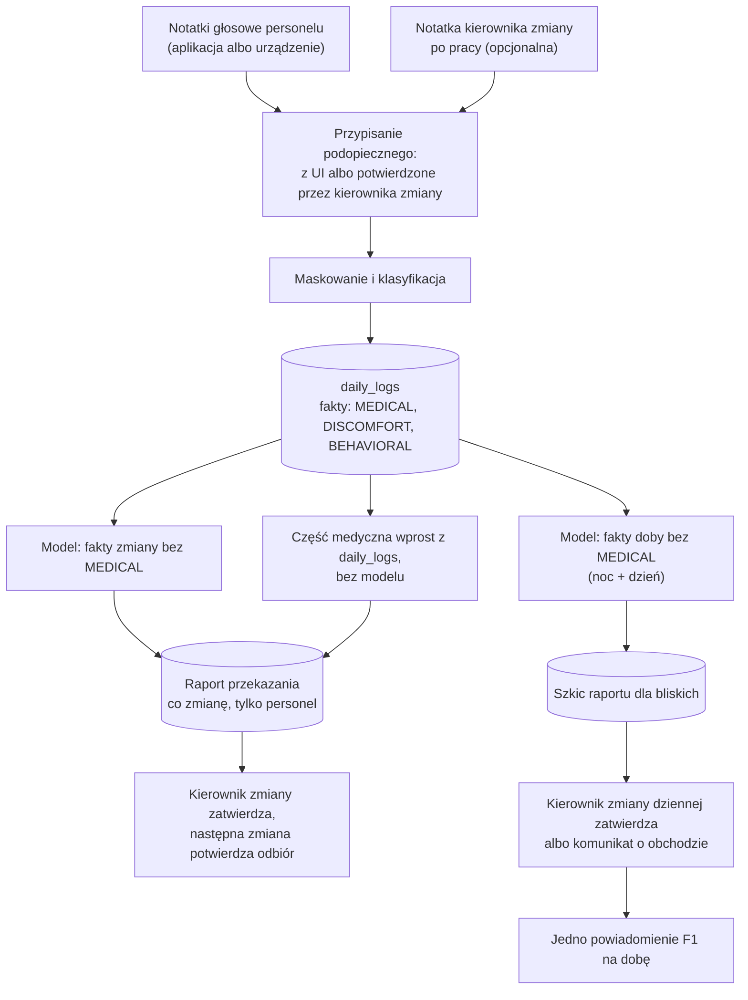

# Audyt ARCH-VOICE-PIPELINE: potok raportowania zmianowego

> **Karta Trello:** `[ARCH-VOICE-PIPELINE]` (`6ada19a4b3b05b0097d775a5`)
> **Data:** 2026-11-05
> **Przedmiot audytu:** projekt Darka „Architektura Potoku Raportowania Zmianowego” v2.0.0-lean (2026-10-24)
> **Uwzględnia:** uwagi i decyzje Michała z v3 (2026-10-29) i v4 (2026-11-03 do 05, `VOICE_SHIFT_REPORTING_PIPELINE.md`), stan gałęzi `staging` (`52f5e9b`, po #190)
> **Status:** 📝 do review Darka

---

## 1. Wynik w skrócie

Projekt v2.0 ma dobre fundamenty i większość z nich już działa na `staging`: fakty tylko do dopisywania, zadania oddzielone od bliskich, złożone klucze z organizacją, strefa `Europe/Warsaw`.

Projekt nie mógł jednak wejść do implementacji w tej postaci. **Siedem ustaleń narusza granice prawne albo bezpieczeństwo** (sekcja 4.1). Najpoważniejsze to:

- gotowy tekst „spokojny i stabilny nastrój” wysyłany bliskim bez żadnej notatki,
- hurtowa publikacja raportów przy zamknięciu zmiany,
- funkcja zamknięcia zmiany, która przyjmuje tożsamość i organizację z parametrów.

| Waga | Liczba | Zamknięte | Rozwiązane decyzją, kod przed nami | Otwarte |
|---|---|---|---|---|
| Krytyczne | 7 | 1 (K7) | 4 (K1, K2, K3, K5) | 2 (K4, K6) |
| Ważne | 10 | 2 (W4, W10) | 4 (W1, W3, W5, W6) | 4 (W2, W7, W8, W9) |
| Drobne | 4 | 2 (D1, D2) | 0 | 2 (D3, D4) |
| **Razem** | **21** | **5** | **8** | **8** |

„Zamknięte” znaczy: wdrożone na `staging` albo nieaktualne, bo element v2.0 zastąpiono innym rozwiązaniem. „Rozwiązane decyzją” znaczy: wiemy, jak ma być, ale kodu jeszcze nie ma.

## 2. Zakres i metoda

Każdy element v2.0 sprawdziłem względem:

1. reguł stałych z `.claude/CLAUDE.md` (granica MDR, RODO art. 9, zakaz fabrykowania danych, terminologia),
2. kontraktów w `contracts/*.contract.mjs` (przede wszystkim `MEDICAL reachesLLM: false`, etap `APPROVE`, `F1`, `GROQ_DEMO_LLM`),
3. ADR-006, ADR-015 i ADR-021,
4. kodu i migracji na `staging`.

**Wagi:**

- **Krytyczne:** narusza granicę prawną (MDR, RODO), regułę stałą albo pozwala obejść uprawnienia.
- **Ważne:** błąd techniczny, ryzyko utraty danych albo niezgodność z kontraktem bez skutku prawnego.
- **Drobne:** spójność, nazewnictwo, proces.

## 3. Co w v2.0 jest dobre i zostaje

| Element v2.0 | Gdzie jest dziś |
|---|---|
| `daily_logs` jako rejestr faktów tylko do dopisywania, raport składany ze wszystkich faktów | Podstawa raportu dla bliskich i raportu przekazania w v4 |
| Zadania w osobnej tabeli, nigdy dla bliskich | ✅ `shift_tasks` z RLS (#186) |
| 2 lub 3 zmiany na dobę, zmiana nocna przez północ | ✅ `shift_definitions`, `/admin/shifts` (#183, #184) |
| Grafik z kierownikiem zmiany (`is_shift_lead`) | ✅ `shift_roster`, wariant B (#185) |
| Złożone klucze obce `(id, organization_id)` | ✅ we wszystkich nowych tabelach |
| Znaczniki czasu nagrań offline | Uproszczone do `recorded_at` (decyzja 11 v4) |
| Aneksy zamiast edycji opublikowanego raportu | Rekomendacja v3 i v4 dla spóźnionych nagrań |
| Wykluczenie podopiecznych w szpitalu lub na przepustce | Zostaje, ale w osobnej tabeli (ustalenie K6) |
| Domknięcie zmiany w dwóch krokach: model poza transakcją | Zasada zostaje dla raportu przekazania |
| Cytat źródłowy przy zadaniu z AI | ✅ `source_quote`, obowiązkowy dla propozycji |

## 4. Ustalenia

### 4.1 Krytyczne

| ID | Element v2.0 | Problem | Naruszona reguła | Rozwiązanie | Status |
|---|---|---|---|---|---|
| K1 | §7.3 krok 3: raport rutynowy `'Spokojny i stabilny nastrój podczas dyżuru'`, `'Dyżur przebiegł spokojnie…'` | System pisze bliskim o nastroju i posiłkach, których nikt nie odnotował. To zmyślone fakty i ocena stanu. | Zakaz fabrykowania danych w fallbackach. System nie ocenia stanu zdrowia. | Komunikat o obchodzie: „Personel potwierdził obchód. Brak notatek z tego dnia.” (decyzja 2 v3) | ⏳ Przycisk „Stan stabilny” usunięty (#153). Zostały: reguła 6 w `FAMILY_REPORT` (`prompts.ts:69`, `voice-redactor.ts:107`) i `'Brak szczególnych uwag'` w `route.ts:163`. Krok 8 WO, `SC-NUR-14`. |
| K2 | §7.3 krok 4: `UPDATE daily_reports SET status = 'PUBLISHED'` dla wszystkich szkiców zmiany, `approved_by = COALESCE(approved_by, p_actor_id)` | Jedno kliknięcie publikuje raporty, których nikt nie czytał, a w `approved_by` zapisuje osobę, która ich nie zatwierdziła. | Kontrakt, etap `APPROVE`: publikacja wymaga człowieka. Rejestr audytowy musi być prawdziwy. | Każdy raport zatwierdzany osobno. Zatwierdza kierownik zmiany dziennej (decyzja 14 v4). | ⏳ Decyzja jest. Kod: `bulk-reports.ts` publikuje do 10 zaznaczonych szkiców i pozwala na to każdemu `nurse`. Do zawężenia po oknie kontraktowym. |
| K3 | §1.1 pkt 3: raport co zmianę i „Reguła Cichej Rutyny” (brak notatki w nocy oznacza spokojny sen) | Wniosek o stanie seniora z braku danych. Do 3 powiadomień dziennie. | Brak danych ma być jawną informacją o braku. Metryka ani brak notatki nie wyzwala treści o zdrowiu. | Raport raz na dobę (decyzja 1 v3). Doba = zmiana nocna + dzienna, zamknięcie po zmianie dziennej (decyzja 13 v4). | ⏳ Decyzja jest. Kod: krok 15 WO. |
| K4 | §7.3 krok A: raport przekazania generowany przez model ze strumieni `MEDICAL`, `DISCOMFORT`, `BEHAVIORAL` | Dane medyczne idą do modelu, choć kontrakt tego zabrania. | `MEDICAL reachesLLM: false` w `voice.contract.mjs`. | v3: jawny wyjątek w `GROQ_DEMO_LLM`, już w kontrakcie na `staging` („treść MEDICAL z nagrania przekazania”). v4 (decyzja 12): przekazanie z notatek zmiany, a część medyczna wprost z `daily_logs`, bez modelu. | ⏳ Darek potwierdza podejście z v4. Wtedy wyjątek w `GROQ_DEMO_LLM` można zawęzić w oknie kontraktowym. |
| K5 | §4.2 tabela 10: `attention_residents JSONB` z `first_name`, `last_name` | Kopia imion i nazwisk w raporcie przekazania. Przetrwa archiwizację i usunięcie danych podopiecznego. | RODO: minimalizacja danych, prawo do usunięcia. | Tylko `resident_id`. „Wymaga uwagi” wynika z otwartych zadań (decyzja 5 v3). | ⏳ Krok 7 WO (sekcja na karcie) i krok 14 (raport przekazania). |
| K6 | §4.2 pkt 1: `temporary_absence_status` (`HOSPITALIZED`) w tabeli `residents` | „W szpitalu” to dana o zdrowiu, a `residents` czytają role bliskich. | RODO art. 9. Bliscy nie widzą danych zdrowotnych poza granicą prezentacji. | Osobna tabela nieobecności, dostęp tylko personelu (`SC-ADM-21/AC4`). | ⏳ Tabeli nie ma na `staging`. Potrzebna przed komunikatem o obchodzie (K1), bo od nieobecności zależy, czy komunikat w ogóle idzie. |
| K7 | §7.3: `close_shift_and_publish_atomic(p_organization_id, p_actor_id, …)` jako `SECURITY DEFINER` | Organizacja i autor pochodzą z parametrów. Każdy zalogowany może zamknąć cudzą zmianę i podpisać się jako ktoś inny. | Weryfikacja sesji i ról po stronie bazy. | Tożsamość z `auth.uid()`, organizacja z JWT, `REVOKE EXECUTE` od `PUBLIC` i `anon`. | ✅ Wzorzec wdrożony w `settle_shift_task`, `record_shift_plan_print`, `is_shift_lead`. Funkcji zamknięcia zmiany nie budujemy: zastąpiła ją akceptacja planu (#188). |

### 4.2 Ważne

| ID | Element v2.0 | Problem | Rozwiązanie | Status |
|---|---|---|---|---|
| W1 | §6: `SELECT … FOR UPDATE OF residents` przed wywołaniem modelu | Błędny SQL (`residents` nie ma w `FROM`). Nawet poprawiony trzymałby blokadę przez wywołanie modelu albo jej nie trzymał, więc lost update zostaje. | Optymistyczna wersja: zapis szkicu tylko przy niezmienionej wersji, inaczej ponowienie z nowymi faktami (v3 §9 pkt 2). | ⏳ Krok 15 WO |
| W2 | §5.2 (spóźnione nagranie przechodzi do następnej zmiany) i §6 pkt 3 (spóźnione nagranie jako aneks) | Dwie sprzeczne reguły dla tego samego przypadku. | Rekomendacja: aneks, bo `recorded_at` wskazuje dobę raportu (v4 §7). | ⏳ Pytanie 3 z v3 |
| W3 | §5.1 i §5.2: cztery znaczniki czasu, szacowanie `effective_started_at`, przenoszenie do następnej zmiany | Notatka z 18:50 może trafić do zmiany nocnej, czyli do złej zmiany i złej doby raportu. Kanał urządzeń i tak nie ma zegara telefonu. | Zmiana wynika z `recorded_at` (decyzja 11 v4). Nagranie z niepewnym zegarem idzie do kierownika zmiany z oznaczeniem „czas niepewny”. | ✅ Decyzja. ⏳ Kod: krok 10 WO |
| W4 | §7.3 krok 5: niezaakceptowane propozycje zadań automatycznie `REJECTED` | Zadanie znika, bo nikt go nie kliknął na czas. | Backlog: przeniesienie, anulowanie tylko z powodem (decyzja 6 v3). | ✅ #186 (`PROPOSED`/`TODO`/`DONE`/`CANCELLED`, powód anulowania wymagany, przeniesienie) |
| W5 | §4.2 pkt 6–8: `organization_id` dodane jako kolumna bez `NOT NULL`, `shift_id` bez klucza obcego | Wiersze bez organizacji wypadają z RLS albo do niego wpadają, zależnie od polityki. | `NOT NULL` po uzupełnieniu, klucze obce na zmianę. | ✅ Nowe tabele. ⏳ `daily_logs`, `daily_reports`, `voice_draft_notes` przy dodaniu zmiany (krok 10 WO) |
| W6 | §4.2 pkt 6: `voice_draft_notes.resident_id DROP NOT NULL` | Obecne polityki RLS opierają się na autorze i podopiecznym. Nagranie bez podopiecznego nie ma jasnych reguł dostępu. | Nowe polityki dla kolejki „Do przypisania” i spraw placówki. | ⏳ Krok 10 WO. Teraz potrzebne dla obu kanałów. |
| W7 | §7.1: przypomnienia i eskalacje z crona | Vercel Hobby uruchamia crona raz dziennie, a `pg_cron` jest w repozytorium tylko w komentarzu. | Wybór mechanizmu planisty. | ⏳ Pytanie 4 z v3, krok 16 WO |
| W8 | §4.2: `ON DELETE RESTRICT` na `auth.users` w wielu kolumnach | Blokuje usunięcie konta pracownika, także na jego żądanie. | Anonimizacja autora zamiast blokady. Na `staging` część kolumn ma `SET NULL`, a `created_by`, `settled_by` i `approved_by` mają domyślne `NO ACTION`. | ⏳ Otwarte |
| W9 | §4.2 tabela 10: `ON CONFLICT (shift_id) DO UPDATE SET summary_markdown = …`, status tylko `GENERATED` albo `ACKNOWLEDGED` | Ponowne zamknięcie po cichu nadpisuje raport przekazania, a następna zmiana mogła już przeczytać poprzednią wersję. Brak stanu „zatwierdzony przez kierownika zmiany”. *Nowe w tym audycie.* | Wersja raportu i stan zatwierdzenia. Zmiana po zatwierdzeniu jako aneks, tak jak w raporcie dla bliskich. | ⏳ Krok 14 WO |
| W10 | §7.3 krok 5: `get_or_create_next_shift(…)` | Funkcji nie ma w projekcie, a od niej zależy przeniesienie zadań. | Model bez instancji zmian: klucz to `shift_definition_id` + `shift_date`. | ✅ Nieaktualne (#183, #186) |

### 4.3 Drobne

| ID | Element v2.0 | Problem | Status |
|---|---|---|---|
| D1 | Status „ZATWIERDZONA DO IMPLEMENTACJI” | Dokument nie przeszedł review ani okna kontraktowego. | ✅ v3 i v4 mają status 📝 PROPOZYCJA |
| D2 | „Ośrodek”, „administrator placówki”, „Lider Dyżuru” | Słownik UI: placówka, Kierownik placówki, kierownik zmiany. | ✅ Poprawione w v3, v4 i w kodzie |
| D3 | §8 i v3 pytanie 6: `facility_tickets` obok zadań placówki | Dwie tabele na podobne rzeczy: usterka i zadanie bez podopiecznego. | ⏳ Pytanie 6 z v3 |
| D4 | `VOICE_CLASSIFIER` (v3 §7) | `prompts.ts` żąda `extracted_streams`, a `voice-redactor.ts` płaskiego JSON-a. Parser (`voice-helpers.ts`) przyjmuje oba formaty, więc to nie jest już błąd działania, ale prompty wciąż sobie przeczą. | ⏳ Do ujednolicenia przy zmianie modelu |

## 5. Zmiany zakresu po v2.0

To nie są błędy v2.0, tylko decyzje produktowe, które zmieniły projekt. Zebrane, żeby było widać, skąd się wzięły różnice.

| Temat | v2.0 | Teraz | Źródło |
|---|---|---|---|
| Raport dla bliskich | Co zmianę | Raz na dobę: noc + dzień, po zmianie dziennej | Decyzja 1 v3, decyzja 13 v4 |
| Kto zatwierdza raport dla bliskich | Każdy `nurse` i `org_admin`, hurtowo | Kierownik zmiany dziennej, każdy raport osobno | Decyzja 14 v4 |
| Źródło raportu przekazania | `daily_logs` przy zamknięciu zmiany | Notatki personelu z tej zmiany + opcjonalna notatka kierownika zmiany. Te same notatki zasilają raport dla bliskich. | v3 decyzja 3 (nagranie przekazania), zastąpiona decyzją 12 v4 |
| Role | Płaska kolejka: każdy zatwierdza | Kierownik zmiany: przypisanie, rozliczenie zadań, plan, oba raporty | Decyzja 2A v2.0 rozwinięta w ADR-021 i v4 |
| Wejście | Aplikacja | Aplikacja albo urządzenie Zero-UI, tryb placówki | Decyzja 9 v4 |
| Tożsamość podopiecznego w nagraniu | Zawsze z UI | Z UI albo z kolejki „Do przypisania”: serwer podsuwa, człowiek potwierdza | Decyzja 10 v4, zmiana ADR-006 |
| Zadania | `PROPOSED_BY_AI` → `TODO` albo `REJECTED` | Backlog, źródła `MANUAL`, `HANDOVER`, `CARE_PLAN`, wydruk planu | Decyzja 6 v3, #186–#190 |

## 6. Stan docelowy po audycie

Jeden diagram, jedna myśl: oba raporty powstają z tych samych notatek, ale różnymi drogami.

## 7. Decyzje potrzebne od Darka

Pogrupowane według tego, co blokują.

**Blokują kod, który jest najbliżej (kroki 7–10 WO):**

| Pytanie | Ustalenia | Rekomendacja |
|---|---|---|
| Kto potwierdza obchód (v3 pyt. 2) | K1 | Kierownik zmiany dziennej razem z zatwierdzaniem raportów (decyzja 14) |
| Osobna tabela nieobecności (`SC-ADM-21/AC4`) | K6 | Tak, tylko personel, przed komunikatem o obchodzie |
| Zmiana ADR-006: serwer podsuwa, człowiek potwierdza (v3 pyt. 1) | Decyzja 10 v4 | Tak, dla wszystkich nagrań |
| Model nagrania: rozszerzenie `voice_draft_notes` czy nowa tabela (v4 pyt. 7) | W5, W6 | Rozszerzenie |

**Blokują raporty (kroki 14–15 WO):**

| Pytanie | Ustalenia | Rekomendacja |
|---|---|---|
| Część medyczna raportu przekazania bez modelu | K4 | Tak. Wyjątek `GROQ_DEMO_LLM` zawęzić. |
| Spóźnione nagrania (v3 pyt. 3) | W2 | Aneks |
| Wersja i zatwierdzenie raportu przekazania | W9 | Wersja, stan zatwierdzenia, zmiana po zatwierdzeniu jako aneks |
| Notatka kierownika zmiany tylko do przekazania (v4 pyt. 15) | Decyzja 12 v4 | Tak |
| Trzy zmiany: która zamyka dobę raportu (v4 pyt. 16) | K3 | Oznaczenie w `shift_definitions` |

**Pozostałe:** planista (W7, v3 pyt. 4), anonimizacja autora zamiast blokady (W8), usterki a zadania placówki (D3, v3 pyt. 6), bramka wydania przy `GROQ_DEMO_LLM` (v3 pyt. 5), pytania 8–12 z v4 o kanale urządzeń.

## 8. Kolejność naprawy

1. **Krok 7:** sekcja „Zadania” na karcie i „wymaga uwagi” z zadań. Zamyka część K5.
2. **Krok 8 (`SC-NUR-14`):** tabela nieobecności, komunikat o obchodzie, usunięcie reguły 6 i `'Brak szczególnych uwag'`. Zamyka K1 i K6. To jedyne krytyczne ustalenie, które **dotyczy działającego kodu**, a nie projektu, więc powinno iść jako pierwsze z potoku.
3. **Okno kontraktowe:** decyzje 9–14, `APPROVE` tylko dla kierownika zmiany, zawężenie `GROQ_DEMO_LLM`. Zamyka K2 i K4 po stronie kontraktu.
4. **Kroki 10–16 WO** według v4 §12. Zamykają K2, K3, K5, W1–W3, W5–W7 i W9 w kodzie.

Szczegóły architektury docelowej: [`VOICE_SHIFT_REPORTING_PIPELINE.md`](VOICE_SHIFT_REPORTING_PIPELINE.md) (v4).
