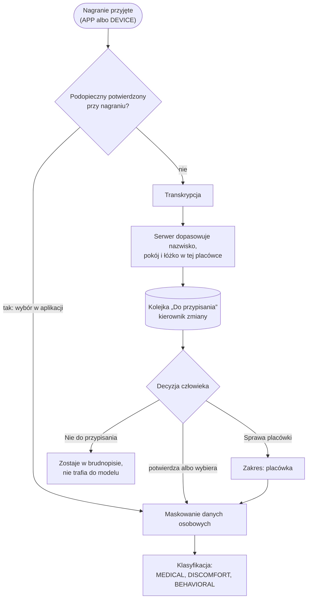
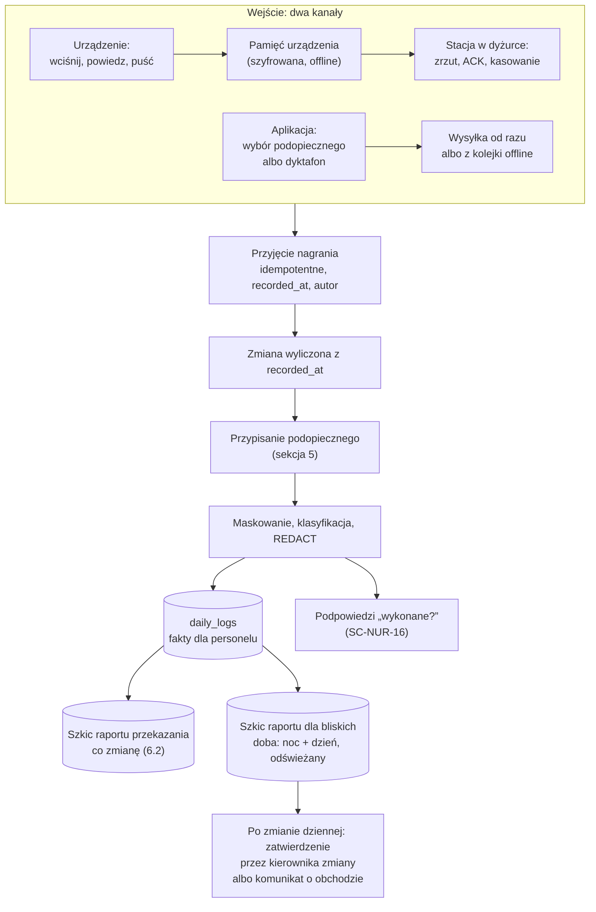
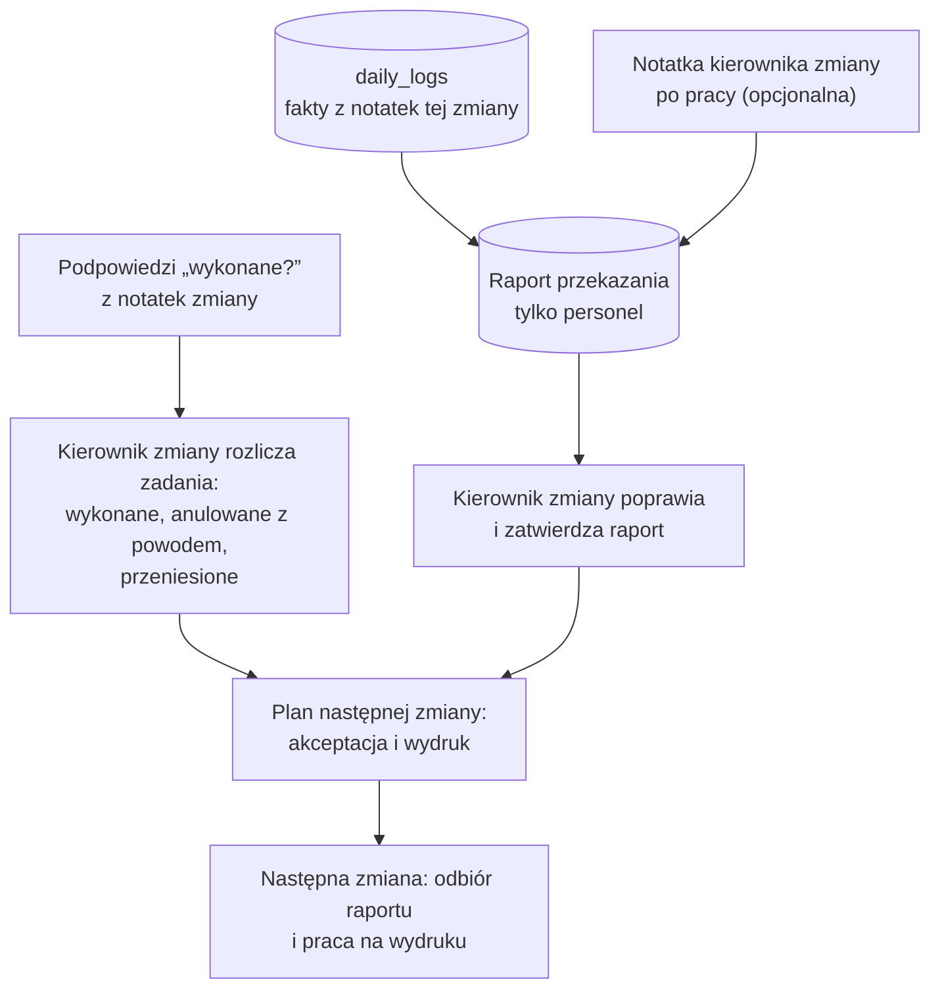
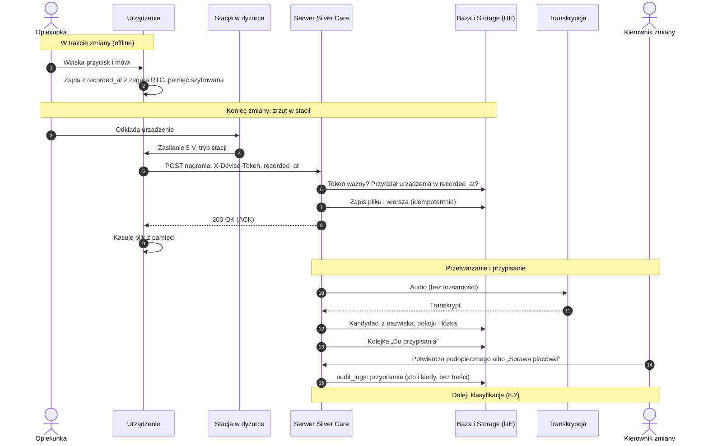
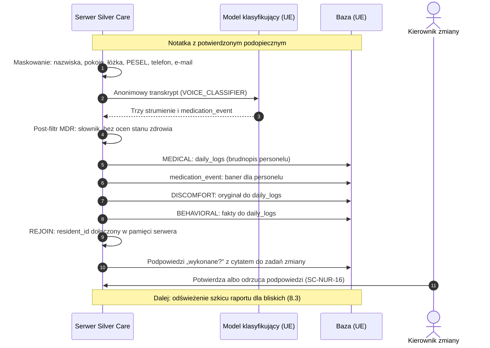
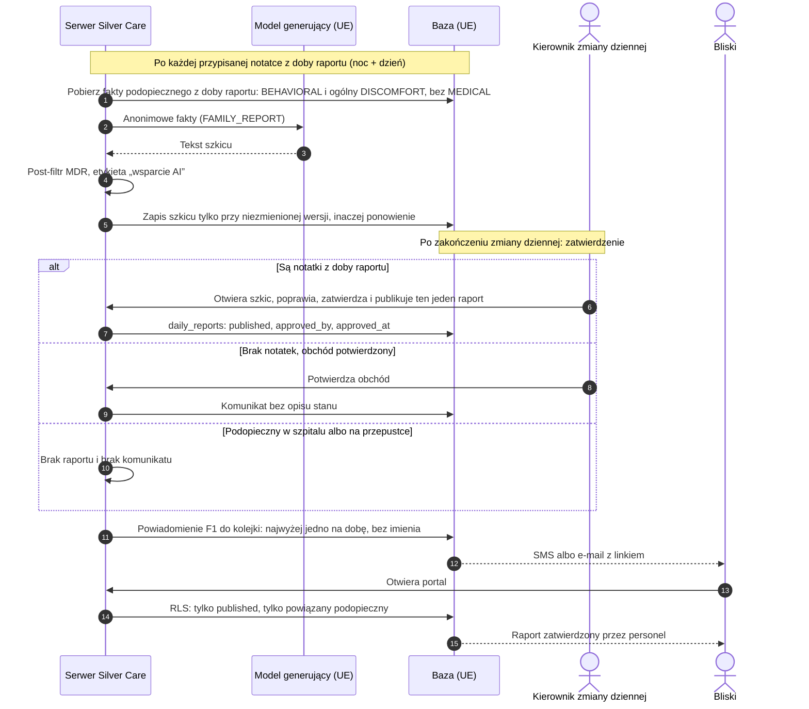
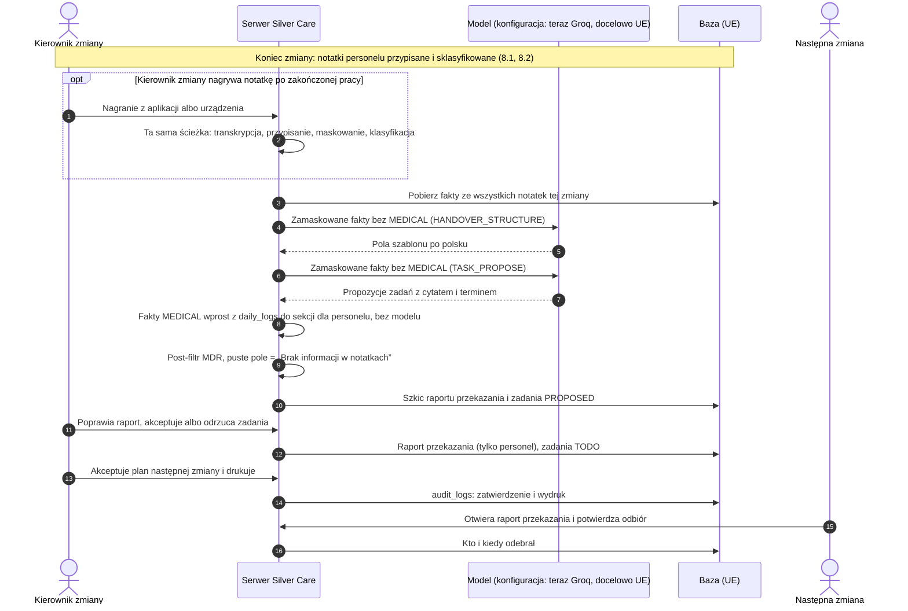

# ARCH-VOICE-PIPELINE v4 — dwa kanały nagrań (urządzenie Zero-UI albo aplikacja), zmiany, zadania, raport dobowy

> **Karta Trello:** `[ARCH-VOICE-PIPELINE]` (`6ada19a4b3b05b0097d775a5`)
> **Status:** 📝 PROPOZYCJA — do review Darka
> **Data:** 2026-11-03
> **Podstawa:** projekt Darka v2.0-lean (2026-10-24), v3 z uwagami Michała (2026-10-29), ADR-021 z uzupełnieniem z 2026-10-30, kompendium sprzętowe `docs/Product_discovery/kompendium_wdro_eniowe_silvercare_voice_zero_ui.md` (po rozmowach z kolejnym domem opieki), decyzja Michała z 2026-11-03: na wejściu urządzenie **albo** aplikacja.
> **Zastępuje:** v3 (`ARCH-VOICE-PIPELINE_v3_do_review.md` w załącznikach karty). Wszystko z v3, czego tu nie zmieniono, obowiązuje dalej (story `SC-NUR-12`–`SC-NUR-16`, `SC-ADM-21`, `SC-ADM-23`, rejestr promptów, diagramy raportu dla bliskich).

---

## 1. Co się zmieniło od v3

1. **Wejście Zero-UI.** Opiekunki nie muszą mieć telefonu ani tabletu. Nagrywają na urządzeniu wielkości pagera: wciśnij, powiedz, puść. Nagrania spływają po odłożeniu urządzenia do stacji w dyżurce (kompendium, §3).
2. **Aplikacja jako drugi kanał.** Placówka, która nie chce kupować urządzeń, nagrywa w aplikacji Silver Care. Od momentu przyjęcia nagrania oba kanały idą **jednym potokiem**. Różnią się tylko tym, skąd wiemy, kto mówi, kiedy i o kim.
3. **Ciężar obsługi u kierownika zmiany** (uzupełnienie ADR-021 z 30.10). Opiekunki nagrywają i pracują na wydruku. Kierownik zmiany potwierdza, o kim jest nagranie, rozlicza zadania i zatwierdza plan.
4. **Część v3 jest już na `staging`** (sekcja 2), więc kolejność Work Orderów jest nowa (sekcja 12).

## 2. Stan wdrożenia (2026-11-03, `staging`)

| Element | Stan | Gdzie |
|---|---|---|
| Definicje zmian (2–3 na dobę, `Europe/Warsaw`) | ✅ | `shift_definitions`, `/admin/shifts` (#183, #184) |
| Grafik tygodniowy i kierownik zmiany (wariant B, `is_shift_lead` z `auth.uid()`) | ✅ | `shift_roster` (#183, #185) |
| Zadania zmiany: źródła `MANUAL`/`HANDOVER`/`CARE_PLAN`, statusy, backlog przez przeniesienie, audyt bez treści | ✅ | `shift_tasks`, `settle_shift_task` (#186) |
| Lista zadań, grupowanie per pokój / per podopieczny, rozliczenie trzema ścieżkami, akceptacja planu | ✅ | `/staff/shift-tasks` (#187, #188) |
| Wydruk planu pracy A4 ze śladem w audycie | ✅ | `/staff/shift-plan/print`, `record_shift_plan_print` (#190) |
| Notatka głosowa z aplikacji (podopieczny wybrany przed nagraniem, offline z `client_uuid`) | ✅ (istniało) | `/voice`, `voice_draft_notes` |
| Sekcja „Zadania” na karcie, „wymaga uwagi” | ⏳ | krok 7 WO |
| Komunikat o obchodzie zamiast „Stan stabilny…” | ⏳ | `SC-NUR-14` |
| Kanał urządzeń, kolejka przypisania podopiecznego, przekazanie z nagrania, podpowiedzi „wykonane?” | ⏳ | ten dokument |

## 3. Decyzje

Decyzje 1–8 z v3 obowiązują. Nowe:

| # | Temat | Decyzja |
|---|---|---|
| 9 | Kanały wejścia | Placówka wybiera tryb: **tylko aplikacja**, **tylko urządzenia** albo **mieszany**. Ustawienie placówki, nie kodu. Jeden potok od przyjęcia nagrania. |
| 10 | Kto przypisuje podopiecznego | Gdy nagranie nie ma potwierdzonego `resident_id`, **serwer podsuwa kandydatów, a potwierdza kierownik zmiany** (albo autor w aplikacji). Bez potwierdzenia nic nie idzie do modelu. Rozszerza decyzję 4 z v3 na wszystkie nagrania, nie tylko przekazanie. |
| 11 | Czas nagrania | Zmiana, do której należy nagranie, wynika z **momentu nagrania** (`recorded_at`), nie z momentu wgrania. |
| 12 | Źródło raportu przekazania (Michał, 2026-11-05) | Raport przekazania powstaje **z notatek głosowych personelu z zakończonej zmiany** i trafia do kierownika zmiany. Kierownik **może, ale nie musi** nagrać notatki po zakończonej pracy; jeśli nagra, ona też wchodzi do raportu. **Z tych samych notatek** powstaje raport dla bliskich. Zastępuje decyzję 3 z v3 („treść tylko z nagrania osoby przekazującej”). |
| 13 | Doba raportu dla bliskich (Michał, 2026-11-05) | Raport dla bliskich zamyka się **po zakończeniu zmiany dziennej** i obejmuje **zmianę nocną i zmianę dzienną**. Przy zmianach 07–19 / 19–07 raport z 5 listopada to notatki od 4.11 19:00 do 5.11 19:00 (liczone z `recorded_at`). |
| 14 | Kto zatwierdza raport dla bliskich (Michał, 2026-11-05) | **Kierownik zmiany** dziennej, w oknie rozliczenia. Komunikat o obchodzie zastępuje raport, więc też go zatwierdza kierownik zmiany. Kto potwierdza sam obchód: pytanie 2 z v3, otwarte. |

## 4. Dwa kanały wejścia

### 4.1 Porównanie

| | Kanał A: urządzenie Zero-UI | Kanał B: aplikacja |
|---|---|---|
| Sprzęt | M5StickC PLUS2, stacja USB w dyżurce (~1 650 PLN na 10 osób, kompendium §2) | Telefon lub tablet, który placówka już ma. 0 PLN na sprzęt. |
| Kto mówi | Z przydziału urządzenia do osoby na tę zmianę (`device_id` → `user_id`) | Z sesji zalogowanego użytkownika |
| O kim | Zawsze bez wyboru: przypisanie przez kolejkę (sekcja 5) | Wybór przed nagraniem (jak dziś) **albo** tryb dyktafonu bez wyboru, który trafia do tej samej kolejki |
| Kiedy | `recorded_at` z zegara RTC urządzenia | `recorded_at` z telefonu w chwili nagrania |
| Kiedy dociera | Po odłożeniu do stacji (zwykle koniec zmiany) | Od razu albo po powrocie sieci (kolejka offline z `client_uuid`) |
| Pytanie uzupełniające (`followup_question`) | Niemożliwe na urządzeniu. Trafia do kierownika zmiany jako uwaga. | Jak dziś: dogrywka od razu |
| Uwierzytelnienie | Token urządzenia (`X-Device-Token`), hash w bazie, unieważnialny | Sesja Supabase, jak dziś |
| Kiedy wybrać | Personel boi się ekranów, placówka chce zerowego oporu | Placówka nie chce inwestować w sprzęt, pilotaż, mała placówka |

### 4.2 Wspólny model nagrania

Oba kanały zapisują nagranie w jednym miejscu (proponuję rozszerzenie `voice_draft_notes` zamiast nowej tabeli, decyzja w pytaniu 7):

| Pole | Opis |
|---|---|
| `capture_source` | `APP` albo `DEVICE` |
| `captured_by` | Autor: z sesji (`APP`) albo z przydziału urządzenia w chwili nagrania (`DEVICE`) |
| `device_id` | Tylko dla `DEVICE` |
| `recorded_at` | Moment nagrania (RTC albo telefon), nie wgrania |
| `client_uuid` | Idempotencja: `APP` jak dziś. `DEVICE` z hasha (`device_id` + `recorded_at` + suma kontrolna pliku), żeby powtórzony zrzut nie dublował nagrań. |
| `resident_id` | Może być pusty do czasu potwierdzenia |
| `resident_confirmed_by`, `resident_confirmed_at` | Kto i kiedy potwierdził podopiecznego (dla wyboru w aplikacji przed nagraniem: autor) |
| `scope` | `RESIDENT` albo `FACILITY` (sprawa placówki) |
| `shift_definition_id`, `shift_date` | Wyliczone z `recorded_at` w strefie `Europe/Warsaw` |
| `status` | `RECEIVED` → `TRANSCRIBED` → `AWAITING_ASSIGNMENT` → `ASSIGNED` → przetwarzanie jak dziś |

### 4.3 Urządzenia: rejestr i przydział

- `voice_devices`: urządzenia placówki (`organization_id`, etykieta „Stick 04”, hash tokenu, `revoked_at`). Zarządza kierownik placówki.
- `voice_device_assignments`: **przydział urządzenia do osoby w czasie** (`device_id`, `user_id`, od–do). Kompendium zakłada stałe „Stick #04 = Pani Krystyna”, ale urządzenia się wymienia (awaria, zapasowe, inna obsada zmiany). Autorem nagrania jest osoba przypisana w chwili `recorded_at`. Nagranie bez przydziału w tym czasie trafia do kolejki z oznaczeniem „nieznany autor”.
- Zgubione urządzenie: kierownik unieważnia token (`revoked_at`), a serwer odrzuca kolejne zrzuty. Zawartość pamięci chroni szyfrowanie Flash z kompendium (§4A).
- Urządzenia są naszym sprzętem, nie dostawcą zewnętrznym, więc to tabele rdzenia. Gdyby kiedyś doszło Omi albo inny gotowy rejestrator, jego identyfikatory trafiają do warstwy integracyjnej, jak `external_wearable_links`.

### 4.4 Aplikacja: dwa tryby

1. **Z wyborem podopiecznego** (dziś na `/voice`): `resident_id` potwierdzony przez autora od razu, przetwarzanie bez kolejki.
2. **Tryb dyktafonu**: jeden duży przycisk, bez wyboru i bez czytania ekranu. Zachowuje się jak urządzenie: nagranie trafia do kolejki przypisania. Daje placówce bez sprzętu to samo „wciśnij i mów”.

Tryb dyktafonu pozwala przetestować kolejkę przypisania i cały przepływ Zero-UI **zanim kupimy pierwsze urządzenie** (sekcja 12, krok 9).

## 5. Przypisanie podopiecznego (kluczowa uwaga do kompendium)

Kompendium (§3, pkt 2) zakłada, że model wyciąga podopiecznego z transkryptu i sam przypina wpis. To jest sprzeczne z regułą stałą projektu („Model nigdy nie ustala tożsamości pensjonariusza z nagrania. Brak identyfikatora kończy się odmową, nie próbą rozpoznania”), z `VOICE-ZERO-GUESSING` i z decyzją 4 z v3. Na urządzeniu nie ma ekranu, więc **każde** nagranie z kanału A przychodzi bez `resident_id`. Rozwiązanie:

1. Transkrypcja (bez promptu, bez tożsamości).
2. **Serwer** szuka w transkrypcie nazwiska, numeru pokoju i łóżka, wyłącznie wśród podopiecznych tej placówki, aktualnie przebywających.
3. Nagranie trafia do **kolejki „Do przypisania”** kierownika zmiany z kandydatami (0, 1 albo kilku) i fragmentem transkryptu.
4. Kierownik zmiany potwierdza, wybiera kogoś innego, oznacza „Sprawa placówki” albo „Nie do przypisania”. Jeden kandydat też wymaga kliknięcia.
5. Dopiero teraz maskowanie (nazwiska, pokoje, łóżka, PESEL, telefon, e-mail) i model. `resident_id` dołączany po stronie serwera przy zapisie, jak dziś.

Reguła dla personelu z kompendium („zacznij od imienia lub pokoju”) zostaje, ale służy dopasowaniu po stronie serwera, nie modelowi. Proponuję dodać zasadę **„jedno naciśnięcie, jedna osoba”**. Nagranie, w którym serwer znajdzie dwie osoby, kierownik przypisuje do jednej albo oznacza do ponownego omówienia (pytanie 8).

## 6. Przebieg zmiany z oboma kanałami

Każda notatka głosowa daje **fakty** (`daily_logs`). **Z tych samych notatek** powstają **dwa różne raporty** (decyzje 12 i 13):

| | Raport przekazania zmiany | Raport dla bliskich |
|---|---|---|
| Rytm | Co zmianę (długość z konfiguracji placówki, np. 8 albo 12 godzin) | Raz na dobę, po zakończeniu zmiany dziennej |
| Dla kogo | Kierownik zmiany zatwierdza, następna zmiana czyta (tylko personel) | Bliscy w portalu rodziny |
| Źródło | Notatki personelu z tej zmiany, opcjonalna notatka kierownika zmiany, zadania zmiany | Notatki z doby raportu: zmiana nocna i zmiana dzienna |
| Dane medyczne | Są, ale wprost z `daily_logs`, bez modelu (`MEDICAL reachesLLM: false`) | Nigdy |
| Tabela | `shift_handover_reports` | `daily_reports` |
| Kto zatwierdza | Kierownik zmiany, a następna zmiana potwierdza odbiór | Kierownik zmiany dziennej zatwierdza i publikuje każdy raport osobno (decyzja 14) |
| Gdy brak notatek | Pola „Brak informacji w notatkach” | Komunikat „Personel potwierdził obchód. Brak notatek z tego dnia.” |

„Szkic” na diagramach to wersja robocza raportu dla bliskich. Odświeża się po każdej przypisanej notatce z doby raportu, ale bliscy widzą go dopiero po zatwierdzeniu przez kierownika zmiany.

Opiekunka nagrywa więc **raz**: ta sama notatka zasila przekazanie jej zmiany i raport dla bliskich. Kierownik zmiany nie powtarza tego, co już nagrano.

### 6.1 Od nagrania do faktów i szkicu raportu dla bliskich

### 6.2 Kierownik zmiany: rozliczenie i przekazanie

Raport przekazania nie jest źródłem raportu dla bliskich. Oba powstają z tych samych notatek, ale bliscy dostają tylko fakty bez danych medycznych (6.1, 8.3).

## 7. Czas: zmiana, zegar i spóźnione nagrania

- **Zmiana z `recorded_at`.** Nagranie z 18:55 należy do zmiany dziennej, nawet jeśli spłynęło o 19:20. Zmiana nocna przechodzi przez północ (`crosses_midnight` w `shift_definitions`).
- **Zegar urządzenia.** RTC synchronizuje się po NTP w stacji. Gdy `recorded_at` jest w przyszłości albo wcześniej niż ostatnia synchronizacja minus doba, nagranie dostaje oznaczenie „czas niepewny” i kierownik zmiany przypisuje je do zmiany ręcznie. Po rozładowaniu baterii zegar może się wyzerować.
- **Okno rozliczenia.** Zrzut z urządzeń następuje po odłożeniu do stacji, czyli zwykle na końcu zmiany. Kierownik zmiany potrzebuje czasu na kolejkę i rozliczenie. Proponuję procedurę: odkładamy urządzenia 20 minut przed końcem zmiany, a kierownik zmiany ma okno rozliczenia do 30 minut po jej końcu (pytanie 9).
- **Doba raportu dla bliskich** (decyzja 13). Zamyka ją koniec zmiany dziennej, a obejmuje poprzedzającą zmianę nocną i zmianę dzienną. Notatka z 02:30 w nocy z 4 na 5 listopada należy do raportu z 5 listopada, razem z notatkami dnia. Kierownik zmiany dziennej zatwierdza raport w oknie rozliczenia po zmianie, więc bliscy dostają go wieczorem.
- **Spóźnione nagranie** (spłynęło po publikacji raportu dla bliskich): v3 pytanie 3 wciąż otwarte. Rekomenduję aneks do raportu, bo `recorded_at` jednoznacznie wskazuje dobę raportu. Do raportu przekazania spóźnione nagranie po jego zatwierdzeniu też trafia jako aneks, widoczny dla następnej zmiany.

## 8. Sekwencje: od urządzenia do raportów

### 8.1 Zrzut nagrań i przypisanie podopiecznego

Kanał aplikacji różni się tylko początkiem: autor z sesji, `recorded_at` z telefonu, a przy wyborze podopiecznego przed nagraniem nie ma kolejki (sekcja 5, gałąź „tak”).

### 8.2 Klasyfikacja notatki i zapis faktów

Ten etap działa już dziś dla notatek z aplikacji. Nowe są tylko kolejka przypisania przed nim i podpowiedzi „wykonane?” po nim.

W kanale urządzeń baner `medication_event` pojawia się dopiero po zrzucie, czyli zwykle po zmianie (uwaga 6 w sekcji 9).

### 8.3 Raport dla bliskich (raz na dobę, po zmianie dziennej)

### 8.4 Raport przekazania zmiany (co zmianę)

## 9. Uwagi do kompendium sprzętowego

1. **Identyfikacja podopiecznego przez model** (§3, pkt 2): niezgodna z regułą stałą. Zastąpiona sekcją 5. W kompendium poprawione 2026-11-03.
2. **Słowo zakazane w warstwie użytkownika** (§3, „encję p…”): w kompendium usunięte przy tej samej poprawce. Pilnujemy go też w dokumentach produktowych, żeby nie wracało do promptów i UI.
3. **Dostawcy modeli** (§4B, pkt 2): kompendium wymienia OpenAI, Vertex AI i Azure. Kontrakt mówi: model w UE (Mistral, DPA, zero retencji), a Groq tylko w wyjątku `GROQ_DEMO_LLM` na danych syntetycznych (ADR-015, ADR-021). Kompendium trzeba z tym zrównać albo otworzyć osobną decyzję.
4. **Retencja audio:** kompendium 7–14 dni, kontrakt `VOICE_RETENTION.ttlDays = 30` dla `voice_draft_notes`. Jedna wartość, w kontrakcie, z uzasadnieniem w DPIA.
5. **Raspberry Pi jako bufor** (§2, opcja): to kolejne miejsce z danymi art. 9 poza chmurą (szyfrowanie dysku, aktualizacje, fizyczny dostęp). Rekomendacja: bez lokalnego bufora, urządzenia trzymają nagrania do ACK, a przy braku Wi-Fi w dyżurce osobny punkt dostępowy bez przechowywania.
6. **Brak sygnałów w czasie rzeczywistym:** nagranie z urządzenia dociera po zmianie, więc `MedicationAlertBanner` i pytanie uzupełniające nie zadziałają w trakcie zmiany. Urządzenie nie służy do spraw pilnych. To trzeba zapisać w procedurze placówki i w materiałach dla personelu (Silver Care nie jest systemem ratunkowym).
7. **Głos pracownika i osób w pobliżu:** głos to dana biometryczna pracownika, a nagranie może złapać podopiecznego lub gościa. Potrzebny jest obowiązek informacyjny dla personelu i wpis w DPIA. Decyzja 8 z v3 (zgody) przestaje być odkładalna przed pilotażem z urządzeniami.
8. **Prywatne telefony (kanał B):** kolejka offline trzyma audio w przeglądarce telefonu. Na prywatnym telefonie pracownika to dane art. 9 poza kontrolą placówki. Rekomendacja: urządzenia placówki albo kasowanie nagrania z pamięci po potwierdzeniu wysyłki i przy wylogowaniu, a w regulaminie zakaz trybu offline na prywatnym sprzęcie.
9. **Metryka pilotażu** (§6, faza 3): „skuteczność rozpoznawania podopiecznych przez AI” zmieniamy na „odsetek nagrań przypisanych bez korekty kandydata”. Model niczego nie rozpoznaje.
10. **Miejsce przyjęcia nagrań** (§3): kompendium wskazuje Supabase Edge Function. U nas reszta potoku jest w Next.js na Vercelu (`fra1`). Do decyzji, gdzie stoi endpoint urządzeń (pytanie 10).

## 10. Uwagi z v3: co załatwione, co otwarte

| v3 §9 | Stan |
|---|---|
| 1. RPC zamknięcia zmiany z tożsamością z sesji | ✅ Wzorzec wdrożony w `settle_shift_task`, `record_shift_plan_print`, `is_shift_lead` (`auth.uid()`, organizacja z JWT, `REVOKE` od `PUBLIC` i `anon`) |
| 2. Lost update przy konsolidacji raportu dobowego | ⏳ Otwarte, dotyczy `SC-NUR-14` |
| 3. `organization_id NOT NULL` i FK na zmianę | ✅ Dla nowych tabel (złożone klucze z `shift_definitions`) |
| 4. `voice_draft_notes.resident_id` bez `NOT NULL` | ⏳ Teraz potrzebne dla obu kanałów (kolejka przypisania), z RLS dla nagrań bez podopiecznego |
| 5. Planista (Vercel Hobby: cron raz dziennie) | ⏳ Otwarte, teraz także dla okna rozliczenia i przypomnień |
| 6. `audit_logs` przy zmianach statusów | ✅ Zadania i wydruk. ⏳ Przypisanie podopiecznego i przekazanie |
| 7. `ON DELETE RESTRICT` na `auth.users` | ⏳ Otwarte, dochodzi przydział urządzeń |

## 11. Zmiany w kontrakcie (okno otwiera człowiek)

Poza listą z v3 §8:

| Plik | Zmiana |
|---|---|
| `voice.contract.mjs` | Etap `CAPTURE` z dwoma źródłami (`APP`, `DEVICE`) i `resident_id` opcjonalnym. Nowy etap `ASSIGN` między `TRANSCRIBE` a `CLASSIFY`: serwer podsuwa, człowiek potwierdza, bez potwierdzenia brak przejścia dalej. `VOICE_RETENTION` zgodne z decyzją z uwagi 4. |
| `roles.contract.mjs` | `voice_devices`, `voice_device_assignments`: zarządza `org_admin`, odczyt `nurse:own`. Kolejka przypisania: odczyt `nurse:own`, potwierdzenie `nurse:shift_lead` i `org_admin`. Bliscy bez dostępu. Publikacja `daily_reports` zawężona do kierownika zmiany (`nurse:shift_lead`) (decyzja 14). |
| `facility.contract.mjs` | Tryb wejścia placówki: `APP_ONLY`, `DEVICE_ONLY`, `MIXED`. Doba raportu dla bliskich: zamyka ją koniec zmiany oznaczonej jako dzienna (decyzja 13). |
| `voice.contract.mjs` (prompty) | `HANDOVER_STRUCTURE` i `TASK_PROPOSE` dostają zamaskowane fakty z notatek zmiany bez `MEDICAL`, a nie transkrypt nagrania przekazania (decyzja 12). Sekcja medyczna raportu przekazania składana z `daily_logs` bez modelu. |
| `integration.contract.mjs` | Uwierzytelnienie urządzenia (token per urządzenie, hash, unieważnianie) jako osobny sposób wejścia obok sesji. |
| `requirements.contract.mjs` | Nowe REQ: `VOICE-CAPTURE-CHANNELS`, `VOICE-DEVICE-INGEST`, `VOICE-RESIDENT-ASSIGN` (rozszerza `VOICE-ZERO-GUESSING` o kolejkę przypisania). |
| `docs/KANONICZNA_SPECYFIKACJA_USER_STORIES.md` | Nowe story (status 📝): nagrywanie na urządzeniu, tryb dyktafonu w aplikacji, kolejka „Do przypisania” kierownika zmiany, rejestr i przydział urządzeń. |

## 12. Proponowana kolejność Work Orderów

Kroki 1–6 z WO `NUR-TASKS-SHIFTS` są zrobione (sekcja 2). Dalej:

7. **Sekcja „Zadania” na karcie i „wymaga uwagi”** (`SC-ADM-21`). Bez AI.
8. **`SC-NUR-14`:** komunikat o obchodzie zamiast „Stan stabilny…”, reguła 6 w `FAMILY_REPORT`.
9. **Kontrakt (okno):** etapy `CAPTURE`/`ASSIGN`, tryb wejścia placówki, zasoby urządzeń, nowe REQ.
10. **Wspólny model nagrania i kolejka „Do przypisania”** + **tryb dyktafonu w aplikacji.** Cały przepływ Zero-UI do sprawdzenia bez sprzętu.
11. **Podpowiedzi „wykonane?” z notatek** (`SC-NUR-16`): kierownik zmiany potwierdza na liście zadań.
12. **Rejestr i przydział urządzeń** (`/admin`), endpoint przyjmowania nagrań z tokenem, idempotencja, ACK.
13. **Firmware** (osobne repozytorium, poza bramką aplikacji): push-to-talk, ADPCM, RTC, zrzut w stacji, szyfrowanie Flash, Secure Boot.
14. **Raport przekazania z notatek zmiany** (`HANDOVER_STRUCTURE`, `TASK_PROPOSE`), z opcjonalną notatką kierownika zmiany, po rozszerzeniu `GROQ_DEMO_LLM`.
15. **Raport dla bliskich z notatek doby raportu** (noc + dzień) z optymistyczną wersją, jedno `F1` na dobę.
16. **Planista:** okno rozliczenia, przypomnienia, eskalacje.

Kroki 10–11 działają już w kanale aplikacji i dają wartość placówce, która nie kupi urządzeń. Kroki 12–13 dokładają sprzęt bez zmiany potoku.

## 13. Pytania do Ciebie (review)

Z v3 (wciąż otwarte): **1** zmiana ADR-006 (sugestia serwera + potwierdzenie człowieka, teraz dla wszystkich nagrań), **2** kto potwierdza obchód, **3** spóźnione nagrania (rekomendacja: aneks), **4** mechanizm planisty, **5** bramka wydania przy `GROQ_DEMO_LLM`, **6** zgłoszenia usterek a zadania placówki.

Nowe:

7. **Model nagrania:** rozszerzamy `voice_draft_notes` czy nowa tabela `voice_captures`, do której `voice_draft_notes` się odwołuje? Rekomenduję rozszerzenie: istniejąca idempotencja, RLS i retencja.
8. **„Jedno naciśnięcie, jedna osoba”:** przyjmujemy jako regułę dla personelu, czy kolejka ma pozwalać podzielić nagranie na kilku podopiecznych?
9. **Okno rozliczenia:** odkładanie urządzeń 20 minut przed końcem zmiany i 30 minut po końcu na rozliczenie. Czy to realne w grafiku placówek, z którymi rozmawiamy?
10. **Endpoint urządzeń:** Next.js (`/api/voice/device`, Vercel `fra1`, jeden stos) czy Supabase Edge Function (jak w kompendium, bliżej Storage)?
11. **Przydział urządzeń:** na zmianę z grafiku (automatycznie z `shift_roster`) czy ręcznie przez kierownika zmiany przy wydawaniu urządzeń?
12. **Autor przypisania w aplikacji:** w trybie dyktafonu potwierdza autor od razu po nagraniu (jeśli chce) czy zawsze kierownik zmiany?
13. ~~Źródło raportu przekazania~~ → rozstrzygnięte przez Michała, decyzja 12.
14. ~~Granica doby dla raportu dla bliskich~~ → rozstrzygnięte przez Michała, decyzja 13.
15. **Notatka kierownika zmiany a bliscy:** rekomenduję, żeby notatka kierownika po zakończonej pracy zasilała **tylko** raport przekazania, a nie raport dla bliskich (jak nagranie przekazania w v3). To mniej danych u bliskich i prostsze zasady dla kierownika. Czy się zgadzasz?
16. **Trzy zmiany po 8 godzin:** która zamyka dobę raportu dla bliskich? Proponuję, żeby placówka oznaczała w `shift_definitions` jedną zmianę jako „zamykającą dobę raportu” (domyślnie tę, która kończy się najpóźniej przed 22:00). Raport obejmuje wtedy 24 godziny przed jej końcem.
