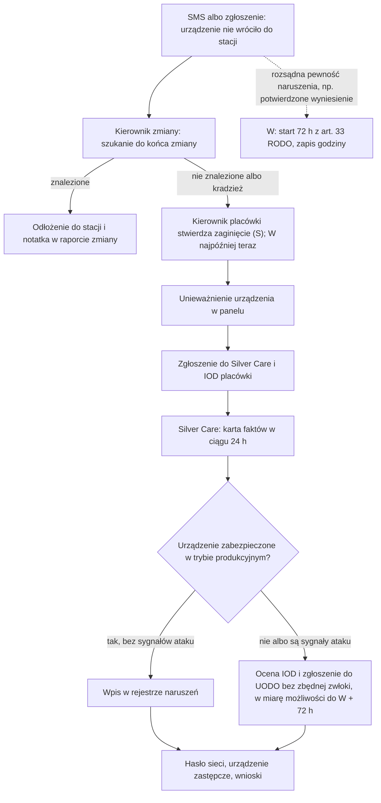

# Zgubione urządzenie nagrywające: procedura dla placówki i Silver Care

**Wersja:** 1.0 · **Data:** 2026-11-26 · **Status:** 📝 PROPOZYCJA (do review i zatwierdzenia przez IOD)

**Dokument bazowy.** Na jego podstawie powstają instrukcje dla klientów, np. „Urządzenie nie wróciło do stacji: co robi kierownik zmiany” albo karta postępowania dla IOD placówki. Treść w [NAWIASACH KWADRATOWYCH] uzupełnia się przy wdrożeniu w konkretnej placówce.

**Powiązane:**
- wymagania: [docs/architecture/VOICE_DEVICES_STATION_REQUIREMENTS.md](../architecture/VOICE_DEVICES_STATION_REQUIREMENTS.md) (ALERT, OPS);
- story: `SC-ADM-24` (rejestr urządzeń), `SC-ADM-27` (SMS o urządzeniu, które nie wróciło do stacji);
- `silver-care-devices/docs/SECURITY.md` (zabezpieczenia i protokół partii).

> Procedura opisuje podział ról i dobre praktyki. **Decyzję o zgłoszeniu naruszenia do Prezesa UODO i o zawiadomieniu osób podejmuje placówka jako administrator danych**, z udziałem swojego IOD. Silver Care jako podmiot przetwarzający dostarcza fakty techniczne i pomaga, ale nie decyduje za placówkę. Dokument nie jest poradą prawną.

## 1. Cel i zakres

Procedura dotyczy urządzeń nagrywających Silver Care (M5Stack StickS3), na których personel placówki nagrywa notatki głosowe. Obejmuje urządzenie, które:
- nie wróciło do stacji po zmianie;
- zostało zgubione, skradzione albo wyniesione z placówki;
- zostało zniszczone, np. w pralni;
- odnalazło się po unieważnieniu.

## 2. Co jest na urządzeniu i jak jest chronione

- **Na urządzeniu są tylko notatki nagrane od ostatniego odłożenia do stacji**, zwykle z jednej zmiany. W stacji urządzenie wysyła je do Silver Care i kasuje dopiero po potwierdzeniu przyjęcia.
- Notatki mogą zawierać dane o zdrowiu podopiecznych, np. o lekach. To dane szczególnej kategorii (art. 9 RODO).
- **Urządzenie nie odtwarza notatek** i nie pokazuje ich treści ani nazwisk. Znalazca nie odsłucha ich z urządzenia.
- **Pamięć urządzenia jest zaszyfrowana kluczem AES-256.** Klucz powstaje w chipie i nikt go nie zna, także Silver Care. Urządzenie uruchamia tylko oprogramowanie podpisane przez Silver Care, a odczyt pamięci przez kabel USB jest zablokowany.
- Token urządzenia pozwala wyłącznie wysyłać nagrania do Silver Care. Nie daje dostępu do żadnych danych.
- Urządzenie łączy się z siecią tylko w stacji. **Zgubionego urządzenia nie da się zdalnie skasować.** Treść chroni szyfrowanie, a unieważnienie odcina urządzenie od Silver Care.

> **Warunek tej procedury.** Urządzenie pracuje z prawdziwymi danymi wyłącznie po zabezpieczeniu w trybie produkcyjnym, potwierdzonym w protokole partii. Urządzenie bez takiego potwierdzenia traktuje się jak nośnik z danymi niezaszyfrowanymi (sekcja 8).

## 3. Role i kontakty

| Rola | Kto | Zadania w procedurze | Kontakt |
|---|---|---|---|
| Personel zmiany | opiekunki i opiekunowie | odkładają urządzenia do stacji, zgłaszają brak | — |
| Kierownik zmiany | osoba wyznaczona w grafiku | organizuje szukanie, przekazuje wynik Kierownikowi placówki | [telefon dyżurny zmiany] |
| Kierownik placówki | rola „Kierownik placówki” w Silver Care | ustawia powiadomienia SMS, stwierdza zaginięcie, unieważnia urządzenie, zgłasza sprawę do Silver Care i IOD | [telefon], [e-mail] |
| IOD placówki | inspektor ochrony danych | ocenia naruszenie, prowadzi rejestr naruszeń, zgłasza do UODO, jeśli trzeba | [e-mail IOD] |
| Dział techniczny placówki | IT albo konserwator | zmienia hasło sieci urządzeń | [kontakt] |
| Silver Care: wsparcie | zespół obsługi | przyjmuje zgłoszenie, wydaje urządzenie zastępcze | [e-mail wsparcia], [telefon] |
| Silver Care: bezpieczeństwo | osoba odpowiedzialna za bezpieczeństwo | przygotowuje kartę faktów, obserwuje próby użycia urządzenia, ocenia incydent bezpieczeństwa | [e-mail ds. bezpieczeństwa] |

## 4. Skąd wiadomo, że urządzenia brakuje

- **SMS z Silver Care.** Przychodzi 60 minut po końcu zmiany (czas ustawia Kierownik placówki) na numery przez niego wskazane: „do stacji nie wróciły urządzenia: …”.
- **Panel Silver Care** pokazuje „W stacji: X z Y” i ostatnie zgłoszenie każdego urządzenia.
- **Zgłoszenie pracownika** („zgubiłam urządzenie”) ma zawsze pierwszeństwo. Nie czekaj na SMS.
- **Kontrola przy przekazaniu zmiany:** kierownik zmiany liczy urządzenia w stacji. Zalecane także wtedy, gdy SMS-y działają.

> SMS „żadne urządzenie nie zgłosiło się w stacji” zwykle oznacza awarię stacji, zasilania albo sieci, a nie zgubienie wszystkich urządzeń. Najpierw sprawdź stację i router.

## 5. Przebieg w skrócie



| Kiedy | Kto | Co |
|---|---|---|
| **T0:** SMS albo zgłoszenie | kierownik zmiany | rozpoczyna szukanie (6.1) |
| do końca bieżącej zmiany, najpóźniej 12 h od T0 | kierownik zmiany | szuka i przekazuje wynik Kierownikowi placówki |
| **W:** rozsądna pewność naruszenia | kierownik zmiany albo Kierownik placówki, kto pierwszy | zapisuje datę i godzinę; **od tej chwili biegnie 72 h z art. 33 ust. 1 RODO**. W może nastąpić przed S, np. przy potwierdzonym wyniesieniu albo kradzieży urządzenia z danymi albo po informacji od Silver Care (7.5), najpóźniej w chwili S |
| **S:** stwierdzenie zaginięcia | Kierownik placówki | zapisuje datę i godzinę; od S liczą się terminy operacyjne poniżej. Jeśli W nie zapisano wcześniej, W = S |
| S + 1 h | Kierownik placówki | unieważnia urządzenie w panelu |
| S + 4 h | Kierownik placówki | zgłasza sprawę do Silver Care i IOD placówki |
| zgłoszenie + 4 h robocze | Silver Care | potwierdza przyjęcie zgłoszenia |
| zgłoszenie + 24 h | Silver Care | przekazuje kartę faktów |
| bez zbędnej zwłoki, w miarę możliwości do W + 72 h | IOD placówki i placówka | decyzja: wpis w rejestrze albo zgłoszenie do UODO; zgłoszenie po 72 h z uzasadnieniem opóźnienia (art. 33 ust. 1) |
| S + 7 dni | placówka i Silver Care | zamknięcie: hasło sieci, urządzenie zastępcze, wnioski |

Terminy są rekomendacją do wpisania w umowie powierzenia [nr umowy, załącznik o incydentach].

**Przy kradzieży albo podejrzeniu celowego zabrania urządzenia:** unieważnij je od razu, bez czekania na koniec szukania.

## 6. Kroki placówki

### 6.1 Szukanie (kierownik zmiany)

Sprawdź po kolei:
- **Stacja.** Czy urządzenie nie leży obok stacji albo nie ładuje się przez luźny kabel. Na ekranie urządzenia powinien być napis „W stacji”.
- **Fartuchy i ubrania robocze.** Urządzenie przypina się do fartucha, więc sprawdź kieszenie i kosze na pranie, a **przed praniem także pralnię**.
- Pokoje podopiecznych odwiedzane na zmianie, pokój socjalny, szafki personelu.
- **Osoby z mijającej zmiany**, telefonicznie, jeśli już wyszły.
- Ewidencja wydania w panelu, jeśli placówka ją prowadzi.

**Urządzenie znalezione:**
- Odłóż je do stacji. Po kilku minutach panel pokaże je jako „w stacji”, a notatki zostaną wysłane.
- Zapisz krótko w [raporcie zmiany]: które urządzenie, kiedy i gdzie się znalazło.

**Urządzenie nieznalezione:** przekaż Kierownikowi placówki:
- etykietę urządzenia (np. „Stick 02”);
- kiedy i gdzie widziano je ostatnio;
- kto mógł je mieć;
- czy w grę wchodzi kradzież.

### 6.2 Stwierdzenie zaginięcia i unieważnienie (Kierownik placówki)

1. Kierownik placówki stwierdza zaginięcie (S), gdy szukanie nie przyniosło wyniku, a przy kradzieży od razu. **Zapisz datę i godzinę S** — od niej liczą się terminy operacyjne z tabeli w sekcji 5.
2. **Zapisz osobno chwilę W**, gdy placówka uzyskała rozsądną pewność naruszenia. To od W biegnie 72 godziny z art. 33 RODO. Jeśli wcześniej było wiadomo, że urządzenie z danymi opuściło placówkę albo zostało skradzione, W jest wcześniejsze niż S i liczy się od tamtej chwili. Jeśli nie, W = S.
3. W panelu Silver Care: **Urządzenia → [etykieta] → Unieważnij.** Unieważnienie działa od razu, a historia urządzenia zostaje.
4. Unieważnienie nie kasuje notatek na urządzeniu. Zostają zaszyfrowane, a jeśli urządzenie się znajdzie, można je odzyskać (sekcja 9).

Jeśli Kierownik placówki nie ma dostępu do panelu, poproś Silver Care o unieważnienie w imieniu placówki (pisemnie, e-mailem) [do potwierdzenia: uprawnienie Silver Care w rejestrze urządzeń].

### 6.3 Zgłoszenie do Silver Care i IOD placówki

Wyślij zgłoszenie według wzoru 12.2. **Nie wpisuj treści notatek ani danych podopiecznych.** Nie są potrzebne i nie powinny krążyć w e-mailach.

### 6.4 Ocena naruszenia (IOD placówki)

IOD ocenia naruszenie na podstawie karty faktów od Silver Care (wzór 12.3) i wskazówek z sekcji 8. **Każde zdarzenie trafia do rejestru naruszeń placówki** (art. 33 ust. 5 RODO), także wtedy, gdy zgłoszenie do UODO nie jest potrzebne.

### 6.5 Zmiana hasła sieci urządzeń (dział techniczny)

Hasło sieci Wi-Fi urządzeń jest zapisane na każdym urządzeniu w postaci zaszyfrowanej. Zmiana hasła po zgubieniu to środek ostrożności, zalecany w ciągu 7 dni:
1. Ustal termin z Silver Care na koniec zmiany. Do czasu wgrania nowego hasła pozostałe urządzenia nie wysyłają notatek, ale ich nie tracą.
2. Zmień hasło w routerze stacji.
3. Silver Care albo przeszkolona osoba wgrywa nowe hasło do pozostałych urządzeń przez USB.

### 6.6 Informacja dla personelu

Krótki komunikat według wzoru 12.5. Bez szukania winnych. Celem jest przypomnienie zasad, nie ocena osoby.

### 6.7 Do czasu urządzenia zastępczego

Personel nagrywa notatki w aplikacji Silver Care na telefonie służbowym, z wyborem podopiecznego przed nagraniem.

## 7. Kroki Silver Care

1. **Przyjęcie zgłoszenia.** Silver Care potwierdza je w ciągu 4 godzin roboczych i nadaje numer. Sprawdza, czy urządzenie jest unieważnione; jeśli nie, od razu przypomina o tym placówce.
2. **Karta faktów w ciągu 24 godzin** (wzór 12.3). Dane pochodzą z rejestru urządzeń, protokołu partii i `audit_logs`. Silver Care nie zna treści niewysłanych notatek. Nie zna ich nikt poza autorem.
3. **Obserwacja przez 90 dni.** Każda próba połączenia unieważnionym urządzeniem trafia do Kierownika placówki (powiadomienie w aplikacji i e-mail). Silver Care informuje też placówkę bezpośrednio.
4. **Ocena incydentu bezpieczeństwa.** Zgubienie samo w sobie nie jest podatnością. Sygnały ataku ukierunkowanego to: kilka urządzeń naraz, próby użycia tokenu, ślady otwierania obudowy, zgłoszenie od osoby trzeciej. Wtedy Silver Care analizuje zdarzenie. Jeśli wykryje aktywnie wykorzystywaną podatność albo poważny incydent, zgłasza go przez platformę ENISA w ciągu 24 h (CRA art. 14, jeśli Silver Care jest producentem urządzenia).
5. **Obowiązek podmiotu przetwarzającego.** Jeśli Silver Care pierwsze zauważy naruszenie, np. próbę połączenia unieważnionym urządzeniem albo urządzenie, które długo nie wraca, informuje placówkę bez zbędnej zwłoki (art. 33 ust. 2 RODO).
6. **Wewnętrzny rejestr incydentów Silver Care.** Wpis obejmuje datę, placówkę, urządzenie, tryb zabezpieczeń, przebieg i wnioski. Bez treści notatek i bez danych podopiecznych.
7. **Urządzenie zastępcze.** Rejestracja, konfiguracja przez USB, wpis w protokole partii i dostawa w ciągu [N dni roboczych].
8. **Wnioski.** Raz na kwartał Silver Care przegląda zdarzenia ze wszystkich placówek: ile ich było, jakie miały przyczyny (pralnia, wyniesienie, kradzież) i co poprawić (klips, smycz, uchwyt).

## 8. Ocena naruszenia: wskazówki dla IOD placówki

Zgubienie urządzenia z danymi to naruszenie ochrony danych, bo RODO obejmuje także utratę danych (art. 4 pkt 12), nawet zaszyfrowanych. Od okoliczności zależą tylko ryzyko i obowiązki.

| Sytuacja | Poufność | Dostępność | Wskazówka |
|---|---|---|---|
| **Urządzenie zabezpieczone** (protokół partii: tryb produkcyjny), zgubione w placówce albo poza nią, bez sygnałów ataku | Dane nieczytelne bez klucza z chipu. Naruszenie poufności raczej nie powoduje ryzyka. | Niewysłane notatki przepadają. | Wpis w rejestrze naruszeń. Zgłoszenie do UODO zwykle niepotrzebne (art. 33 ust. 1). Zawiadomienie osób niepotrzebne (art. 34 ust. 3 lit. a). Personel odtwarza ważne informacje z pamięci w aplikacji. |
| Urządzenie zabezpieczone, ale **kradzież ukierunkowana albo sygnały ataku** | Ryzyko niskie, wymaga oceny indywidualnej | jak wyżej | Ocena wspólnie z Silver Care. Rozważ zgłoszenie do UODO. |
| **Urządzenie niezabezpieczone** (tryb testowy, przed zabezpieczeniem albo brak wpisu w protokole partii) | Dane czytelne dla osoby z wiedzą techniczną | jak wyżej | Zgłoszenie do UODO w ciągu 72 h. Ocena wysokiego ryzyka i zawiadomienia podopiecznych albo ich opiekunów prawnych (art. 34): dane o zdrowiu osób szczególnie wrażliwych. |
| **Urządzenie zniszczone** bez dostępu osób trzecich (pralnia, upadek) | Brak naruszenia poufności | Niewysłane notatki przepadają. | Wpis w rejestrze naruszeń (naruszenie dostępności). |
| Urządzenie **odnalezione w ciągu zmiany** na terenie placówki, w miejscu bez dostępu osób postronnych | Zwykle brak naruszenia | Brak utraty | Notatka w dzienniku incydentów. IOD ocenia, czy doszło do naruszenia. |

Uwagi:
- 72 godziny liczy się od chwili W, gdy placówka ma rozsądną pewność, że doszło do naruszenia (art. 33 ust. 1 RODO, wytyczne EDPB 9/2022, pkt 30–35). W nie musi czekać na formalne stwierdzenie zaginięcia (S): potwierdzone wyniesienie albo kradzież urządzenia z danymi, a także informacja od Silver Care jako podmiotu przetwarzającego, dają tę pewność wcześniej. Dlatego zapisujemy obie godziny, W i S. Zgłoszenie następuje bez zbędnej zwłoki, w miarę możliwości do W + 72 h; zgłoszenie późniejsze wymaga uzasadnienia opóźnienia.
- Krótki czas na szukanie (sekcja 6.1) to ustalanie faktów, które według wytycznych EDPB może poprzedzać W. Nie przedłuża jednak terminu, gdy pewność naruszenia jest już wcześniej.
- Karta faktów podaje, ile notatek czekało na wysłanie przy ostatnim zgłoszeniu urządzenia w stacji. Liczba notatek nagranych później nie jest znana, zwykle to jedna zmiana. Pozwala to oszacować, ilu podopiecznych mogło dotyczyć zdarzenie.

## 9. Urządzenie odnalezione po unieważnieniu

1. **Obejrzyj obudowę.** Jeśli widać ślady otwierania albo uszkodzenia, nie używaj urządzenia i przekaż je Silver Care. Urządzenie zostaje wycofane, a o losie notatek decyduje placówka z IOD.
2. Gdy obudowa jest nienaruszona:
   - Kierownik placówki wybiera w panelu „Urządzenie odnalezione” i otrzymuje nowy token;
   - Silver Care albo przeszkolona osoba wgrywa token przez USB;
   - po odłożeniu do stacji notatki trafiają do kolejki „Do przypisania”, a gdy urządzenie było rozładowane, z oznaczeniem „czas niepewny”.
3. IOD uzupełnia wpis w rejestrze naruszeń: urządzenie odzyskane, data. Jeśli placówka zgłosiła sprawę do UODO, składa zgłoszenie uzupełniające (art. 33 ust. 4).

Odłożenie unieważnionego urządzenia do stacji jest bezpieczne. Urządzenie nie wyśle notatek, a Kierownik placówki dostanie powiadomienie, że się zgłosiło.

## 10. Sytuacje szczególne

| Sytuacja | Postępowanie |
|---|---|
| Kradzież | Unieważnij od razu. Rozważ zgłoszenie kradzieży mienia na policję. W zgłoszeniu nie podawaj treści notatek ani danych podopiecznych. |
| Pracownik wyniósł urządzenie do domu | Poproś o zwrot najpóźniej na najbliższej zmianie. Zwrot w ciągu [24 h] przy nienaruszonej obudowie traktuj jak odnalezienie, a IOD ocenia zdarzenie. Bez zwrotu postępuj jak przy zgubieniu. |
| Urządzenie zabrał podopieczny | Odbierz je spokojnie i z poszanowaniem godności podopiecznego, bez wymuszania. Jeśli się nie da, postępuj jak przy zgubieniu i zaplanuj odbiór. |
| Urządzenie zniszczone (pralnia, upadek) | Przekaż je Silver Care do utylizacji. Dane są zaszyfrowane, a utylizacja odbywa się z protokołem. Wpis w rejestrze naruszeń (dostępność). |
| Żadne urządzenie nie wróciło | Sprawdź stację, zasilanie i router. Zgłoś awarię do Silver Care. Nie unieważniaj urządzeń, zanim ich nie policzysz. |
| Unieważnione urządzenie zgłosiło się w stacji | Ktoś je odłożył. Sprawdź stację, zwykle to odnalezienie. Dalej według sekcji 9. |
| Urządzenie niezabezpieczone z prawdziwymi danymi | Nie powinno się zdarzyć (warunek z sekcji 2). Jeśli jednak się zdarzy, postępuj według trzeciego wiersza tabeli w sekcji 8 i zgłoś to Silver Care jako błąd procesu. |

## 11. Zapobieganie

- Kierownik zmiany liczy urządzenia przy przekazaniu zmiany.
- Urządzenie noszone na klipsie albo smyczy, zdejmowane przed oddaniem fartucha do prania.
- Zakaz wynoszenia urządzeń z placówki, wpisany do regulaminu.
- Urządzenia zapasowe oznaczone w panelu jako „w rezerwie”.
- SMS-y na telefon dyżurny zmiany i telefon Kierownika placówki, najlepiej służbowe. Lista numerów aktualizowana przy zmianach kadrowych, a SMS testowy wysyłany raz na kwartał.
- Placówka ma osobną sieć Wi-Fi dla urządzeń, żeby zmiana hasła po zgubieniu była prosta.

## 12. Wzory

### 12.1 SMS z Silver Care

- `Silver Care: po zmianie dziennej (koniec 19:00) do stacji nie wróciły urządzenia: Stick 02. Sprawdź stan w panelu Silver Care.`
- `Silver Care: po zmianie dziennej żadne urządzenie nie zgłosiło się w stacji. Możliwa awaria stacji lub sieci. Sprawdź stację.`

SMS z Silver Care nigdy nie zawiera linku ani danych podopiecznych. SMS z linkiem podpisany jako Silver Care to próba oszustwa: zgłoś go Silver Care i usuń.

### 12.2 Zgłoszenie placówki do Silver Care (kopia do IOD placówki)

```
Temat: Zaginione urządzenie nagrywające – [nazwa placówki] – [etykieta urządzenia]

Placówka: [nazwa]
Urządzenie: [etykieta, np. Stick 02]
Rozsądna pewność naruszenia (W, start 72 h): [data, godzina]
Stwierdzenie zaginięcia (S): [data, godzina]
Ostatnio widziane: [data, godzina, miejsce]
Okoliczności: zgubione / kradzież / zniszczone / wyniesione / inne: [opis bez danych podopiecznych]
Unieważnione w panelu: tak, [godzina] / nie (prośba o unieważnienie)
Osoba kontaktowa: [imię i nazwisko, telefon]
```

### 12.3 Karta faktów (Silver Care do placówki)

| Pole | Wartość |
|---|---|
| Numer zgłoszenia | [SC-INC-…] |
| Urządzenie | etykieta, numer z obudowy |
| Wersja firmware'u | [wersja] |
| Tryb zabezpieczeń | produkcyjny (szyfrowanie XTS-AES-256, Secure Boot V2), z datą i osobą z protokołu partii / testowy / brak |
| Unieważnienie | data i godzina, kto |
| Ostatnie zgłoszenie w stacji | data i godzina |
| Ostatni udany zrzut nagrań | data i godzina, liczba przyjętych nagrań |
| Notatki czekające na wysłanie przy ostatnim zgłoszeniu | [liczba] (notatki nagrane później: nieznane) |
| Próby połączenia po unieważnieniu | brak / [daty] |
| Ocena techniczna | czy dane są czytelne bez klucza z chipu, sygnały ataku |
| Rekomendacja Silver Care | [np. wpis w rejestrze, bez zgłoszenia do UODO] (decyzja należy do placówki) |

### 12.4 Wpis do rejestru naruszeń placówki

| Pole | Do wpisania |
|---|---|
| Data uzyskania rozsądnej pewności naruszenia (W) | [data, godzina] — od niej 72 h z art. 33 ust. 1 |
| Data stwierdzenia zaginięcia (S) | [data, godzina] |
| Data zgłoszenia do UODO i uzasadnienie opóźnienia | [data, godzina; uzasadnienie, jeśli po W + 72 h] / nie dotyczy |
| Opis | zaginięcie / kradzież / zniszczenie urządzenia nagrywającego [etykieta] |
| Kategorie danych | notatki głosowe personelu, które mogą zawierać dane o zdrowiu podopiecznych (art. 9); głos personelu |
| Przybliżona liczba osób | podopieczni objęci notatkami zmiany [szacunek z karty faktów] |
| Zabezpieczenia | szyfrowanie AES-256 z kluczem w chipie, Secure Boot, unieważnienie [godzina] |
| Ocena ryzyka | [według sekcji 8] |
| Decyzja o zgłoszeniu do UODO i zawiadomieniu osób | [tak / nie, z uzasadnieniem] |
| Działania naprawcze | zmiana hasła sieci, urządzenie zastępcze, [inne] |

### 12.5 Komunikat dla personelu

> Na zmianie [dziennej, data] zaginęło urządzenie nagrywające [Stick 02]. Zostało zablokowane, a dane na nim są zaszyfrowane. Jeśli je znajdziesz, odłóż je do stacji albo oddaj kierownikowi zmiany. Przypominamy: urządzenie odkładamy do stacji po każdej zmianie, zdejmujemy je przed oddaniem fartucha do prania i nie wynosimy go z placówki. Dziękujemy.

## 13. Podstawy prawne i powiązania

- RODO: art. 4 pkt 12, art. 28, 32, 33 (ust. 1, 2, 4 i 5), art. 34 (ust. 3 lit. a).
- Wytyczne EDPB 9/2022 w sprawie zgłaszania naruszeń ochrony danych osobowych oraz 01/2021 z przykładami naruszeń.
- Cyber Resilience Act (2024/2847), art. 14: zgłaszanie aktywnie wykorzystywanych podatności i poważnych incydentów, jeśli Silver Care jest producentem urządzenia.
- Umowa powierzenia [nr], załącznik o incydentach.
- Wymagania: ALERT-01–12, OPS-01–02 w [VOICE_DEVICES_STATION_REQUIREMENTS.md](../architecture/VOICE_DEVICES_STATION_REQUIREMENTS.md).

## Historia zmian

| Wersja | Data | Zmiana |
|---|---|---|
| 1.0 | 2026-11-26 | Pierwsza wersja (propozycja) |
| 1.1 | 2026-11-27 | Po review #347: rozdzielenie W (rozsądna pewność naruszenia, start 72 h z art. 33 ust. 1) od S (formalne stwierdzenie zaginięcia, terminy operacyjne) w diagramie, tabeli, 6.2, sekcji 8 i wzorach 12.2 i 12.4 |
